# 基准测试：base 与 head

- base：`v1.0.0`（`0ea9a0176f`），weflow 4.3.0
- head：`v2.0.0`（`317dc50ebf`），weflow 4.3.0
- 基准账号：种子 1，325,798 条消息，316 个会话
- runner：4 个逻辑 CPU，16.0 GiB 内存，win32 win25-vs2026
- 每条命令先各运行一次不计时，再由 base 和 head 交替各运行 5 次，取成功运行的中位数
- 比值是 head / base：▲ 表示增加超过 10%，▼ 表示减少超过 10%；差值小于噪声下限时不标（耗时 20 ms，CPU 50 ms，内存 5 MiB，路由延迟 5 ms）。除了吞吐量和每秒请求数，其余指标都是越低越好

**怎么看**：同一份代码在 runner 上对比时，耗时比值在 0.99–1.02 之间，个别命令（如 json 导出）每次在两个耗时之间跳。比值超过约 10%，并且两边最快到最慢的范围不重叠，才算真正的变化。

## 二进制体积

|  | base | head | head / base |
|---|---|---|---|
| `weflow.exe` | 23.7 MiB | 23.8 MiB | 1.00× |

## 命令

### 耗时（ms）

从启动到退出。括号里是最快和最慢的一次。

| 命令 | base | head | head / base |
|---|---|---|---|
| `export media images` | 73,773（71,486–86,226） | 70,509（70,260–72,529） | 0.96× |
| `export messages json with images` | 77,770（77,444–78,503） | 77,827（77,120–78,422） | 1.00× |
| `export messages json` | 11,171（10,947–11,445） | 11,023（10,891–11,406） | 0.99× |
| `export messages chatlab` | 9,352（9,201–9,513） | 9,436（9,322–9,677） | 1.01× |
| `export messages excel` | 12,087（12,013–12,351） | 12,099（12,096–12,195） | 1.00× |
| `export messages html` | 9,702（9,617–9,745） | 9,710（9,641–9,813） | 1.00× |
| `export messages txt` | 5,442（5,356–5,492） | 5,541（5,499–5,612） | 1.02× |
| `report annual` | 4,936（4,898–4,943） | 4,902（4,871–4,919） | 0.99× |
| `analytics overall` | 1,309（1,289–1,348） | 1,294（1,273–1,315） | 0.99× |
| `group members` | 1,386（1,381–1,389） | 1,371（1,357–1,386） | 0.99× |
| `group ranking` | 1,334（1,320–1,362） | 1,354（1,329–1,371） | 1.02× |
| `chat export-stats` | 1,269（1,243–1,293） | 1,272（1,241–1,292） | 1.00× |
| `chat date-counts` | 969（962–978） | 952（946–994） | 0.98× |
| `chat search` | 3,054（3,001–3,089） | 3,056（2,998–3,091） | 1.00× |
| `report dual` | 758（742–785） | 739（726–786） | 0.98× |
| `chat messages first page` | 369（339–387） | 351（341–363） | 0.95× |
| `chat messages offset` | 3,422（3,398–3,477） | 3,440（3,415–3,470） | 1.01× |

### 第一批结果（ms）

从启动到第一个有进度的事件（`--progress`）。不输出进度的命令没有这一项。

| 命令 | base | head | head / base |
|---|---|---|---|
| `export media images` | 2,609 | 2,642 | 1.01× |
| `export messages json with images` | 1,147 | 1,155 | 1.01× |
| `export messages json` | 1,045 | 1,066 | 1.02× |
| `export messages chatlab` | 1,040 | 1,050 | 1.01× |
| `export messages excel` | 1,059 | 1,065 | 1.01× |
| `export messages html` | 1,045 | 1,039 | 0.99× |
| `export messages txt` | 1,014 | 1,012 | 1.00× |
| `report annual` | 17 | 18 | 1.03× |
| `analytics overall` | 166 | 167 | 1.01× |
| `report dual` | 17 | 17 | 1.02× |

### 用户态 CPU（ms）

进程及其子进程的合计（Job Object）。Windows 的 CPU 时间精度是 15.6 ms，1 秒左右的命令差几十毫秒属于噪声。

| 命令 | base | head | head / base |
|---|---|---|---|
| `export media images` | 118,891 | 118,750 | 1.00× |
| `export messages json with images` | 124,250 | 123,078 | 0.99× |
| `export messages json` | 10,562 | 10,500 | 0.99× |
| `export messages chatlab` | 8,984 | 8,969 | 1.00× |
| `export messages excel` | 11,453 | 11,266 | 0.98× |
| `export messages html` | 9,109 | 9,125 | 1.00× |
| `export messages txt` | 5,062 | 5,141 | 1.02× |
| `report annual` | 4,672 | 4,594 | 0.98× |
| `analytics overall` | 1,266 | 1,234 | 0.98× |
| `group members` | 1,359 | 1,312 | 0.97× |
| `group ranking` | 1,297 | 1,359 | 1.05× |
| `chat export-stats` | 1,266 | 1,188 | 0.94× |
| `chat date-counts` | 922 | 906 | 0.98× |
| `chat search` | 2,812 | 2,734 | 0.97× |
| `report dual` | 797 | 812 | 1.02× |
| `chat messages first page` | 484 | 422 | 0.87× ▼ |
| `chat messages offset` | 2,922 | 2,938 | 1.01× |

### 内核态 CPU（ms）

进程及其子进程的合计（Job Object）。Windows 的 CPU 时间精度是 15.6 ms，1 秒左右的命令差几十毫秒属于噪声。

| 命令 | base | head | head / base |
|---|---|---|---|
| `export media images` | 123,203 | 122,328 | 0.99× |
| `export messages json with images` | 121,422 | 122,344 | 1.01× |
| `export messages json` | 703 | 844 | 1.20× ▲ |
| `export messages chatlab` | 547 | 547 | 1.00× |
| `export messages excel` | 734 | 906 | 1.23× ▲ |
| `export messages html` | 594 | 578 | 0.97× |
| `export messages txt` | 500 | 578 | 1.16× ▲ |
| `report annual` | 359 | 391 | 1.09× |
| `analytics overall` | 219 | 203 | 0.93× |
| `group members` | 203 | 203 | 1.00× |
| `group ranking` | 219 | 188 | 0.86× |
| `chat export-stats` | 203 | 203 | 1.00× |
| `chat date-counts` | 203 | 203 | 1.00× |
| `chat search` | 391 | 438 | 1.12× |
| `report dual` | 109 | 109 | 1.00× |
| `chat messages first page` | 62 | 78 | 1.25× |
| `chat messages offset` | 641 | 625 | 0.98× |

### 峰值工作集（MiB）

主进程占用物理内存的峰值。

| 命令 | base | head | head / base |
|---|---|---|---|
| `export media images` | 278 | 277 | 1.00× |
| `export messages json with images` | 869 | 869 | 1.00× |
| `export messages json` | 849 | 849 | 1.00× |
| `export messages chatlab` | 561 | 561 | 1.00× |
| `export messages excel` | 511 | 511 | 1.00× |
| `export messages html` | 781 | 782 | 1.00× |
| `export messages txt` | 134 | 133 | 1.00× |
| `report annual` | 129 | 129 | 1.00× |
| `analytics overall` | 116 | 116 | 1.00× |
| `group members` | 201 | 201 | 1.00× |
| `group ranking` | 197 | 198 | 1.00× |
| `chat export-stats` | 201 | 200 | 1.00× |
| `chat date-counts` | 196 | 195 | 1.00× |
| `chat search` | 320 | 320 | 1.00× |
| `report dual` | 45.6 | 45.4 | 1.00× |
| `chat messages first page` | 31.6 | 31.6 | 1.00× |
| `chat messages offset` | 968 | 968 | 1.00× |

### 峰值提交内存（MiB）

进程及其子进程提交内存的峰值，包括还没有占用物理内存的部分。

| 命令 | base | head | head / base |
|---|---|---|---|
| `export media images` | 269 | 269 | 1.00× |
| `export messages json with images` | 925 | 926 | 1.00× |
| `export messages json` | 905 | 905 | 1.00× |
| `export messages chatlab` | 580 | 579 | 1.00× |
| `export messages excel` | 531 | 531 | 1.00× |
| `export messages html` | 864 | 864 | 1.00× |
| `export messages txt` | 132 | 132 | 1.00× |
| `report annual` | 115 | 116 | 1.00× |
| `analytics overall` | 104 | 103 | 1.00× |
| `group members` | 196 | 195 | 1.00× |
| `group ranking` | 194 | 194 | 1.00× |
| `chat export-stats` | 189 | 189 | 1.00× |
| `chat date-counts` | 189 | 189 | 1.00× |
| `chat search` | 329 | 328 | 1.00× |
| `report dual` | 32.7 | 32.5 | 0.99× |
| `chat messages first page` | 19.4 | 19.3 | 0.99× |
| `chat messages offset` | 978 | 978 | 1.00× |

### 峰值线程数

每 20 ms 采样一次主进程得到的最大值。

| 命令 | base | head | head / base |
|---|---|---|---|
| `export media images` | 12 | 12 | 1.00× |
| `export messages json with images` | 12 | 12 | 1.00× |
| `export messages json` | 10 | 10 | 1.00× |
| `export messages chatlab` | 10 | 10 | 1.00× |
| `export messages excel` | 10 | 10 | 1.00× |
| `export messages html` | 10 | 10 | 1.00× |
| `export messages txt` | 10 | 10 | 1.00× |
| `report annual` | 10 | 10 | 1.00× |
| `analytics overall` | 10 | 10 | 1.00× |
| `group members` | 10 | 10 | 1.00× |
| `group ranking` | 10 | 10 | 1.00× |
| `chat export-stats` | 10 | 10 | 1.00× |
| `chat date-counts` | 10 | 10 | 1.00× |
| `chat search` | 10 | 10 | 1.00× |
| `report dual` | 10 | 10 | 1.00× |
| `chat messages first page` | 10 | 10 | 1.00× |
| `chat messages offset` | 10 | 10 | 1.00× |

### 读取（MiB）

逻辑 I/O，包括命中系统文件缓存的部分；Windows 不按进程统计实际的磁盘 I/O。

| 命令 | base | head | head / base |
|---|---|---|---|
| `export media images` | 900 | 900 | 1.00× |
| `export messages json with images` | 1,109 | 1,109 | 1.00× |
| `export messages json` | 417 | 417 | 1.00× |
| `export messages chatlab` | 417 | 417 | 1.00× |
| `export messages excel` | 506 | 506 | 1.00× |
| `export messages html` | 417 | 417 | 1.00× |
| `export messages txt` | 417 | 417 | 1.00× |
| `report annual` | 146 | 146 | 1.00× |
| `analytics overall` | 142 | 142 | 1.00× |
| `group members` | 207 | 207 | 1.00× |
| `group ranking` | 207 | 207 | 1.00× |
| `chat export-stats` | 232 | 232 | 1.00× |
| `chat date-counts` | 206 | 206 | 1.00× |
| `chat search` | 524 | 524 | 1.00× |
| `report dual` | 42.7 | 42.7 | 1.00× |
| `chat messages first page` | 28.4 | 28.4 | 1.00× |
| `chat messages offset` | 429 | 429 | 1.00× |

### 写入（MiB）

逻辑 I/O，包括命中系统文件缓存的部分；Windows 不按进程统计实际的磁盘 I/O。

| 命令 | base | head | head / base |
|---|---|---|---|
| `export media images` | 952 | 952 | 1.00× |
| `export messages json with images` | 1,166 | 1,166 | 1.00× |
| `export messages json` | 216 | 216 | 1.00× |
| `export messages chatlab` | 49.9 | 49.9 | 1.00× |
| `export messages excel` | 101 | 101 | 1.00× |
| `export messages html` | 61.9 | 61.9 | 1.00× |
| `export messages txt` | 11.0 | 11.0 | 1.00× |
| `report annual` | 0.0 | 0.0 | 1.00× |
| `analytics overall` | 0.0 | 0.0 | 1.00× |
| `group members` | 0.1 | 0.1 | 1.00× |
| `group ranking` | 0.0 | 0.0 | 1.00× |
| `chat export-stats` | 0.0 | 0.0 | 1.00× |
| `chat date-counts` | 0.0 | 0.0 | 1.00× |
| `chat search` | 0.1 | 0.1 | 1.00× |
| `report dual` | 0.0 | 0.0 | 1.00× |
| `chat messages first page` | 0.1 | 0.1 | 1.00× |
| `chat messages offset` | 36.5 | 36.5 | 1.00× |

### 页错误

进程及其子进程，包括软页错误。

| 命令 | base | head | head / base |
|---|---|---|---|
| `export media images` | 10,552,388 | 10,557,241 | 1.00× |
| `export messages json with images` | 10,758,719 | 10,752,788 | 1.00× |
| `export messages json` | 310,717 | 311,348 | 1.00× |
| `export messages chatlab` | 236,409 | 236,599 | 1.00× |
| `export messages excel` | 212,740 | 212,663 | 1.00× |
| `export messages html` | 292,838 | 293,330 | 1.00× |
| `export messages txt` | 212,216 | 212,868 | 1.00× |
| `report annual` | 43,261 | 43,364 | 1.00× |
| `analytics overall` | 37,958 | 38,060 | 1.00× |
| `group members` | 63,251 | 63,208 | 1.00× |
| `group ranking` | 60,971 | 60,970 | 1.00× |
| `chat export-stats` | 56,629 | 56,322 | 0.99× |
| `chat date-counts` | 57,472 | 57,619 | 1.00× |
| `chat search` | 94,579 | 94,785 | 1.00× |
| `report dual` | 27,206 | 27,471 | 1.01× |
| `chat messages first page` | 13,449 | 13,988 | 1.04× |
| `chat messages offset` | 259,477 | 259,530 | 1.00× |

### 吞吐量（消息/秒）

命令处理的消息数除以耗时。这是唯一一个越高越好的指标。

| 命令 | base | head | head / base |
|---|---|---|---|
| `export messages json with images` | 2,572 | 2,570 | 1.00× |
| `export messages json` | 17,903 | 18,143 | 1.01× |
| `export messages chatlab` | 21,385 | 21,196 | 0.99× |
| `export messages excel` | 16,546 | 16,530 | 1.00× |
| `export messages html` | 20,614 | 20,598 | 1.00× |
| `export messages txt` | 36,752 | 36,097 | 0.98× |
| `report annual` | 66,007 | 66,460 | 1.01× |
| `group members` | 144,271 | 145,907 | 1.01× |
| `group ranking` | 149,979 | 147,757 | 0.99× |
| `chat export-stats` | 157,615 | 157,228 | 1.00× |
| `chat date-counts` | 206,473 | 210,193 | 1.02× |
| `report dual` | 13,191 | 13,524 | 1.03× |
| `chat messages first page` | 135 | 142 | 1.05× |
| `chat messages offset` | 15 | 15 | 0.99× |

## `weflow serve` 持续负载

没有完成：base：weflow serve exited (2) before it listened: error: unexpected argument '--api-only' found   tip: a similar argument exists: '--api-token' Usage: weflow-base.exe serve --port <PORT> --api-token <API_TOKEN> For more information, try '--help'.；head：weflow serve exited (2) before it listened: error: unexpected argument '--api-only' found   tip: a similar argument exists: '--api-token' Usage: weflow-head.exe serve --port <PORT> --api-token <API_TOKEN> For more information, try '--help'.。完整信息见 results.json 的 `load_failed`。

## serve_bench

各路由响应时间的中位数（ms），由 `serve_bench` 在同一个基准账号上测得。路由名是它自己的；`[api]` 是进程内的 `/api/` 路由，`[sub]` 是启动子进程的路由。退出码：base 1，head 1。非 0 表示它在自己的合成账号上有检查没通过（旧版本缺少某个路由时会这样），计时照常保留，原因见 `logs/serve-bench-*.txt`。某一边不是每次都返回 200 时（例如旧版本还没有这个 `/api/` 路由，返回 404 只要零点几毫秒），格子里注明返回的状态，不计算比值。

| 路由 | base | head | head / base |
|---|---|---|---|
## 内存曲线

主进程的工作集，每 20 ms 采样一次（持续负载每 0.5 s 一次）。命令取耗时居中的那次运行。蓝线 base，红线 head；先结束的版本在退出后记为 0。

### `export media images`

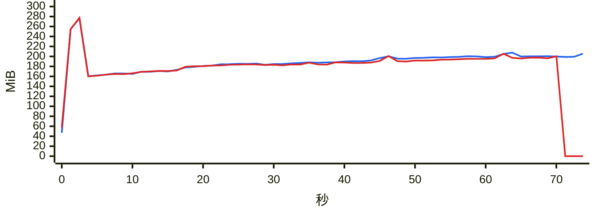

### `export messages json with images`

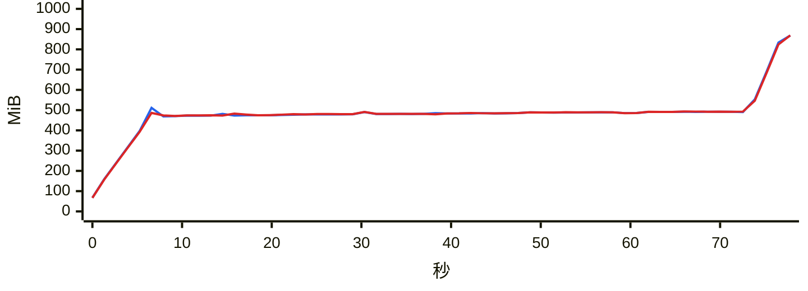

### `export messages json`

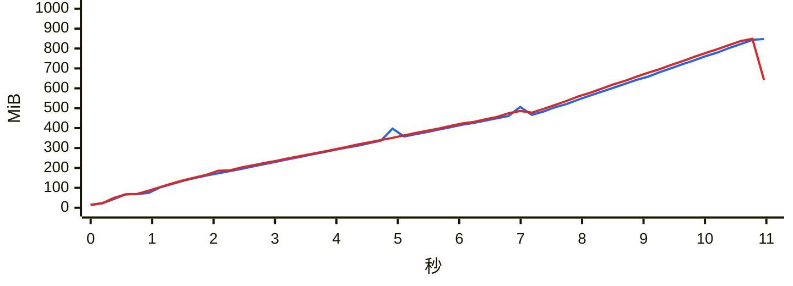

### `export messages chatlab`

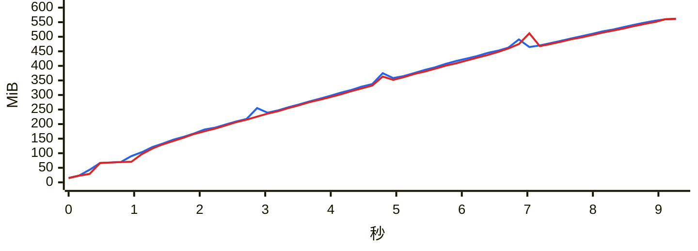

### `export messages excel`

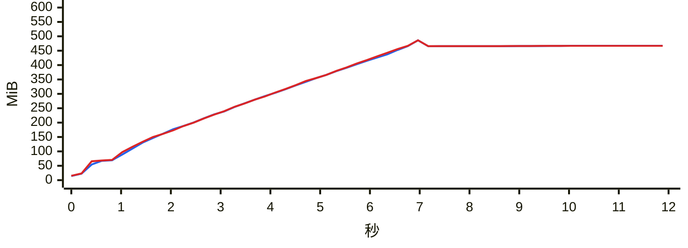

### `export messages html`

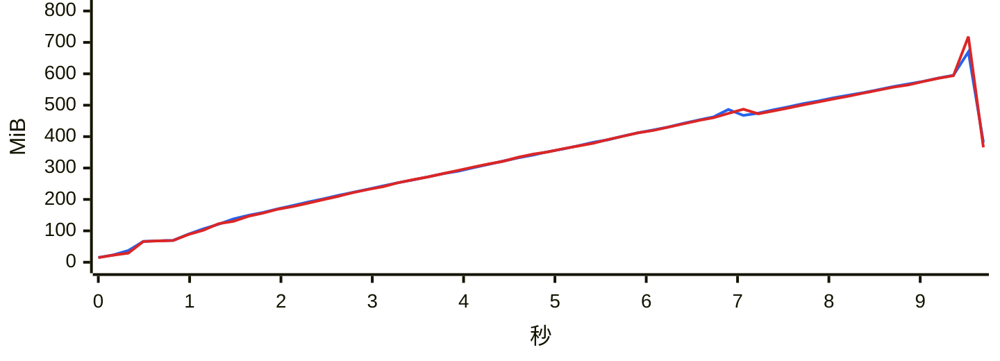

### `export messages txt`

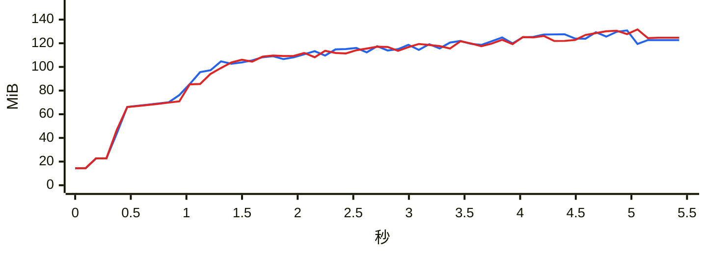

### `report annual`

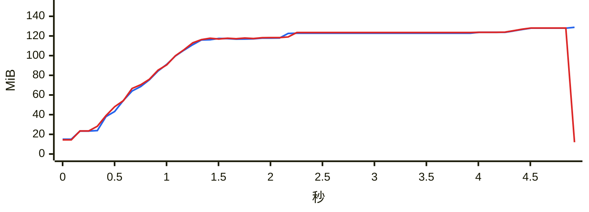

### `analytics overall`

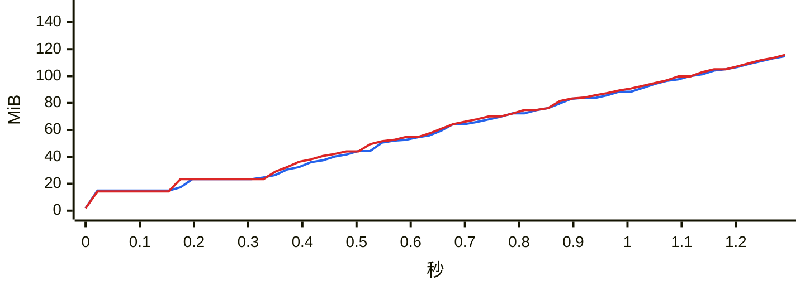

### `group members`

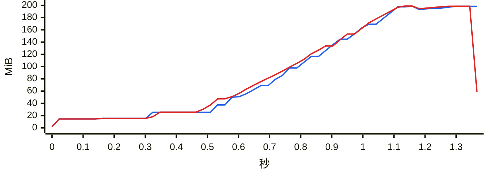

### `group ranking`

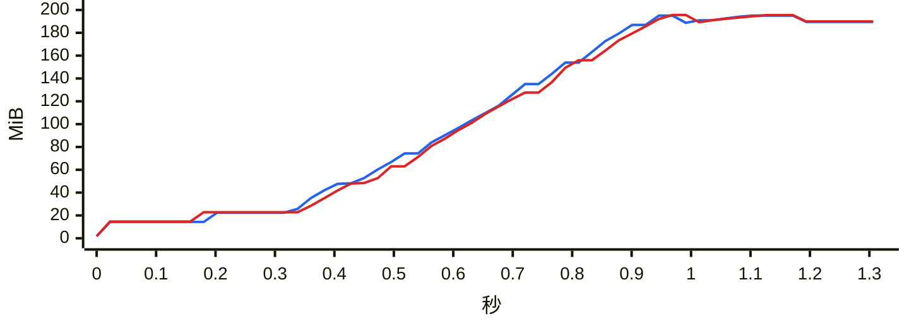

### `chat export-stats`

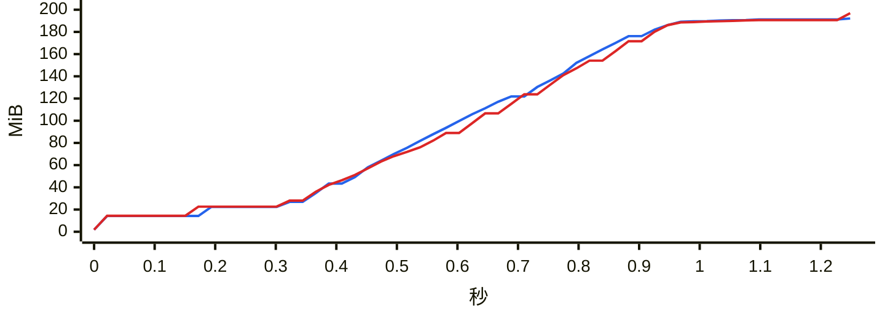

### `chat date-counts`

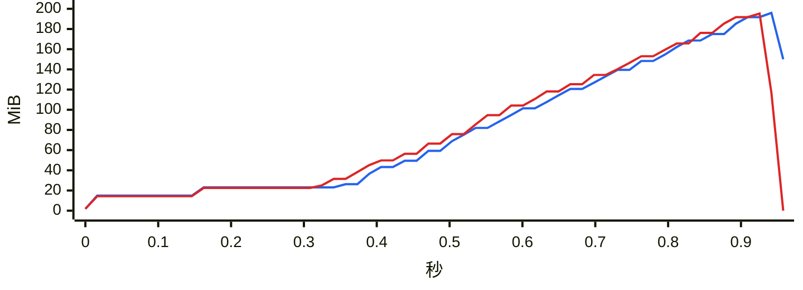

### `chat search`

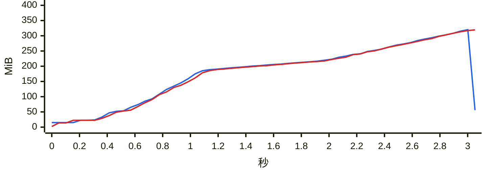

### `report dual`

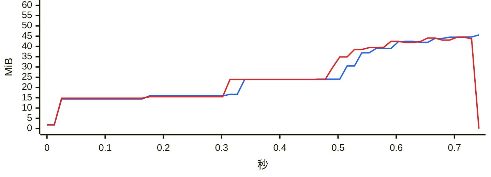

### `chat messages first page`

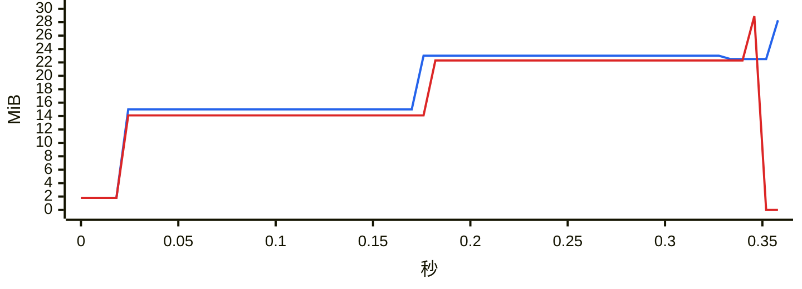

### `chat messages offset`

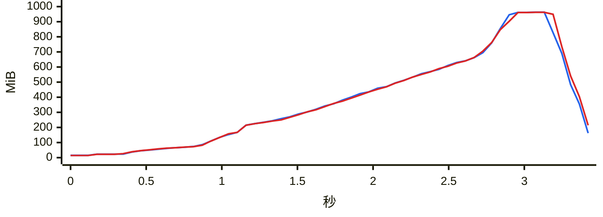
