# 基准测试：base 与 head

- base：`v1.0.0`（`0ea9a0176f`），weflow 4.3.0
- head：`v2.0.0`（`317dc50ebf`），weflow 4.3.0
- 基准账号：种子 1，325,798 条消息，316 个会话
- runner：4 个逻辑 CPU，16.0 GiB 内存，win32 win25-vs2026
- 每条命令先各运行一次不计时，再由 base 和 head 交替各运行 5 次，取成功运行的中位数
- 比值是 head / base：▲ 表示增加超过 10%，▼ 表示减少超过 10%；差值小于噪声下限时不标（耗时 20 ms，CPU 50 ms，内存 5 MiB，路由延迟 5 ms）。除了吞吐量和每秒请求数，其余指标都是越低越好

**怎么看**：同一份代码在 runner 上对比时，耗时比值在 0.99–1.02 之间，个别命令（如 json 导出）每次在两个耗时之间跳。比值超过约 10%，并且两边最快到最慢的范围不重叠，才算真正的变化。

## 二进制体积

|  | base | head | head / base |
|---|---|---|---|
| `weflow.exe` | 23.7 MiB | 23.8 MiB | 1.00× |

## 命令

### 耗时（ms）

从启动到退出。括号里是最快和最慢的一次。

| 命令 | base | head | head / base |
|---|---|---|---|
| `export media images` | 50,617（50,092–51,344） | 50,356（49,850–62,671） | 0.99× |
| `export messages json with images` | 56,507（56,362–57,394） | 57,124（56,252–57,637） | 1.01× |
| `export messages json` | 9,117（9,029–9,335） | 9,105（9,081–9,258） | 1.00× |
| `export messages chatlab` | 7,747（7,714–7,992） | 7,782（7,722–7,938） | 1.00× |
| `export messages excel` | 9,928（9,895–10,223） | 10,060（9,897–10,187） | 1.01× |
| `export messages html` | 8,329（8,015–8,380） | 8,211（8,115–8,421） | 0.99× |
| `export messages txt` | 4,563（4,529–4,729） | 4,548（4,502–4,614） | 1.00× |
| `report annual` | 3,701（3,668–3,730） | 3,689（3,684–3,707） | 1.00× |
| `analytics overall` | 1,033（1,016–1,041） | 1,050（1,015–1,073） | 1.02× |
| `group members` | 1,170（1,149–1,195） | 1,157（1,149–1,170） | 0.99× |
| `group ranking` | 1,143（1,134–1,147） | 1,134（1,125–1,161） | 0.99× |
| `chat export-stats` | 1,114（1,105–1,135） | 1,132（1,112–1,155） | 1.02× |
| `chat date-counts` | 824（818–840） | 830（823–846） | 1.01× |
| `chat search` | 2,465（2,441–2,481） | 2,480（2,469–2,512） | 1.01× |
| `report dual` | 635（626–667） | 638（624–645） | 1.01× |
| `chat messages first page` | 297（292–323） | 307（297–324） | 1.03× |
| `chat messages offset` | 2,962（2,925–2,972） | 2,922（2,909–2,938） | 0.99× |

### 第一批结果（ms）

从启动到第一个有进度的事件（`--progress`）。不输出进度的命令没有这一项。

| 命令 | base | head | head / base |
|---|---|---|---|
| `export media images` | 2,081 | 2,131 | 1.02× |
| `export messages json with images` | 912 | 915 | 1.00× |
| `export messages json` | 895 | 888 | 0.99× |
| `export messages chatlab` | 882 | 886 | 1.00× |
| `export messages excel` | 878 | 883 | 1.00× |
| `export messages html` | 883 | 878 | 0.99× |
| `export messages txt` | 861 | 859 | 1.00× |
| `report annual` | 14 | 14 | 1.03× |
| `analytics overall` | 144 | 144 | 1.00× |
| `report dual` | 14 | 14 | 1.03× |

### 用户态 CPU（ms）

进程及其子进程的合计（Job Object）。Windows 的 CPU 时间精度是 15.6 ms，1 秒左右的命令差几十毫秒属于噪声。

| 命令 | base | head | head / base |
|---|---|---|---|
| `export media images` | 90,391 | 89,828 | 0.99× |
| `export messages json with images` | 95,250 | 94,453 | 0.99× |
| `export messages json` | 8,500 | 8,578 | 1.01× |
| `export messages chatlab` | 7,391 | 7,547 | 1.02× |
| `export messages excel` | 9,250 | 9,359 | 1.01× |
| `export messages html` | 7,672 | 7,672 | 1.00× |
| `export messages txt` | 4,234 | 4,156 | 0.98× |
| `report annual` | 3,531 | 3,516 | 1.00× |
| `analytics overall` | 1,016 | 1,000 | 0.98× |
| `group members` | 1,078 | 1,078 | 1.00× |
| `group ranking` | 1,078 | 1,094 | 1.01× |
| `chat export-stats` | 1,047 | 1,047 | 1.00× |
| `chat date-counts` | 781 | 828 | 1.06× |
| `chat search` | 2,203 | 2,234 | 1.01× |
| `report dual` | 703 | 703 | 1.00× |
| `chat messages first page` | 359 | 375 | 1.04× |
| `chat messages offset` | 2,406 | 2,391 | 0.99× |

### 内核态 CPU（ms）

进程及其子进程的合计（Job Object）。Windows 的 CPU 时间精度是 15.6 ms，1 秒左右的命令差几十毫秒属于噪声。

| 命令 | base | head | head / base |
|---|---|---|---|
| `export media images` | 84,984 | 85,469 | 1.01× |
| `export messages json with images` | 85,797 | 86,047 | 1.00× |
| `export messages json` | 766 | 641 | 0.84× ▼ |
| `export messages chatlab` | 469 | 500 | 1.07× |
| `export messages excel` | 734 | 688 | 0.94× |
| `export messages html` | 484 | 594 | 1.23× ▲ |
| `export messages txt` | 453 | 500 | 1.10× |
| `report annual` | 297 | 250 | 0.84× |
| `analytics overall` | 141 | 203 | 1.44× ▲ |
| `group members` | 234 | 188 | 0.80× |
| `group ranking` | 188 | 234 | 1.25× |
| `chat export-stats` | 172 | 219 | 1.27× |
| `chat date-counts` | 172 | 109 | 0.64× ▼ |
| `chat search` | 375 | 406 | 1.08× |
| `report dual` | 78 | 78 | 1.00× |
| `chat messages first page` | 94 | 47 | 0.50× |
| `chat messages offset` | 641 | 672 | 1.05× |

### 峰值工作集（MiB）

主进程占用物理内存的峰值。

| 命令 | base | head | head / base |
|---|---|---|---|
| `export media images` | 278 | 278 | 1.00× |
| `export messages json with images` | 868 | 869 | 1.00× |
| `export messages json` | 849 | 850 | 1.00× |
| `export messages chatlab` | 560 | 561 | 1.00× |
| `export messages excel` | 511 | 511 | 1.00× |
| `export messages html` | 781 | 781 | 1.00× |
| `export messages txt` | 133 | 134 | 1.00× |
| `report annual` | 129 | 129 | 1.00× |
| `analytics overall` | 116 | 116 | 1.00× |
| `group members` | 201 | 201 | 1.00× |
| `group ranking` | 198 | 198 | 1.00× |
| `chat export-stats` | 201 | 200 | 1.00× |
| `chat date-counts` | 196 | 196 | 1.00× |
| `chat search` | 320 | 320 | 1.00× |
| `report dual` | 45.4 | 45.6 | 1.00× |
| `chat messages first page` | 31.7 | 31.6 | 1.00× |
| `chat messages offset` | 968 | 968 | 1.00× |

### 峰值提交内存（MiB）

进程及其子进程提交内存的峰值，包括还没有占用物理内存的部分。

| 命令 | base | head | head / base |
|---|---|---|---|
| `export media images` | 269 | 269 | 1.00× |
| `export messages json with images` | 925 | 925 | 1.00× |
| `export messages json` | 905 | 906 | 1.00× |
| `export messages chatlab` | 579 | 579 | 1.00× |
| `export messages excel` | 531 | 531 | 1.00× |
| `export messages html` | 863 | 864 | 1.00× |
| `export messages txt` | 132 | 132 | 1.00× |
| `report annual` | 115 | 115 | 1.00× |
| `analytics overall` | 104 | 104 | 1.00× |
| `group members` | 195 | 196 | 1.00× |
| `group ranking` | 194 | 194 | 1.00× |
| `chat export-stats` | 189 | 189 | 1.00× |
| `chat date-counts` | 189 | 189 | 1.00× |
| `chat search` | 328 | 328 | 1.00× |
| `report dual` | 32.6 | 32.7 | 1.00× |
| `chat messages first page` | 19.6 | 19.3 | 0.99× |
| `chat messages offset` | 978 | 979 | 1.00× |

### 峰值线程数

每 20 ms 采样一次主进程得到的最大值。

| 命令 | base | head | head / base |
|---|---|---|---|
| `export media images` | 12 | 12 | 1.00× |
| `export messages json with images` | 12 | 12 | 1.00× |
| `export messages json` | 10 | 10 | 1.00× |
| `export messages chatlab` | 10 | 10 | 1.00× |
| `export messages excel` | 10 | 10 | 1.00× |
| `export messages html` | 10 | 10 | 1.00× |
| `export messages txt` | 10 | 10 | 1.00× |
| `report annual` | 10 | 10 | 1.00× |
| `analytics overall` | 10 | 10 | 1.00× |
| `group members` | 10 | 10 | 1.00× |
| `group ranking` | 10 | 10 | 1.00× |
| `chat export-stats` | 10 | 10 | 1.00× |
| `chat date-counts` | 10 | 10 | 1.00× |
| `chat search` | 10 | 10 | 1.00× |
| `report dual` | 10 | 10 | 1.00× |
| `chat messages first page` | 10 | 10 | 1.00× |
| `chat messages offset` | 10 | 10 | 1.00× |

### 读取（MiB）

逻辑 I/O，包括命中系统文件缓存的部分；Windows 不按进程统计实际的磁盘 I/O。

| 命令 | base | head | head / base |
|---|---|---|---|
| `export media images` | 900 | 900 | 1.00× |
| `export messages json with images` | 1,109 | 1,109 | 1.00× |
| `export messages json` | 417 | 417 | 1.00× |
| `export messages chatlab` | 417 | 417 | 1.00× |
| `export messages excel` | 506 | 506 | 1.00× |
| `export messages html` | 417 | 417 | 1.00× |
| `export messages txt` | 417 | 417 | 1.00× |
| `report annual` | 146 | 146 | 1.00× |
| `analytics overall` | 142 | 142 | 1.00× |
| `group members` | 207 | 207 | 1.00× |
| `group ranking` | 207 | 207 | 1.00× |
| `chat export-stats` | 232 | 232 | 1.00× |
| `chat date-counts` | 206 | 206 | 1.00× |
| `chat search` | 524 | 524 | 1.00× |
| `report dual` | 42.7 | 42.7 | 1.00× |
| `chat messages first page` | 28.4 | 28.4 | 1.00× |
| `chat messages offset` | 429 | 429 | 1.00× |

### 写入（MiB）

逻辑 I/O，包括命中系统文件缓存的部分；Windows 不按进程统计实际的磁盘 I/O。

| 命令 | base | head | head / base |
|---|---|---|---|
| `export media images` | 952 | 952 | 1.00× |
| `export messages json with images` | 1,166 | 1,166 | 1.00× |
| `export messages json` | 216 | 216 | 1.00× |
| `export messages chatlab` | 49.9 | 49.9 | 1.00× |
| `export messages excel` | 101 | 101 | 1.00× |
| `export messages html` | 61.9 | 61.9 | 1.00× |
| `export messages txt` | 11.0 | 11.0 | 1.00× |
| `report annual` | 0.0 | 0.0 | 1.00× |
| `analytics overall` | 0.0 | 0.0 | 1.00× |
| `group members` | 0.1 | 0.1 | 1.00× |
| `group ranking` | 0.0 | 0.0 | 1.00× |
| `chat export-stats` | 0.0 | 0.0 | 1.00× |
| `chat date-counts` | 0.0 | 0.0 | 1.00× |
| `chat search` | 0.1 | 0.1 | 1.00× |
| `report dual` | 0.0 | 0.0 | 1.00× |
| `chat messages first page` | 0.1 | 0.1 | 1.00× |
| `chat messages offset` | 36.5 | 36.5 | 1.00× |

### 页错误

进程及其子进程，包括软页错误。

| 命令 | base | head | head / base |
|---|---|---|---|
| `export media images` | 10,542,602 | 10,551,958 | 1.00× |
| `export messages json with images` | 10,758,243 | 10,751,540 | 1.00× |
| `export messages json` | 311,335 | 311,276 | 1.00× |
| `export messages chatlab` | 236,046 | 236,664 | 1.00× |
| `export messages excel` | 212,223 | 212,152 | 1.00× |
| `export messages html` | 293,157 | 293,852 | 1.00× |
| `export messages txt` | 211,569 | 213,340 | 1.01× |
| `report annual` | 43,349 | 43,385 | 1.00× |
| `analytics overall` | 38,104 | 38,098 | 1.00× |
| `group members` | 63,307 | 63,339 | 1.00× |
| `group ranking` | 61,271 | 61,033 | 1.00× |
| `chat export-stats` | 56,261 | 56,304 | 1.00× |
| `chat date-counts` | 57,275 | 57,386 | 1.00× |
| `chat search` | 94,793 | 94,489 | 1.00× |
| `report dual` | 27,000 | 26,818 | 0.99× |
| `chat messages first page` | 13,486 | 13,691 | 1.02× |
| `chat messages offset` | 259,664 | 259,596 | 1.00× |

### 吞吐量（消息/秒）

命令处理的消息数除以耗时。这是唯一一个越高越好的指标。

| 命令 | base | head | head / base |
|---|---|---|---|
| `export messages json with images` | 3,539 | 3,501 | 0.99× |
| `export messages json` | 21,937 | 21,966 | 1.00× |
| `export messages chatlab` | 25,817 | 25,699 | 1.00× |
| `export messages excel` | 20,145 | 19,880 | 0.99× |
| `export messages html` | 24,011 | 24,356 | 1.01× |
| `export messages txt` | 43,833 | 43,976 | 1.00× |
| `report annual` | 88,023 | 88,321 | 1.00× |
| `group members` | 170,877 | 172,845 | 1.01× |
| `group ranking` | 175,036 | 176,353 | 1.01× |
| `chat export-stats` | 179,593 | 176,694 | 0.98× |
| `chat date-counts` | 242,773 | 240,830 | 0.99× |
| `report dual` | 15,759 | 15,676 | 0.99× |
| `chat messages first page` | 168 | 163 | 0.97× |
| `chat messages offset` | 17 | 17 | 1.01× |

## `weflow serve` 持续负载

没有完成：base：weflow serve exited (2) before it listened: error: unexpected argument '--api-only' found   tip: a similar argument exists: '--api-token' Usage: weflow-base.exe serve --port <PORT> --api-token <API_TOKEN> For more information, try '--help'.；head：weflow serve exited (2) before it listened: error: unexpected argument '--api-only' found   tip: a similar argument exists: '--api-token' Usage: weflow-head.exe serve --port <PORT> --api-token <API_TOKEN> For more information, try '--help'.。完整信息见 results.json 的 `load_failed`。

## serve_bench

各路由响应时间的中位数（ms），由 `serve_bench` 在同一个基准账号上测得。路由名是它自己的；`[api]` 是进程内的 `/api/` 路由，`[sub]` 是启动子进程的路由。退出码：base 1，head 1。非 0 表示它在自己的合成账号上有检查没通过（旧版本缺少某个路由时会这样），计时照常保留，原因见 `logs/serve-bench-*.txt`。某一边不是每次都返回 200 时（例如旧版本还没有这个 `/api/` 路由，返回 404 只要零点几毫秒），格子里注明返回的状态，不计算比值。base 没有计时结果：它的 `weflow serve` 没有启动（v5.0.0 之前的版本没有现在的命令 API），见 `logs/serve-bench-base.txt`。head 没有计时结果：它的 `weflow serve` 没有启动（v5.0.0 之前的版本没有现在的命令 API），见 `logs/serve-bench-head.txt`。
## 内存曲线

主进程的工作集，每 20 ms 采样一次（持续负载每 0.5 s 一次）。命令取耗时居中的那次运行。蓝线 base，红线 head；先结束的版本在退出后记为 0。

### `export media images`

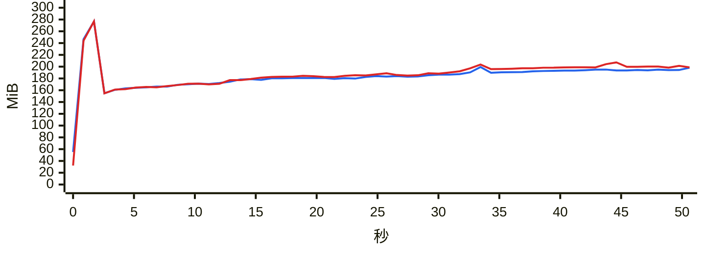

### `export messages json with images`

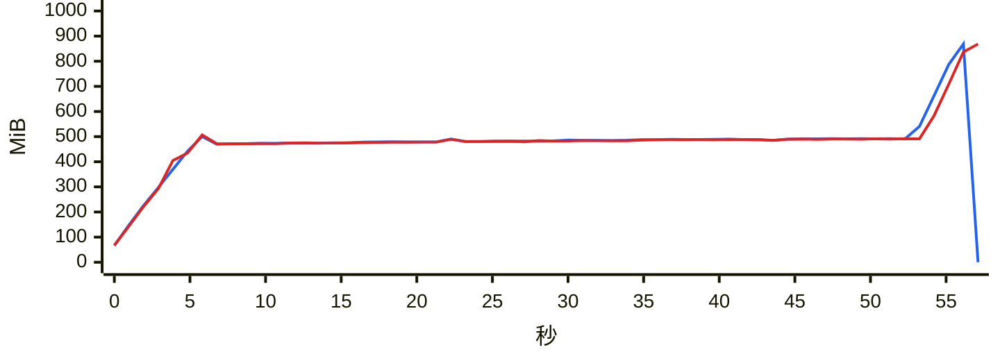

### `export messages json`

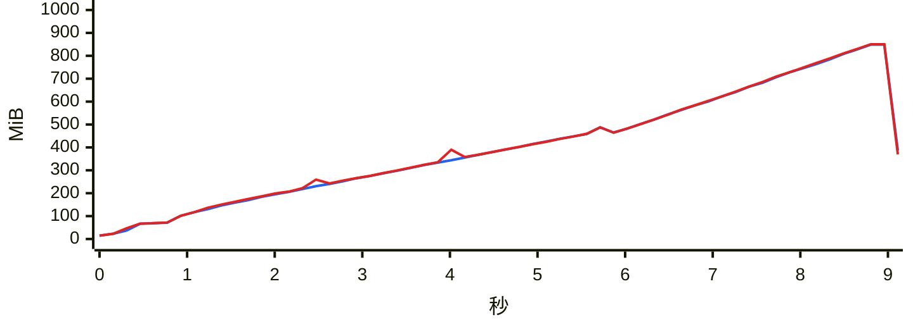

### `export messages chatlab`

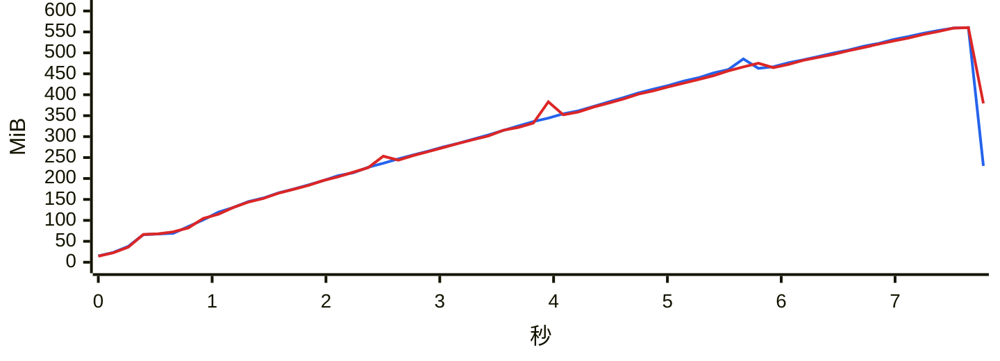

### `export messages excel`

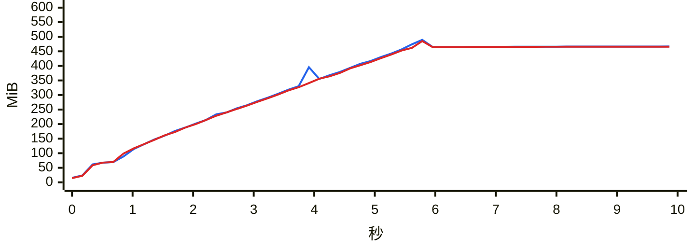

### `export messages html`

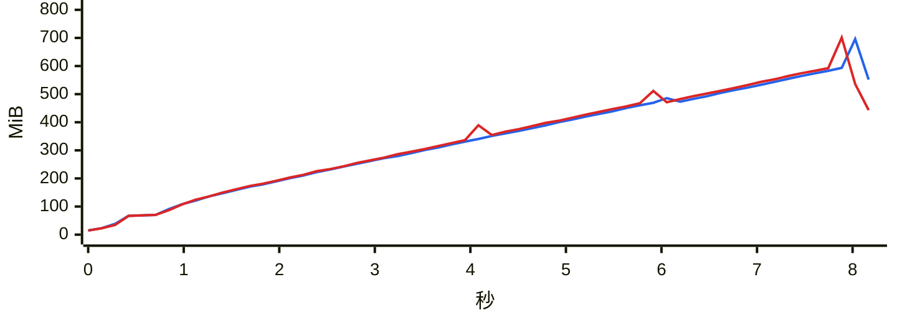

### `export messages txt`

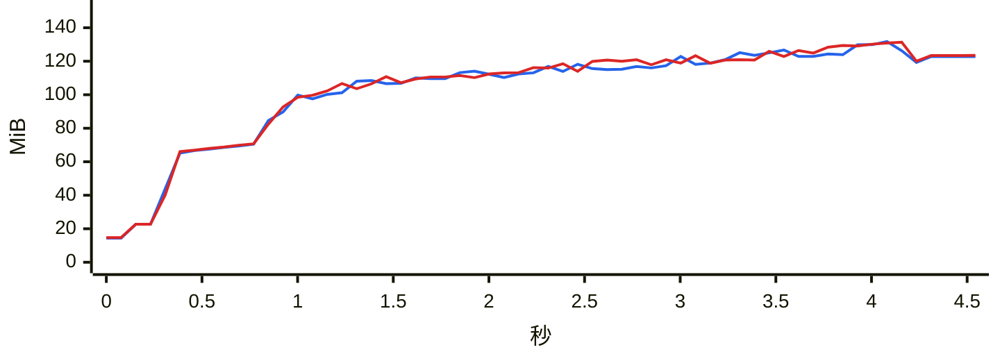

### `report annual`

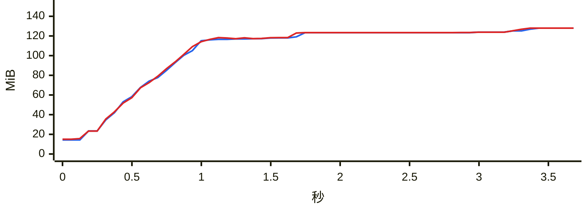

### `analytics overall`

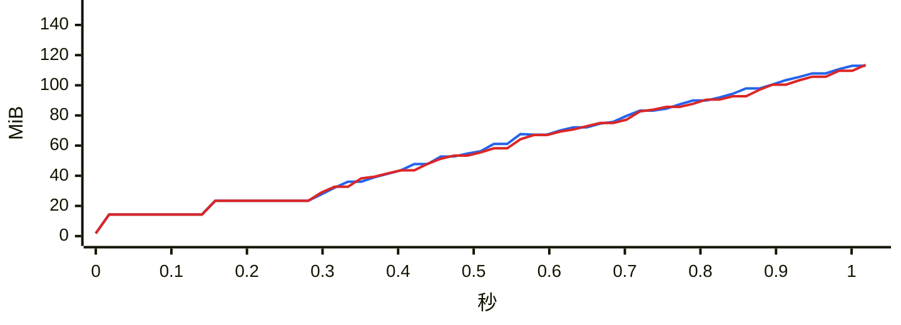

### `group members`

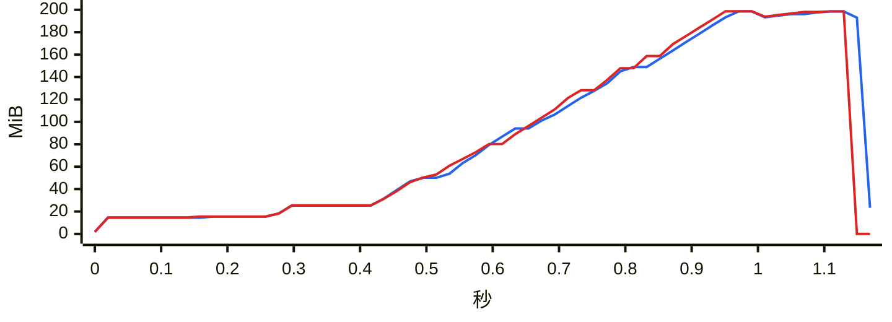

### `group ranking`

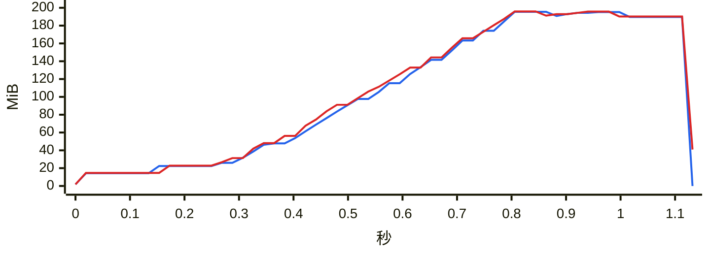

### `chat export-stats`

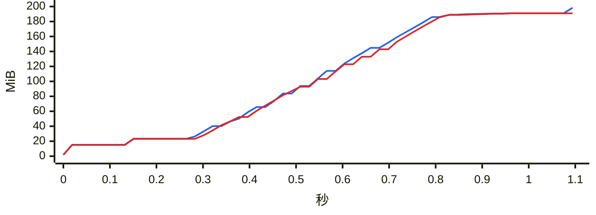

### `chat date-counts`

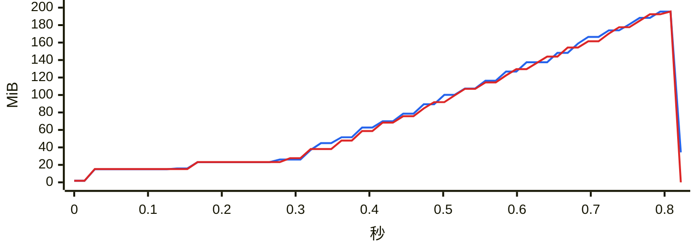

### `chat search`

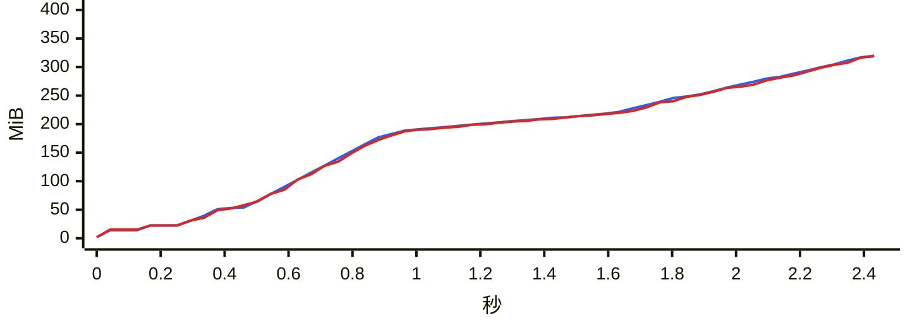

### `report dual`

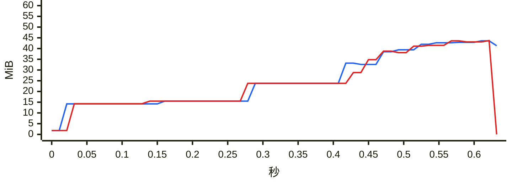

### `chat messages first page`

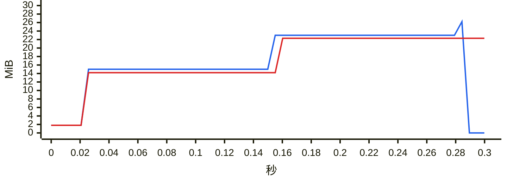

### `chat messages offset`

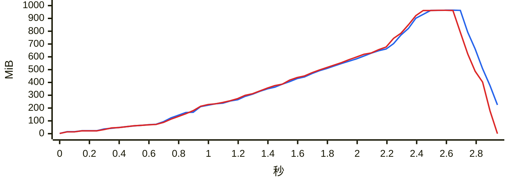
