# 基准测试：base 与 head

- base：`v2.0.0`（`317dc50ebf`），weflow 4.3.0
- head：`v3.0.0`（`a46fa8eb59`），weflow 4.3.0
- 基准账号：种子 1，325,798 条消息，316 个会话
- runner：4 个逻辑 CPU，16.0 GiB 内存，win32 win25-vs2026
- 每条命令先各运行一次不计时，再由 base 和 head 交替各运行 5 次，取成功运行的中位数
- 比值是 head / base：▲ 表示增加超过 10%，▼ 表示减少超过 10%；差值小于噪声下限时不标（耗时 20 ms，CPU 50 ms，内存 5 MiB，路由延迟 5 ms）。除了吞吐量和每秒请求数，其余指标都是越低越好

**怎么看**：同一份代码在 runner 上对比时，耗时比值在 0.99–1.02 之间，个别命令（如 json 导出）每次在两个耗时之间跳。比值超过约 10%，并且两边最快到最慢的范围不重叠，才算真正的变化。

## 二进制体积

|  | base | head | head / base |
|---|---|---|---|
| `weflow.exe` | 23.8 MiB | 24.2 MiB | 1.02× |

## 命令

### 耗时（ms）

从启动到退出。括号里是最快和最慢的一次。

| 命令 | base | head | head / base |
|---|---|---|---|
| `export media images` | 69,504（68,598–85,813） | 69,267（68,258–71,864） | 1.00× |
| `export messages json with images` | 76,782（76,268–78,373） | 76,674（76,500–77,911） | 1.00× |
| `export messages json` | 11,020（10,862–11,052） | 10,874（10,771–11,159） | 0.99× |
| `export messages chatlab` | 9,343（9,140–9,584） | 9,341（9,280–9,537） | 1.00× |
| `export messages excel` | 12,139（11,900–12,366） | 11,938（11,820–12,357） | 0.98× |
| `export messages html` | 9,754（9,662–9,869） | 9,733（9,602–9,784） | 1.00× |
| `export messages txt` | 5,369（5,247–5,535） | 5,300（5,287–5,373） | 0.99× |
| `report annual` | 4,819（4,796–4,870） | 4,872（4,859–4,880） | 1.01× |
| `analytics overall` | 1,292（1,290–1,308） | 1,298（1,279–1,313） | 1.00× |
| `group members` | 1,382（1,365–1,387） | 1,385（1,354–1,393） | 1.00× |
| `group ranking` | 1,359（1,353–1,362） | 1,359（1,333–1,408） | 1.00× |
| `chat export-stats` | 1,312（1,294–1,331） | 1,305（1,284–1,369） | 0.99× |
| `chat date-counts` | 978（969–989） | 987（965–994） | 1.01× |
| `chat search` | 3,082（3,033–3,099） | 3,068（3,035–3,074） | 1.00× |
| `report dual` | 748（734–763） | 759（731–787） | 1.01× |
| `chat messages first page` | 359（344–366） | 354（341–374） | 0.98× |
| `chat messages offset` | 3,482（3,427–3,528） | 3,479（3,444–3,551） | 1.00× |

### 第一批结果（ms）

从启动到第一个有进度的事件（`--progress`）。不输出进度的命令没有这一项。

| 命令 | base | head | head / base |
|---|---|---|---|
| `export media images` | 2,565 | 2,605 | 1.02× |
| `export messages json with images` | 1,139 | 1,151 | 1.01× |
| `export messages json` | 1,042 | 1,030 | 0.99× |
| `export messages chatlab` | 1,035 | 1,037 | 1.00× |
| `export messages excel` | 1,040 | 1,040 | 1.00× |
| `export messages html` | 1,042 | 1,043 | 1.00× |
| `export messages txt` | 1,014 | 998 | 0.98× |
| `report annual` | 17 | 18 | 1.00× |
| `analytics overall` | 166 | 168 | 1.01× |
| `report dual` | 17 | 17 | 1.01× |

### 用户态 CPU（ms）

进程及其子进程的合计（Job Object）。Windows 的 CPU 时间精度是 15.6 ms，1 秒左右的命令差几十毫秒属于噪声。

| 命令 | base | head | head / base |
|---|---|---|---|
| `export media images` | 117,297 | 120,531 | 1.03× |
| `export messages json with images` | 124,953 | 125,000 | 1.00× |
| `export messages json` | 10,266 | 10,219 | 1.00× |
| `export messages chatlab` | 8,969 | 8,969 | 1.00× |
| `export messages excel` | 11,391 | 11,188 | 0.98× |
| `export messages html` | 9,078 | 9,047 | 1.00× |
| `export messages txt` | 4,922 | 4,781 | 0.97× |
| `report annual` | 4,531 | 4,594 | 1.01× |
| `analytics overall` | 1,266 | 1,219 | 0.96× |
| `group members` | 1,328 | 1,312 | 0.99× |
| `group ranking` | 1,281 | 1,312 | 1.02× |
| `chat export-stats` | 1,234 | 1,219 | 0.99× |
| `chat date-counts` | 891 | 938 | 1.05× |
| `chat search` | 2,688 | 2,750 | 1.02× |
| `report dual` | 797 | 828 | 1.04× |
| `chat messages first page` | 438 | 453 | 1.04× |
| `chat messages offset` | 2,812 | 2,906 | 1.03× |

### 内核态 CPU（ms）

进程及其子进程的合计（Job Object）。Windows 的 CPU 时间精度是 15.6 ms，1 秒左右的命令差几十毫秒属于噪声。

| 命令 | base | head | head / base |
|---|---|---|---|
| `export media images` | 121,062 | 118,656 | 0.98× |
| `export messages json with images` | 120,141 | 119,266 | 0.99× |
| `export messages json` | 812 | 703 | 0.87× ▼ |
| `export messages chatlab` | 516 | 547 | 1.06× |
| `export messages excel` | 828 | 828 | 1.00× |
| `export messages html` | 688 | 656 | 0.95× |
| `export messages txt` | 547 | 625 | 1.14× ▲ |
| `report annual` | 422 | 406 | 0.96× |
| `analytics overall` | 188 | 250 | 1.33× ▲ |
| `group members` | 234 | 250 | 1.07× |
| `group ranking` | 203 | 203 | 1.00× |
| `chat export-stats` | 250 | 219 | 0.88× |
| `chat date-counts` | 234 | 219 | 0.93× |
| `chat search` | 562 | 484 | 0.86× ▼ |
| `report dual` | 109 | 125 | 1.14× |
| `chat messages first page` | 47 | 47 | 1.00× |
| `chat messages offset` | 750 | 672 | 0.90× ▼ |

### 峰值工作集（MiB）

主进程占用物理内存的峰值。

| 命令 | base | head | head / base |
|---|---|---|---|
| `export media images` | 277 | 278 | 1.00× |
| `export messages json with images` | 868 | 869 | 1.00× |
| `export messages json` | 849 | 849 | 1.00× |
| `export messages chatlab` | 561 | 560 | 1.00× |
| `export messages excel` | 511 | 511 | 1.00× |
| `export messages html` | 782 | 782 | 1.00× |
| `export messages txt` | 134 | 134 | 1.00× |
| `report annual` | 129 | 129 | 1.00× |
| `analytics overall` | 116 | 116 | 1.00× |
| `group members` | 200 | 201 | 1.00× |
| `group ranking` | 198 | 198 | 1.00× |
| `chat export-stats` | 200 | 201 | 1.00× |
| `chat date-counts` | 195 | 196 | 1.00× |
| `chat search` | 320 | 320 | 1.00× |
| `report dual` | 45.6 | 45.7 | 1.00× |
| `chat messages first page` | 31.6 | 31.8 | 1.01× |
| `chat messages offset` | 968 | 968 | 1.00× |

### 峰值提交内存（MiB）

进程及其子进程提交内存的峰值，包括还没有占用物理内存的部分。

| 命令 | base | head | head / base |
|---|---|---|---|
| `export media images` | 269 | 269 | 1.00× |
| `export messages json with images` | 924 | 925 | 1.00× |
| `export messages json` | 905 | 906 | 1.00× |
| `export messages chatlab` | 579 | 579 | 1.00× |
| `export messages excel` | 531 | 531 | 1.00× |
| `export messages html` | 864 | 864 | 1.00× |
| `export messages txt` | 132 | 132 | 1.00× |
| `report annual` | 116 | 115 | 1.00× |
| `analytics overall` | 103 | 104 | 1.00× |
| `group members` | 195 | 196 | 1.00× |
| `group ranking` | 194 | 194 | 1.00× |
| `chat export-stats` | 189 | 189 | 1.00× |
| `chat date-counts` | 189 | 189 | 1.00× |
| `chat search` | 329 | 329 | 1.00× |
| `report dual` | 32.6 | 32.9 | 1.01× |
| `chat messages first page` | 19.4 | 19.4 | 1.00× |
| `chat messages offset` | 979 | 978 | 1.00× |

### 峰值线程数

每 20 ms 采样一次主进程得到的最大值。

| 命令 | base | head | head / base |
|---|---|---|---|
| `export media images` | 12 | 12 | 1.00× |
| `export messages json with images` | 12 | 12 | 1.00× |
| `export messages json` | 10 | 10 | 1.00× |
| `export messages chatlab` | 10 | 10 | 1.00× |
| `export messages excel` | 10 | 10 | 1.00× |
| `export messages html` | 10 | 10 | 1.00× |
| `export messages txt` | 10 | 10 | 1.00× |
| `report annual` | 10 | 10 | 1.00× |
| `analytics overall` | 10 | 10 | 1.00× |
| `group members` | 10 | 10 | 1.00× |
| `group ranking` | 10 | 10 | 1.00× |
| `chat export-stats` | 10 | 10 | 1.00× |
| `chat date-counts` | 10 | 10 | 1.00× |
| `chat search` | 10 | 10 | 1.00× |
| `report dual` | 10 | 10 | 1.00× |
| `chat messages first page` | 10 | 10 | 1.00× |
| `chat messages offset` | 10 | 10 | 1.00× |

### 读取（MiB）

逻辑 I/O，包括命中系统文件缓存的部分；Windows 不按进程统计实际的磁盘 I/O。

| 命令 | base | head | head / base |
|---|---|---|---|
| `export media images` | 900 | 900 | 1.00× |
| `export messages json with images` | 1,109 | 1,109 | 1.00× |
| `export messages json` | 417 | 417 | 1.00× |
| `export messages chatlab` | 417 | 417 | 1.00× |
| `export messages excel` | 506 | 506 | 1.00× |
| `export messages html` | 417 | 417 | 1.00× |
| `export messages txt` | 417 | 417 | 1.00× |
| `report annual` | 146 | 146 | 1.00× |
| `analytics overall` | 142 | 142 | 1.00× |
| `group members` | 207 | 207 | 1.00× |
| `group ranking` | 207 | 207 | 1.00× |
| `chat export-stats` | 232 | 232 | 1.00× |
| `chat date-counts` | 206 | 206 | 1.00× |
| `chat search` | 524 | 524 | 1.00× |
| `report dual` | 42.7 | 42.7 | 1.00× |
| `chat messages first page` | 28.4 | 28.4 | 1.00× |
| `chat messages offset` | 429 | 429 | 1.00× |

### 写入（MiB）

逻辑 I/O，包括命中系统文件缓存的部分；Windows 不按进程统计实际的磁盘 I/O。

| 命令 | base | head | head / base |
|---|---|---|---|
| `export media images` | 952 | 952 | 1.00× |
| `export messages json with images` | 1,166 | 1,166 | 1.00× |
| `export messages json` | 216 | 216 | 1.00× |
| `export messages chatlab` | 49.9 | 49.9 | 1.00× |
| `export messages excel` | 101 | 101 | 1.00× |
| `export messages html` | 61.9 | 61.9 | 1.00× |
| `export messages txt` | 11.0 | 11.0 | 1.00× |
| `report annual` | 0.0 | 0.0 | 1.00× |
| `analytics overall` | 0.0 | 0.0 | 1.00× |
| `group members` | 0.1 | 0.1 | 1.00× |
| `group ranking` | 0.0 | 0.0 | 1.00× |
| `chat export-stats` | 0.0 | 0.0 | 1.00× |
| `chat date-counts` | 0.0 | 0.0 | 1.00× |
| `chat search` | 0.1 | 0.1 | 1.00× |
| `report dual` | 0.0 | 0.0 | 1.00× |
| `chat messages first page` | 0.1 | 0.1 | 1.00× |
| `chat messages offset` | 36.5 | 36.5 | 1.00× |

### 页错误

进程及其子进程，包括软页错误。

| 命令 | base | head | head / base |
|---|---|---|---|
| `export media images` | 10,551,186 | 10,553,674 | 1.00× |
| `export messages json with images` | 10,752,945 | 10,748,022 | 1.00× |
| `export messages json` | 310,606 | 311,155 | 1.00× |
| `export messages chatlab` | 236,780 | 236,609 | 1.00× |
| `export messages excel` | 212,945 | 212,665 | 1.00× |
| `export messages html` | 293,781 | 293,542 | 1.00× |
| `export messages txt` | 216,334 | 212,569 | 0.98× |
| `report annual` | 43,468 | 43,349 | 1.00× |
| `analytics overall` | 37,953 | 38,059 | 1.00× |
| `group members` | 63,053 | 63,195 | 1.00× |
| `group ranking` | 60,962 | 61,027 | 1.00× |
| `chat export-stats` | 56,361 | 56,372 | 1.00× |
| `chat date-counts` | 57,606 | 57,417 | 1.00× |
| `chat search` | 95,076 | 94,606 | 1.00× |
| `report dual` | 26,814 | 27,327 | 1.02× |
| `chat messages first page` | 13,713 | 13,757 | 1.00× |
| `chat messages offset` | 259,528 | 259,550 | 1.00× |

### 吞吐量（消息/秒）

命令处理的消息数除以耗时。这是唯一一个越高越好的指标。

| 命令 | base | head | head / base |
|---|---|---|---|
| `export messages json with images` | 2,605 | 2,608 | 1.00× |
| `export messages json` | 18,148 | 18,392 | 1.01× |
| `export messages chatlab` | 21,406 | 21,411 | 1.00× |
| `export messages excel` | 16,476 | 16,753 | 1.02× |
| `export messages html` | 20,504 | 20,549 | 1.00× |
| `export messages txt` | 37,254 | 37,737 | 1.01× |
| `report annual` | 67,602 | 66,876 | 0.99× |
| `group members` | 144,736 | 144,438 | 1.00× |
| `group ranking` | 147,138 | 147,206 | 1.00× |
| `chat export-stats` | 152,381 | 153,285 | 1.01× |
| `chat date-counts` | 204,526 | 202,543 | 0.99× |
| `report dual` | 13,366 | 13,181 | 0.99× |
| `chat messages first page` | 139 | 141 | 1.02× |
| `chat messages offset` | 14 | 14 | 1.00× |

## `weflow serve` 持续负载

没有完成：base：weflow serve exited (2) before it listened: error: unexpected argument '--api-only' found   tip: a similar argument exists: '--api-token' Usage: weflow-base.exe serve --port <PORT> --api-token <API_TOKEN> For more information, try '--help'.；head：weflow serve exited (2) before it listened: error: unexpected argument '--api-only' found   tip: a similar argument exists: '--api-token' Usage: weflow-head.exe serve --port <PORT> --api-token <API_TOKEN> For more information, try '--help'.。完整信息见 results.json 的 `load_failed`。

## serve_bench

各路由响应时间的中位数（ms），由 `serve_bench` 在同一个基准账号上测得。路由名是它自己的；`[api]` 是进程内的 `/api/` 路由，`[sub]` 是启动子进程的路由。退出码：base 1，head 1。非 0 表示它在自己的合成账号上有检查没通过（旧版本缺少某个路由时会这样），计时照常保留，原因见 `logs/serve-bench-*.txt`。某一边不是每次都返回 200 时（例如旧版本还没有这个 `/api/` 路由，返回 404 只要零点几毫秒），格子里注明返回的状态，不计算比值。base 没有计时结果：它的 `weflow serve` 没有启动（v5.0.0 之前的版本没有现在的命令 API），见 `logs/serve-bench-base.txt`。head 没有计时结果：它的 `weflow serve` 没有启动（v5.0.0 之前的版本没有现在的命令 API），见 `logs/serve-bench-head.txt`。
## 内存曲线

主进程的工作集，每 20 ms 采样一次（持续负载每 0.5 s 一次）。命令取耗时居中的那次运行。蓝线 base，红线 head；先结束的版本在退出后记为 0。

### `export media images`

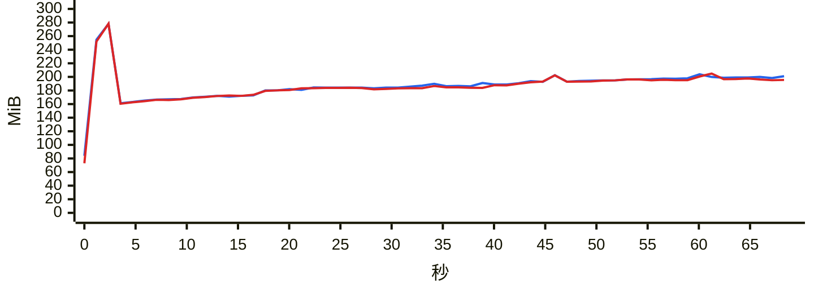

### `export messages json with images`

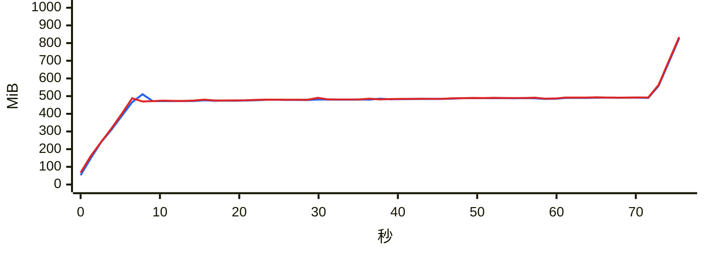

### `export messages json`

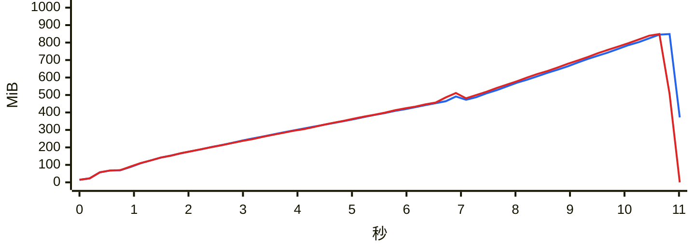

### `export messages chatlab`

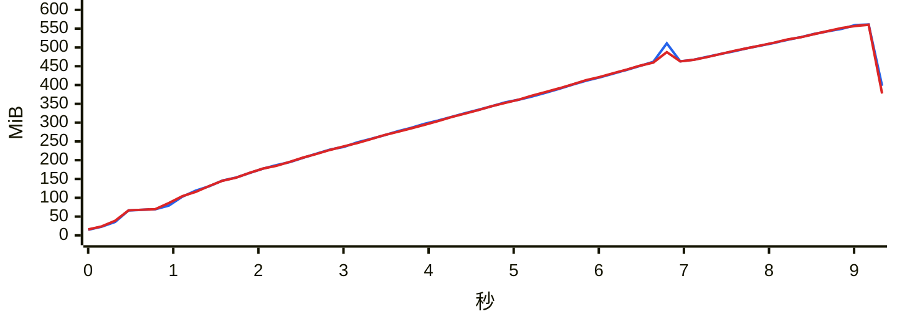

### `export messages excel`

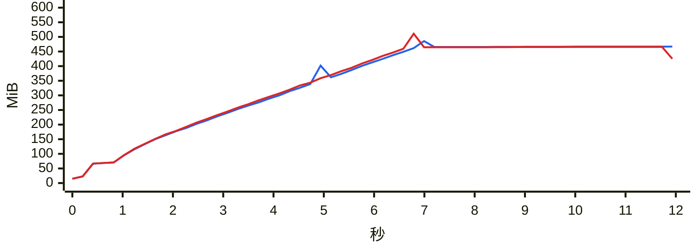

### `export messages html`

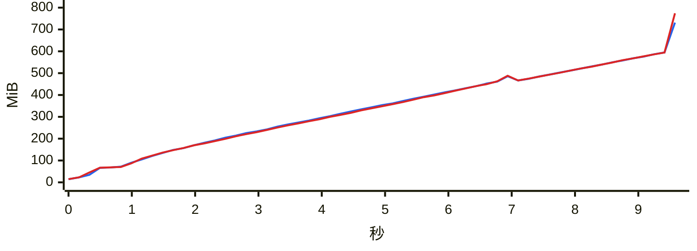

### `export messages txt`

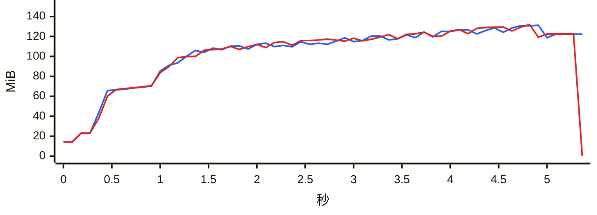

### `report annual`

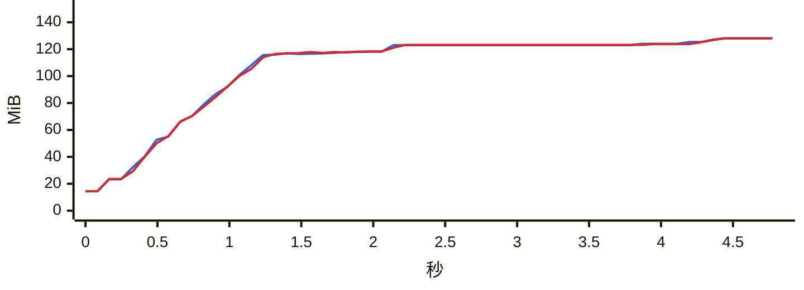

### `analytics overall`

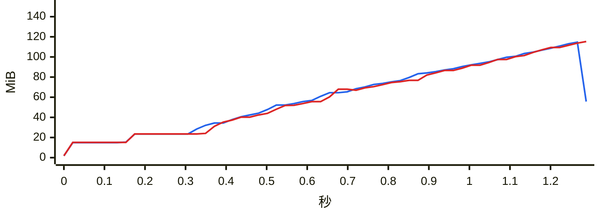

### `group members`

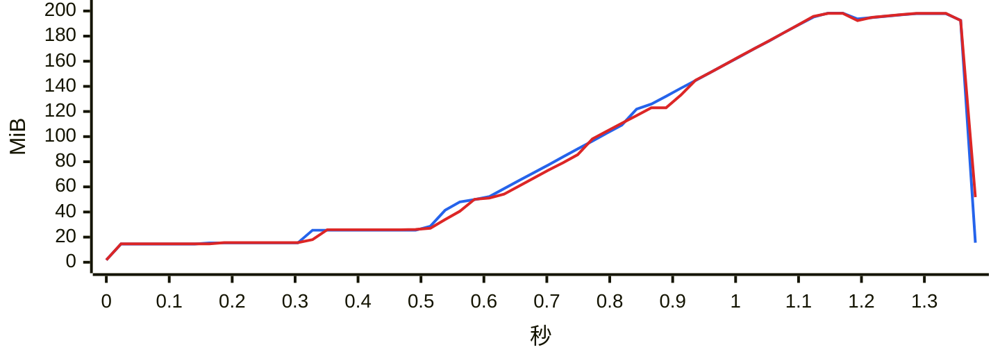

### `group ranking`

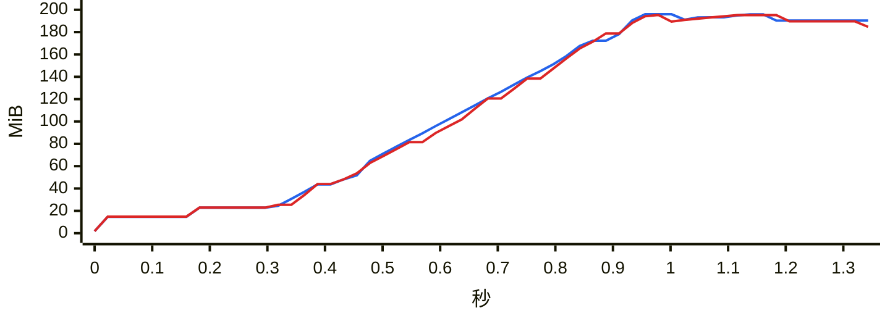

### `chat export-stats`

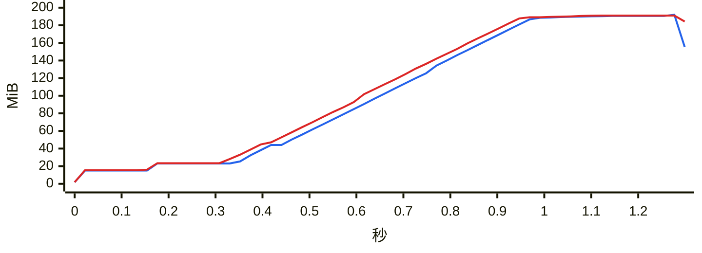

### `chat date-counts`

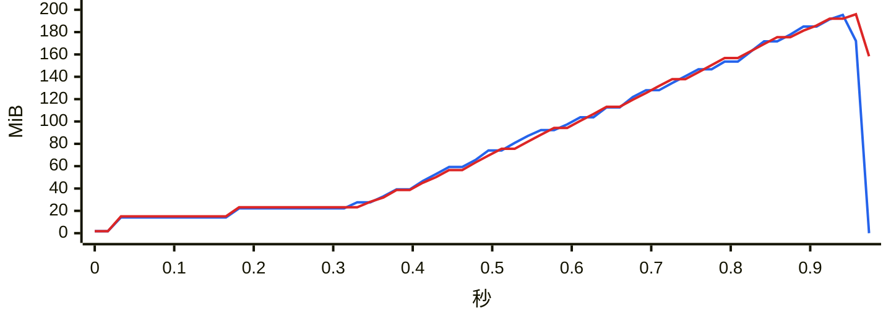

### `chat search`

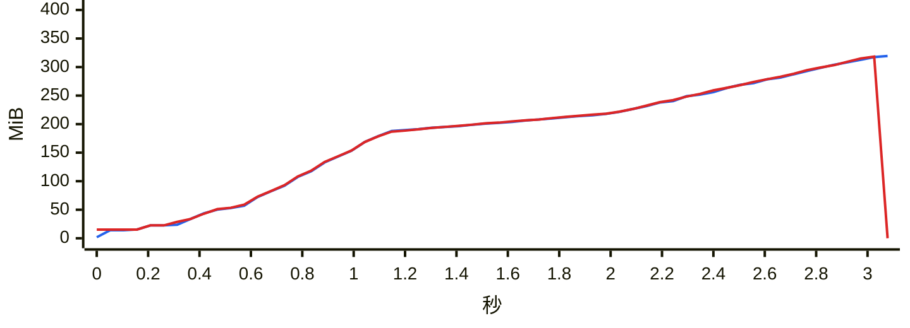

### `report dual`

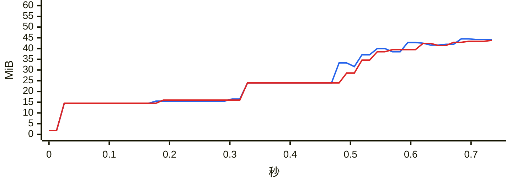

### `chat messages first page`

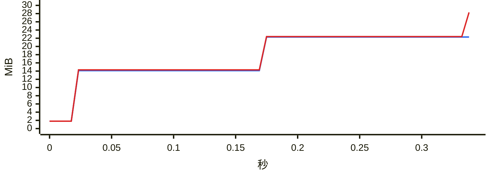

### `chat messages offset`

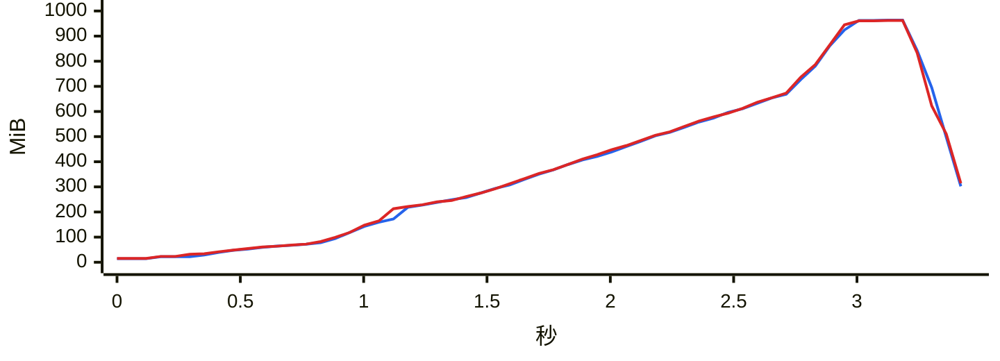
