# 基准测试：base 与 head

- base：`v3.0.0`（`a46fa8eb59`），weflow 4.3.0
- head：`v3.0.1`（`afd428718d`），weflow 4.3.0
- 基准账号：种子 1，325,798 条消息，316 个会话
- runner：4 个逻辑 CPU，16.0 GiB 内存，win32 win25-vs2026
- 每条命令先各运行一次不计时，再由 base 和 head 交替各运行 5 次，取成功运行的中位数
- 比值是 head / base：▲ 表示增加超过 10%，▼ 表示减少超过 10%；差值小于噪声下限时不标（耗时 20 ms，CPU 50 ms，内存 5 MiB，路由延迟 5 ms）。除了吞吐量和每秒请求数，其余指标都是越低越好

**怎么看**：同一份代码在 runner 上对比时，耗时比值在 0.99–1.02 之间，个别命令（如 json 导出）每次在两个耗时之间跳。比值超过约 10%，并且两边最快到最慢的范围不重叠，才算真正的变化。

## 二进制体积

|  | base | head | head / base |
|---|---|---|---|
| `weflow.exe` | 24.2 MiB | 24.4 MiB | 1.01× |

## 命令

### 耗时（ms）

从启动到退出。括号里是最快和最慢的一次。

| 命令 | base | head | head / base |
|---|---|---|---|
| `export media images` | 38,984（38,496–39,932） | 39,764（39,225–45,518） | 1.02× |
| `export messages json with images` | 45,842（43,084–47,119） | 45,102（43,590–45,758） | 0.98× |
| `export messages json` | 7,861（7,775–7,935） | 4,068（4,052–4,118） | 0.52× ▼ |
| `export messages chatlab` | 6,602（6,542–6,725） | 3,677（3,662–3,773） | 0.56× ▼ |
| `export messages excel` | 8,539（8,286–8,722） | 5,361（5,296–5,470） | 0.63× ▼ |
| `export messages html` | 7,016（6,582–7,409） | 3,637（3,587–3,682） | 0.52× ▼ |
| `export messages txt` | 3,776（3,602–3,821） | 3,367（3,296–3,419） | 0.89× ▼ |
| `report annual` | 2,570（2,560–2,589） | 2,576（2,565–2,611） | 1.00× |
| `analytics overall` | 718（709–733） | 747（730–757） | 1.04× |
| `group members` | 832（816–834） | 815（804–837） | 0.98× |
| `group ranking` | 777（771–801） | 783（780–799） | 1.01× |
| `chat export-stats` | 808（795–821） | 832（786–893） | 1.03× |
| `chat date-counts` | 565（559–580） | 576（569–583） | 1.02× |
| `chat search` | 1,805（1,774–1,889） | 1,793（1,768–1,875） | 0.99× |
| `report dual` | 420（406–430） | 415（411–421） | 0.99× |
| `chat messages first page` | 199（183–207） | 183（182–186） | 0.92× |
| `chat messages offset` | 2,270（2,221–2,356） | 2,251（2,236–2,269） | 0.99× |

### 第一批结果（ms）

从启动到第一个有进度的事件（`--progress`）。不输出进度的命令没有这一项。

| 命令 | base | head | head / base |
|---|---|---|---|
| `export media images` | 1,603 | 1,667 | 1.04× |
| `export messages json with images` | 706 | 675 | 0.96× |
| `export messages json` | 657 | 692 | 1.05× |
| `export messages chatlab` | 652 | 692 | 1.06× |
| `export messages excel` | 650 | 685 | 1.05× |
| `export messages html` | 643 | 685 | 1.07× |
| `export messages txt` | 592 | 653 | 1.10× ▲ |
| `report annual` | 13 | 13 | 0.99× |
| `analytics overall` | 91 | 92 | 1.01× |
| `report dual` | 13 | 13 | 1.01× |

### 用户态 CPU（ms）

进程及其子进程的合计（Job Object）。Windows 的 CPU 时间精度是 15.6 ms，1 秒左右的命令差几十毫秒属于噪声。

| 命令 | base | head | head / base |
|---|---|---|---|
| `export media images` | 67,375 | 68,672 | 1.02× |
| `export messages json with images` | 73,219 | 75,016 | 1.02× |
| `export messages json` | 7,312 | 9,781 | 1.34× ▲ |
| `export messages chatlab` | 6,234 | 8,328 | 1.34× ▲ |
| `export messages excel` | 7,828 | 9,953 | 1.27× ▲ |
| `export messages html` | 6,359 | 8,125 | 1.28× ▲ |
| `export messages txt` | 3,422 | 7,016 | 2.05× ▲ |
| `report annual` | 2,422 | 2,484 | 1.03× |
| `analytics overall` | 656 | 656 | 1.00× |
| `group members` | 750 | 750 | 1.00× |
| `group ranking` | 703 | 734 | 1.04× |
| `chat export-stats` | 719 | 734 | 1.02× |
| `chat date-counts` | 500 | 578 | 1.16× ▲ |
| `chat search` | 1,625 | 1,547 | 0.95× |
| `report dual` | 453 | 422 | 0.93× |
| `chat messages first page` | 203 | 172 | 0.85× |
| `chat messages offset` | 1,844 | 1,875 | 1.02× |

### 内核态 CPU（ms）

进程及其子进程的合计（Job Object）。Windows 的 CPU 时间精度是 15.6 ms，1 秒左右的命令差几十毫秒属于噪声。

| 命令 | base | head | head / base |
|---|---|---|---|
| `export media images` | 66,016 | 67,281 | 1.02× |
| `export messages json with images` | 69,172 | 69,766 | 1.01× |
| `export messages json` | 516 | 656 | 1.27× ▲ |
| `export messages chatlab` | 422 | 469 | 1.11× |
| `export messages excel` | 594 | 672 | 1.13× ▲ |
| `export messages html` | 547 | 484 | 0.89× ▼ |
| `export messages txt` | 406 | 438 | 1.08× |
| `report annual` | 203 | 203 | 1.00× |
| `analytics overall` | 141 | 156 | 1.11× |
| `group members` | 172 | 172 | 1.00× |
| `group ranking` | 156 | 141 | 0.90× |
| `chat export-stats` | 172 | 156 | 0.91× |
| `chat date-counts` | 156 | 94 | 0.60× ▼ |
| `chat search` | 297 | 328 | 1.11× |
| `report dual` | 62 | 94 | 1.50× |
| `chat messages first page` | 62 | 78 | 1.25× |
| `chat messages offset` | 500 | 469 | 0.94× |

### 峰值工作集（MiB）

主进程占用物理内存的峰值。

| 命令 | base | head | head / base |
|---|---|---|---|
| `export media images` | 278 | 278 | 1.00× |
| `export messages json with images` | 870 | 524 | 0.60× ▼ |
| `export messages json` | 849 | 158 | 0.19× ▼ |
| `export messages chatlab` | 561 | 152 | 0.27× ▼ |
| `export messages excel` | 511 | 179 | 0.35× ▼ |
| `export messages html` | 782 | 151 | 0.19× ▼ |
| `export messages txt` | 134 | 150 | 1.12× ▲ |
| `report annual` | 129 | 129 | 1.00× |
| `analytics overall` | 116 | 116 | 1.00× |
| `group members` | 201 | 201 | 1.00× |
| `group ranking` | 198 | 198 | 1.00× |
| `chat export-stats` | 201 | 201 | 1.00× |
| `chat date-counts` | 196 | 196 | 1.00× |
| `chat search` | 320 | 321 | 1.00× |
| `report dual` | 45.7 | 45.7 | 1.00× |
| `chat messages first page` | 31.8 | 31.8 | 1.00× |
| `chat messages offset` | 969 | 967 | 1.00× |

### 峰值提交内存（MiB）

进程及其子进程提交内存的峰值，包括还没有占用物理内存的部分。

| 命令 | base | head | head / base |
|---|---|---|---|
| `export media images` | 269 | 269 | 1.00× |
| `export messages json with images` | 925 | 549 | 0.59× ▼ |
| `export messages json` | 905 | 148 | 0.16× ▼ |
| `export messages chatlab` | 579 | 143 | 0.25× ▼ |
| `export messages excel` | 531 | 175 | 0.33× ▼ |
| `export messages html` | 864 | 143 | 0.17× ▼ |
| `export messages txt` | 132 | 142 | 1.08× |
| `report annual` | 116 | 115 | 1.00× |
| `analytics overall` | 103 | 103 | 1.00× |
| `group members` | 196 | 196 | 1.00× |
| `group ranking` | 194 | 194 | 1.00× |
| `chat export-stats` | 190 | 190 | 1.00× |
| `chat date-counts` | 189 | 189 | 1.00× |
| `chat search` | 328 | 328 | 1.00× |
| `report dual` | 32.6 | 32.7 | 1.00× |
| `chat messages first page` | 19.5 | 19.5 | 1.00× |
| `chat messages offset` | 979 | 977 | 1.00× |

### 峰值线程数

每 20 ms 采样一次主进程得到的最大值。

| 命令 | base | head | head / base |
|---|---|---|---|
| `export media images` | 12 | 12 | 1.00× |
| `export messages json with images` | 12 | 13 | 1.08× |
| `export messages json` | 10 | 13 | 1.30× ▲ |
| `export messages chatlab` | 10 | 13 | 1.30× ▲ |
| `export messages excel` | 10 | 13 | 1.30× ▲ |
| `export messages html` | 10 | 13 | 1.30× ▲ |
| `export messages txt` | 10 | 13 | 1.30× ▲ |
| `report annual` | 10 | 10 | 1.00× |
| `analytics overall` | 10 | 10 | 1.00× |
| `group members` | 10 | 10 | 1.00× |
| `group ranking` | 10 | 10 | 1.00× |
| `chat export-stats` | 10 | 10 | 1.00× |
| `chat date-counts` | 10 | 10 | 1.00× |
| `chat search` | 10 | 10 | 1.00× |
| `report dual` | 10 | 10 | 1.00× |
| `chat messages first page` | 10 | 10 | 1.00× |
| `chat messages offset` | 10 | 10 | 1.00× |

### 读取（MiB）

逻辑 I/O，包括命中系统文件缓存的部分；Windows 不按进程统计实际的磁盘 I/O。

| 命令 | base | head | head / base |
|---|---|---|---|
| `export media images` | 900 | 900 | 1.00× |
| `export messages json with images` | 1,109 | 1,325 | 1.19× ▲ |
| `export messages json` | 417 | 633 | 1.52× ▲ |
| `export messages chatlab` | 417 | 467 | 1.12× ▲ |
| `export messages excel` | 506 | 504 | 1.00× |
| `export messages html` | 417 | 479 | 1.15× ▲ |
| `export messages txt` | 417 | 417 | 1.00× |
| `report annual` | 146 | 146 | 1.00× |
| `analytics overall` | 142 | 142 | 1.00× |
| `group members` | 207 | 207 | 1.00× |
| `group ranking` | 207 | 207 | 1.00× |
| `chat export-stats` | 232 | 232 | 1.00× |
| `chat date-counts` | 206 | 206 | 1.00× |
| `chat search` | 524 | 524 | 1.00× |
| `report dual` | 42.7 | 42.7 | 1.00× |
| `chat messages first page` | 28.4 | 28.4 | 1.00× |
| `chat messages offset` | 429 | 429 | 1.00× |

### 写入（MiB）

逻辑 I/O，包括命中系统文件缓存的部分；Windows 不按进程统计实际的磁盘 I/O。

| 命令 | base | head | head / base |
|---|---|---|---|
| `export media images` | 952 | 952 | 1.00× |
| `export messages json with images` | 1,166 | 1,381 | 1.18× ▲ |
| `export messages json` | 216 | 431 | 2.00× ▲ |
| `export messages chatlab` | 49.9 | 99.1 | 1.99× ▲ |
| `export messages excel` | 101 | 98.2 | 0.97× |
| `export messages html` | 61.9 | 122 | 1.97× ▲ |
| `export messages txt` | 11.0 | 14.6 | 1.33× ▲ |
| `report annual` | 0.0 | 0.0 | 1.00× |
| `analytics overall` | 0.0 | 0.0 | 1.00× |
| `group members` | 0.1 | 0.1 | 1.00× |
| `group ranking` | 0.0 | 0.0 | 1.00× |
| `chat export-stats` | 0.0 | 0.0 | 1.00× |
| `chat date-counts` | 0.0 | 0.0 | 1.00× |
| `chat search` | 0.1 | 0.1 | 1.00× |
| `report dual` | 0.0 | 0.0 | 1.00× |
| `chat messages first page` | 0.1 | 0.1 | 1.00× |
| `chat messages offset` | 36.5 | 36.5 | 1.00× |

### 页错误

进程及其子进程，包括软页错误。

| 命令 | base | head | head / base |
|---|---|---|---|
| `export media images` | 10,553,791 | 10,555,127 | 1.00× |
| `export messages json with images` | 10,755,823 | 10,660,555 | 0.99× |
| `export messages json` | 310,069 | 139,344 | 0.45× ▼ |
| `export messages chatlab` | 237,176 | 127,440 | 0.54× ▼ |
| `export messages excel` | 212,749 | 166,669 | 0.78× ▼ |
| `export messages html` | 293,774 | 136,656 | 0.47× ▼ |
| `export messages txt` | 213,096 | 132,065 | 0.62× ▼ |
| `report annual` | 43,344 | 43,165 | 1.00× |
| `analytics overall` | 37,754 | 37,838 | 1.00× |
| `group members` | 63,339 | 63,309 | 1.00× |
| `group ranking` | 61,131 | 61,329 | 1.00× |
| `chat export-stats` | 56,700 | 56,358 | 0.99× |
| `chat date-counts` | 57,678 | 57,645 | 1.00× |
| `chat search` | 94,840 | 94,917 | 1.00× |
| `report dual` | 27,565 | 27,350 | 0.99× |
| `chat messages first page` | 13,461 | 13,888 | 1.03× |
| `chat messages offset` | 259,669 | 259,620 | 1.00× |

### 吞吐量（消息/秒）

命令处理的消息数除以耗时。这是唯一一个越高越好的指标。

| 命令 | base | head | head / base |
|---|---|---|---|
| `export messages json with images` | 4,363 | 4,434 | 1.02× |
| `export messages json` | 25,442 | 49,166 | 1.93× ▲ |
| `export messages chatlab` | 30,293 | 54,398 | 1.80× ▲ |
| `export messages excel` | 23,422 | 37,304 | 1.59× ▲ |
| `export messages html` | 28,508 | 54,986 | 1.93× ▲ |
| `export messages txt` | 52,971 | 59,404 | 1.12× ▲ |
| `report annual` | 126,781 | 126,457 | 1.00× |
| `group members` | 240,256 | 245,490 | 1.02× |
| `group ranking` | 257,519 | 255,588 | 0.99× |
| `chat export-stats` | 247,579 | 240,358 | 0.97× |
| `chat date-counts` | 353,872 | 347,051 | 0.98× |
| `report dual` | 23,834 | 24,078 | 1.01× |
| `chat messages first page` | 251 | 273 | 1.08× |
| `chat messages offset` | 22 | 22 | 1.01× |

## `weflow serve` 持续负载

没有完成：base：weflow serve exited (2) before it listened: error: unexpected argument '--api-only' found   tip: a similar argument exists: '--api-token' Usage: weflow-base.exe serve --port <PORT> --api-token <API_TOKEN> For more information, try '--help'.；head：weflow serve exited (2) before it listened: error: unexpected argument '--api-only' found   tip: a similar argument exists: '--api-token' Usage: weflow-head.exe serve --port <PORT> --api-token <API_TOKEN> For more information, try '--help'.。完整信息见 results.json 的 `load_failed`。

## serve_bench

各路由响应时间的中位数（ms），由 `serve_bench` 在同一个基准账号上测得。路由名是它自己的；`[api]` 是进程内的 `/api/` 路由，`[sub]` 是启动子进程的路由。退出码：base 1，head 1。非 0 表示它在自己的合成账号上有检查没通过（旧版本缺少某个路由时会这样），计时照常保留，原因见 `logs/serve-bench-*.txt`。某一边不是每次都返回 200 时（例如旧版本还没有这个 `/api/` 路由，返回 404 只要零点几毫秒），格子里注明返回的状态，不计算比值。base 没有计时结果：它的 `weflow serve` 没有启动（v5.0.0 之前的版本没有现在的命令 API），见 `logs/serve-bench-base.txt`。head 没有计时结果：它的 `weflow serve` 没有启动（v5.0.0 之前的版本没有现在的命令 API），见 `logs/serve-bench-head.txt`。
## 内存曲线

主进程的工作集，每 20 ms 采样一次（持续负载每 0.5 s 一次）。命令取耗时居中的那次运行。蓝线 base，红线 head；先结束的版本在退出后记为 0。

### `export media images`

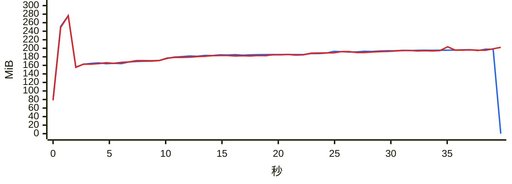

### `export messages json with images`

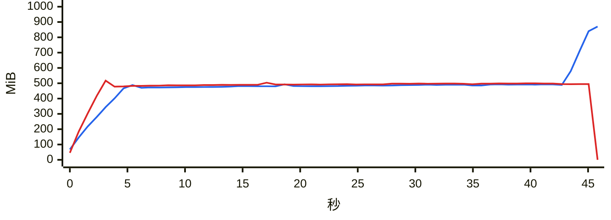

### `export messages json`

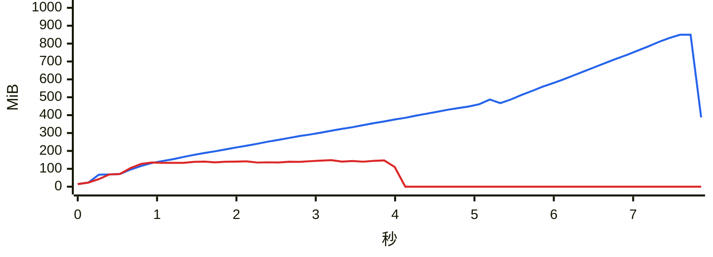

### `export messages chatlab`

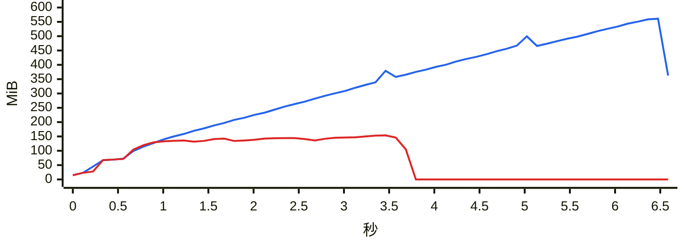

### `export messages excel`

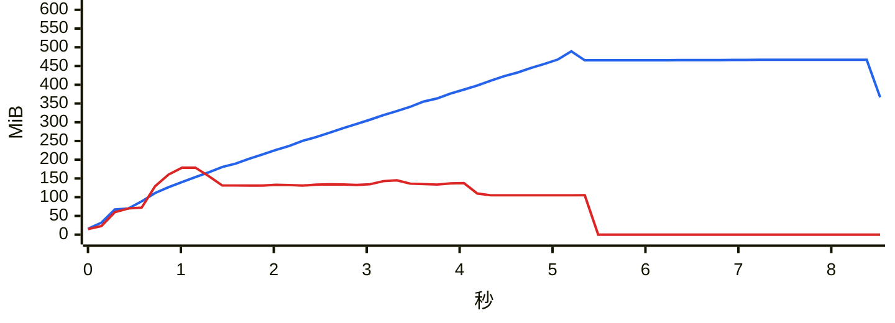

### `export messages html`

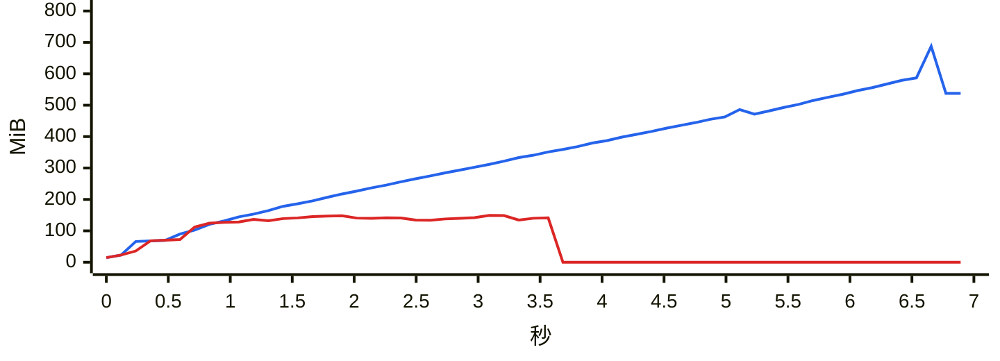

### `export messages txt`

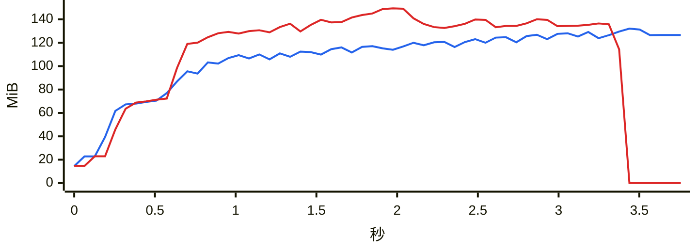

### `report annual`

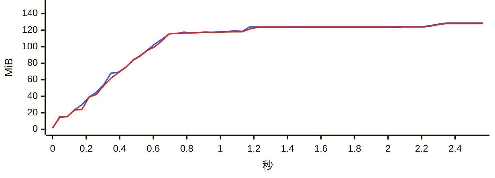

### `analytics overall`

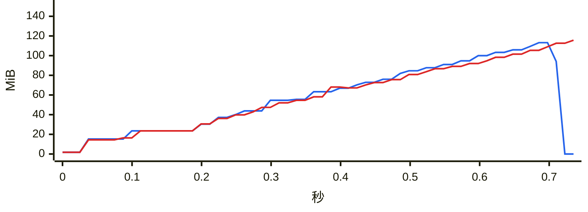

### `group members`

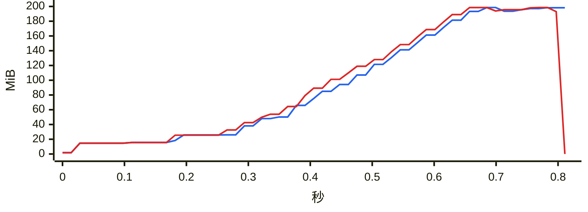

### `group ranking`

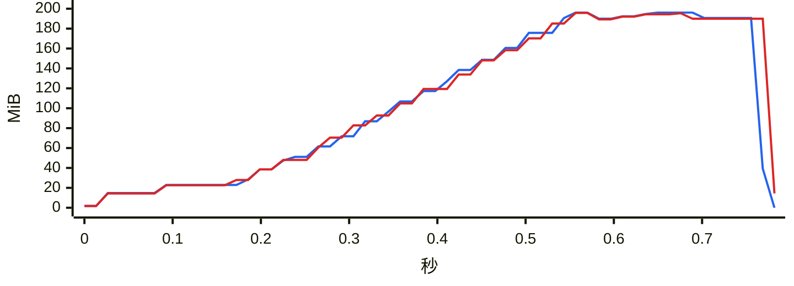

### `chat export-stats`

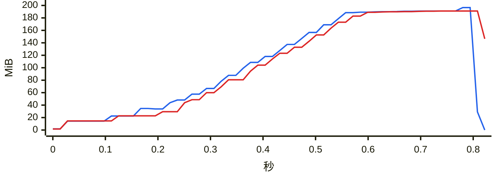

### `chat date-counts`

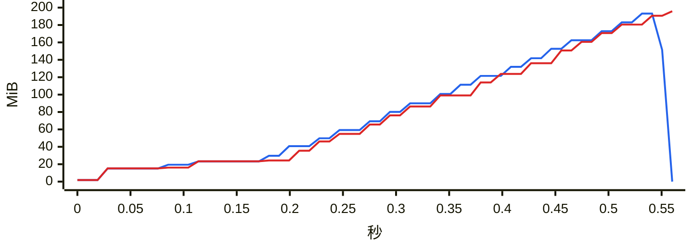

### `chat search`

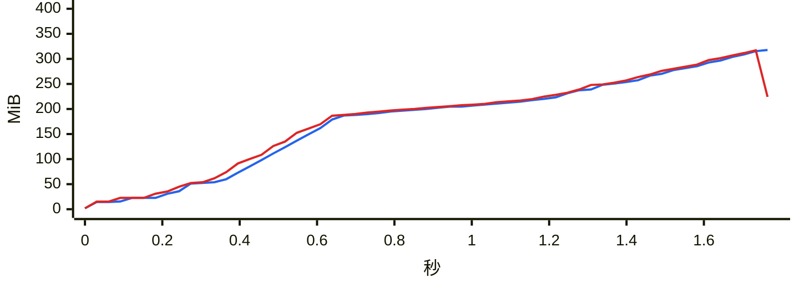

### `report dual`

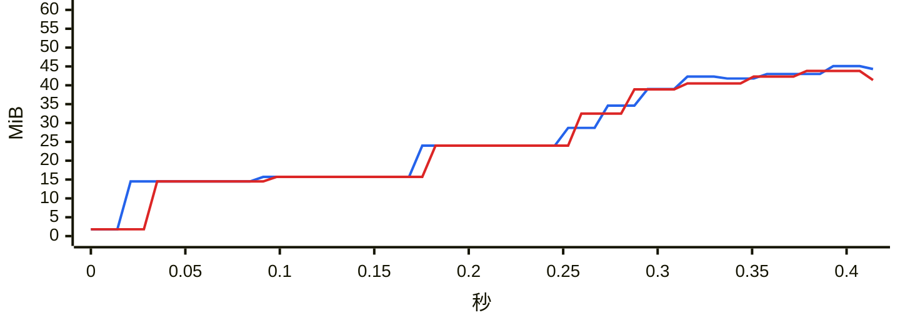

### `chat messages first page`

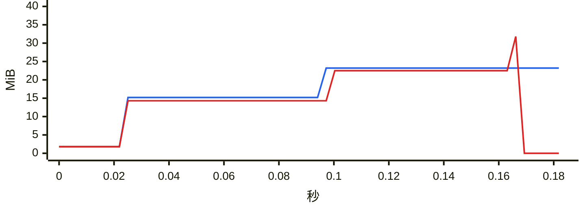

### `chat messages offset`

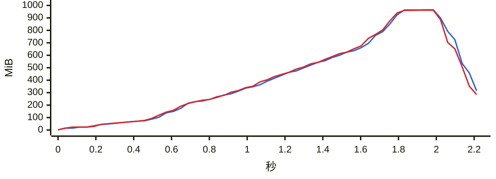
