# 基准测试：base 与 head

- base：`v3.0.1`（`afd428718d`），weflow 4.3.0
- head：`v4.0.0`（`4e8844c139`），weflow 4.3.0
- 基准账号：种子 1，325,798 条消息，316 个会话
- runner：4 个逻辑 CPU，16.0 GiB 内存，win32 win25-vs2026
- 每条命令先各运行一次不计时，再由 base 和 head 交替各运行 5 次，取成功运行的中位数
- 比值是 head / base：▲ 表示增加超过 10%，▼ 表示减少超过 10%；差值小于噪声下限时不标（耗时 20 ms，CPU 50 ms，内存 5 MiB，路由延迟 5 ms）。除了吞吐量和每秒请求数，其余指标都是越低越好

**怎么看**：同一份代码在 runner 上对比时，耗时比值在 0.99–1.02 之间，个别命令（如 json 导出）每次在两个耗时之间跳。比值超过约 10%，并且两边最快到最慢的范围不重叠，才算真正的变化。

## 二进制体积

|  | base | head | head / base |
|---|---|---|---|
| `weflow.exe` | 24.4 MiB | 24.3 MiB | 1.00× |

## 命令

### 耗时（ms）

从启动到退出。括号里是最快和最慢的一次。

| 命令 | base | head | head / base |
|---|---|---|---|
| `export media images` | 73,908（70,363–82,716） | 69,298（68,956–69,593） | 0.94× |
| `export messages json with images` | 75,064（74,547–75,276） | 75,214（75,022–75,704） | 1.00× |
| `export messages json` | 6,208（6,145–6,296） | 6,222（6,173–6,382） | 1.00× |
| `export messages chatlab` | 5,674（5,618–5,679） | 5,687（5,625–5,764） | 1.00× |
| `export messages excel` | 8,276（8,096–8,369） | 8,217（8,069–8,337） | 0.99× |
| `export messages html` | 5,476（5,378–5,562） | 5,554（5,469–5,648） | 1.01× |
| `export messages txt` | 5,268（5,168–5,317） | 5,309（5,278–5,463） | 1.01× |
| `report annual` | 4,865（4,820–4,874） | 4,867（4,812–4,871） | 1.00× |
| `analytics overall` | 1,286（1,285–1,290） | 1,295（1,283–1,307） | 1.01× |
| `group members` | 1,378（1,367–1,389） | 1,378（1,354–1,382） | 1.00× |
| `group ranking` | 1,364（1,347–1,390） | 1,354（1,351–1,361） | 0.99× |
| `chat export-stats` | 1,299（1,283–1,309） | 1,300（1,270–1,353） | 1.00× |
| `chat date-counts` | 984（960–991） | 986（981–1,006） | 1.00× |
| `chat search` | 3,053（3,011–3,064） | 3,042（3,030–3,058） | 1.00× |
| `report dual` | 740（732–755） | 745（736–751） | 1.01× |
| `chat messages first page` | 343（339–358） | 344（340–380） | 1.00× |
| `chat messages offset` | 3,511（3,457–3,575） | 3,486（3,468–3,512） | 0.99× |

### 第一批结果（ms）

从启动到第一个有进度的事件（`--progress`）。不输出进度的命令没有这一项。

| 命令 | base | head | head / base |
|---|---|---|---|
| `export media images` | 2,591 | 2,569 | 0.99× |
| `export messages json with images` | 1,162 | 1,150 | 0.99× |
| `export messages json` | 1,142 | 1,141 | 1.00× |
| `export messages chatlab` | 1,142 | 1,148 | 1.01× |
| `export messages excel` | 1,141 | 1,133 | 0.99× |
| `export messages html` | 1,137 | 1,140 | 1.00× |
| `export messages txt` | 1,135 | 1,157 | 1.02× |
| `report annual` | 17 | 17 | 0.98× |
| `analytics overall` | 166 | 166 | 1.00× |
| `report dual` | 17 | 17 | 0.99× |

### 用户态 CPU（ms）

进程及其子进程的合计（Job Object）。Windows 的 CPU 时间精度是 15.6 ms，1 秒左右的命令差几十毫秒属于噪声。

| 命令 | base | head | head / base |
|---|---|---|---|
| `export media images` | 119,250 | 118,344 | 0.99× |
| `export messages json with images` | 125,672 | 128,016 | 1.02× |
| `export messages json` | 14,578 | 14,672 | 1.01× |
| `export messages chatlab` | 12,156 | 12,281 | 1.01× |
| `export messages excel` | 14,672 | 14,797 | 1.01× |
| `export messages html` | 12,016 | 12,078 | 1.01× |
| `export messages txt` | 10,781 | 10,875 | 1.01× |
| `report annual` | 4,594 | 4,594 | 1.00× |
| `analytics overall` | 1,219 | 1,250 | 1.03× |
| `group members` | 1,312 | 1,266 | 0.96× |
| `group ranking` | 1,328 | 1,312 | 0.99× |
| `chat export-stats` | 1,234 | 1,219 | 0.99× |
| `chat date-counts` | 938 | 922 | 0.98× |
| `chat search` | 2,703 | 2,766 | 1.02× |
| `report dual` | 797 | 812 | 1.02× |
| `chat messages first page` | 422 | 438 | 1.04× |
| `chat messages offset` | 2,875 | 2,953 | 1.03× |

### 内核态 CPU（ms）

进程及其子进程的合计（Job Object）。Windows 的 CPU 时间精度是 15.6 ms，1 秒左右的命令差几十毫秒属于噪声。

| 命令 | base | head | head / base |
|---|---|---|---|
| `export media images` | 120,594 | 120,875 | 1.00× |
| `export messages json with images` | 121,188 | 120,406 | 0.99× |
| `export messages json` | 812 | 828 | 1.02× |
| `export messages chatlab` | 641 | 625 | 0.98× |
| `export messages excel` | 922 | 906 | 0.98× |
| `export messages html` | 656 | 766 | 1.17× ▲ |
| `export messages txt` | 719 | 609 | 0.85× ▼ |
| `report annual` | 375 | 406 | 1.08× |
| `analytics overall` | 203 | 219 | 1.08× |
| `group members` | 203 | 234 | 1.15× |
| `group ranking` | 188 | 188 | 1.00× |
| `chat export-stats` | 234 | 250 | 1.07× |
| `chat date-counts` | 203 | 219 | 1.08× |
| `chat search` | 469 | 422 | 0.90× |
| `report dual` | 109 | 62 | 0.57× |
| `chat messages first page` | 47 | 78 | 1.67× |
| `chat messages offset` | 719 | 672 | 0.93× |

### 峰值工作集（MiB）

主进程占用物理内存的峰值。

| 命令 | base | head | head / base |
|---|---|---|---|
| `export media images` | 278 | 277 | 1.00× |
| `export messages json with images` | 524 | 525 | 1.00× |
| `export messages json` | 159 | 160 | 1.01× |
| `export messages chatlab` | 144 | 144 | 1.00× |
| `export messages excel` | 174 | 176 | 1.01× |
| `export messages html` | 146 | 145 | 0.99× |
| `export messages txt` | 143 | 144 | 1.01× |
| `report annual` | 129 | 129 | 1.00× |
| `analytics overall` | 116 | 116 | 1.00× |
| `group members` | 201 | 200 | 1.00× |
| `group ranking` | 198 | 198 | 1.00× |
| `chat export-stats` | 201 | 201 | 1.00× |
| `chat date-counts` | 196 | 196 | 1.00× |
| `chat search` | 321 | 320 | 1.00× |
| `report dual` | 45.7 | 45.5 | 0.99× |
| `chat messages first page` | 32.6 | 31.6 | 0.97× |
| `chat messages offset` | 968 | 968 | 1.00× |

### 峰值提交内存（MiB）

进程及其子进程提交内存的峰值，包括还没有占用物理内存的部分。

| 命令 | base | head | head / base |
|---|---|---|---|
| `export media images` | 269 | 268 | 1.00× |
| `export messages json with images` | 548 | 549 | 1.00× |
| `export messages json` | 150 | 151 | 1.00× |
| `export messages chatlab` | 135 | 137 | 1.01× |
| `export messages excel` | 170 | 172 | 1.01× |
| `export messages html` | 137 | 136 | 0.99× |
| `export messages txt` | 134 | 135 | 1.01× |
| `report annual` | 115 | 115 | 1.00× |
| `analytics overall` | 104 | 103 | 0.99× |
| `group members` | 196 | 195 | 1.00× |
| `group ranking` | 194 | 193 | 1.00× |
| `chat export-stats` | 189 | 189 | 1.00× |
| `chat date-counts` | 189 | 188 | 1.00× |
| `chat search` | 329 | 328 | 1.00× |
| `report dual` | 32.4 | 32.6 | 1.01× |
| `chat messages first page` | 21.0 | 19.2 | 0.91× |
| `chat messages offset` | 978 | 978 | 1.00× |

### 峰值线程数

每 20 ms 采样一次主进程得到的最大值。

| 命令 | base | head | head / base |
|---|---|---|---|
| `export media images` | 12 | 12 | 1.00× |
| `export messages json with images` | 13 | 13 | 1.00× |
| `export messages json` | 13 | 13 | 1.00× |
| `export messages chatlab` | 13 | 13 | 1.00× |
| `export messages excel` | 13 | 13 | 1.00× |
| `export messages html` | 13 | 13 | 1.00× |
| `export messages txt` | 13 | 13 | 1.00× |
| `report annual` | 10 | 10 | 1.00× |
| `analytics overall` | 10 | 10 | 1.00× |
| `group members` | 10 | 10 | 1.00× |
| `group ranking` | 10 | 10 | 1.00× |
| `chat export-stats` | 10 | 10 | 1.00× |
| `chat date-counts` | 10 | 10 | 1.00× |
| `chat search` | 10 | 10 | 1.00× |
| `report dual` | 10 | 10 | 1.00× |
| `chat messages first page` | 10 | 10 | 1.00× |
| `chat messages offset` | 10 | 10 | 1.00× |

### 读取（MiB）

逻辑 I/O，包括命中系统文件缓存的部分；Windows 不按进程统计实际的磁盘 I/O。

| 命令 | base | head | head / base |
|---|---|---|---|
| `export media images` | 900 | 900 | 1.00× |
| `export messages json with images` | 1,325 | 1,325 | 1.00× |
| `export messages json` | 633 | 633 | 1.00× |
| `export messages chatlab` | 467 | 467 | 1.00× |
| `export messages excel` | 504 | 504 | 1.00× |
| `export messages html` | 479 | 479 | 1.00× |
| `export messages txt` | 417 | 417 | 1.00× |
| `report annual` | 146 | 146 | 1.00× |
| `analytics overall` | 142 | 142 | 1.00× |
| `group members` | 207 | 207 | 1.00× |
| `group ranking` | 207 | 207 | 1.00× |
| `chat export-stats` | 232 | 232 | 1.00× |
| `chat date-counts` | 206 | 206 | 1.00× |
| `chat search` | 524 | 524 | 1.00× |
| `report dual` | 42.7 | 42.7 | 1.00× |
| `chat messages first page` | 28.4 | 28.4 | 1.00× |
| `chat messages offset` | 429 | 429 | 1.00× |

### 写入（MiB）

逻辑 I/O，包括命中系统文件缓存的部分；Windows 不按进程统计实际的磁盘 I/O。

| 命令 | base | head | head / base |
|---|---|---|---|
| `export media images` | 952 | 952 | 1.00× |
| `export messages json with images` | 1,381 | 1,381 | 1.00× |
| `export messages json` | 431 | 431 | 1.00× |
| `export messages chatlab` | 99.1 | 99.1 | 1.00× |
| `export messages excel` | 98.2 | 98.2 | 1.00× |
| `export messages html` | 122 | 122 | 1.00× |
| `export messages txt` | 14.6 | 14.6 | 1.00× |
| `report annual` | 0.0 | 0.0 | 1.00× |
| `analytics overall` | 0.0 | 0.0 | 1.00× |
| `group members` | 0.1 | 0.1 | 1.00× |
| `group ranking` | 0.0 | 0.0 | 1.00× |
| `chat export-stats` | 0.0 | 0.0 | 1.00× |
| `chat date-counts` | 0.0 | 0.0 | 1.00× |
| `chat search` | 0.1 | 0.1 | 1.00× |
| `report dual` | 0.0 | 0.0 | 1.00× |
| `chat messages first page` | 0.1 | 0.1 | 1.00× |
| `chat messages offset` | 36.5 | 36.5 | 1.00× |

### 页错误

进程及其子进程，包括软页错误。

| 命令 | base | head | head / base |
|---|---|---|---|
| `export media images` | 10,554,047 | 10,559,728 | 1.00× |
| `export messages json with images` | 10,657,812 | 10,663,392 | 1.00× |
| `export messages json` | 135,169 | 137,211 | 1.02× |
| `export messages chatlab` | 137,100 | 150,969 | 1.10× ▲ |
| `export messages excel` | 173,582 | 152,405 | 0.88× ▼ |
| `export messages html` | 138,736 | 151,286 | 1.09× |
| `export messages txt` | 148,284 | 157,439 | 1.06× |
| `report annual` | 43,303 | 43,267 | 1.00× |
| `analytics overall` | 37,844 | 37,963 | 1.00× |
| `group members` | 63,128 | 63,188 | 1.00× |
| `group ranking` | 61,289 | 61,064 | 1.00× |
| `chat export-stats` | 56,412 | 56,598 | 1.00× |
| `chat date-counts` | 57,350 | 57,246 | 1.00× |
| `chat search` | 94,759 | 94,928 | 1.00× |
| `report dual` | 27,177 | 26,892 | 0.99× |
| `chat messages first page` | 13,700 | 13,555 | 0.99× |
| `chat messages offset` | 259,400 | 259,498 | 1.00× |

### 吞吐量（消息/秒）

命令处理的消息数除以耗时。这是唯一一个越高越好的指标。

| 命令 | base | head | head / base |
|---|---|---|---|
| `export messages json with images` | 2,664 | 2,659 | 1.00× |
| `export messages json` | 32,219 | 32,142 | 1.00× |
| `export messages chatlab` | 35,247 | 35,166 | 1.00× |
| `export messages excel` | 24,166 | 24,339 | 1.01× |
| `export messages html` | 36,526 | 36,009 | 0.99× |
| `export messages txt` | 37,963 | 37,669 | 0.99× |
| `report annual` | 66,963 | 66,946 | 1.00× |
| `group members` | 145,171 | 145,098 | 1.00× |
| `group ranking` | 146,641 | 147,688 | 1.01× |
| `chat export-stats` | 153,982 | 153,841 | 1.00× |
| `chat date-counts` | 203,330 | 202,762 | 1.00× |
| `report dual` | 13,521 | 13,427 | 0.99× |
| `chat messages first page` | 146 | 145 | 1.00× |
| `chat messages offset` | 14 | 14 | 1.01× |

## `weflow serve` 持续负载

没有完成：base：weflow serve exited (2) before it listened: error: unexpected argument '--api-only' found   tip: a similar argument exists: '--api-token' Usage: weflow-base.exe serve --port <PORT> --api-token <API_TOKEN> For more information, try '--help'.；head：weflow serve exited (2) before it listened: error: unexpected argument '--api-only' found   tip: a similar argument exists: '--api-token' Usage: weflow-head.exe serve --port <PORT> --api-token <API_TOKEN> For more information, try '--help'.。完整信息见 results.json 的 `load_failed`。

## serve_bench

各路由响应时间的中位数（ms），由 `serve_bench` 在同一个基准账号上测得。路由名是它自己的；`[api]` 是进程内的 `/api/` 路由，`[sub]` 是启动子进程的路由。退出码：base 1，head 1。非 0 表示它在自己的合成账号上有检查没通过（旧版本缺少某个路由时会这样），计时照常保留，原因见 `logs/serve-bench-*.txt`。某一边不是每次都返回 200 时（例如旧版本还没有这个 `/api/` 路由，返回 404 只要零点几毫秒），格子里注明返回的状态，不计算比值。base 没有计时结果：它的 `weflow serve` 没有启动（v5.0.0 之前的版本没有现在的命令 API），见 `logs/serve-bench-base.txt`。head 没有计时结果：它的 `weflow serve` 没有启动（v5.0.0 之前的版本没有现在的命令 API），见 `logs/serve-bench-head.txt`。
## 内存曲线

主进程的工作集，每 20 ms 采样一次（持续负载每 0.5 s 一次）。命令取耗时居中的那次运行。蓝线 base，红线 head；先结束的版本在退出后记为 0。

### `export media images`

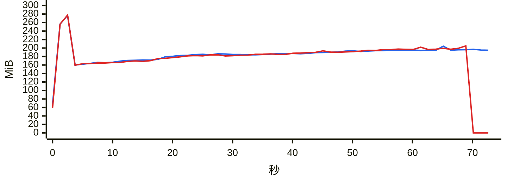

### `export messages json with images`

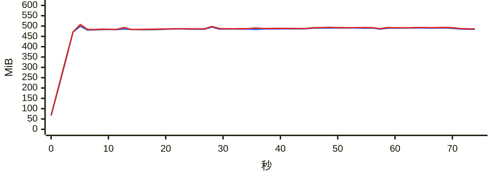

### `export messages json`

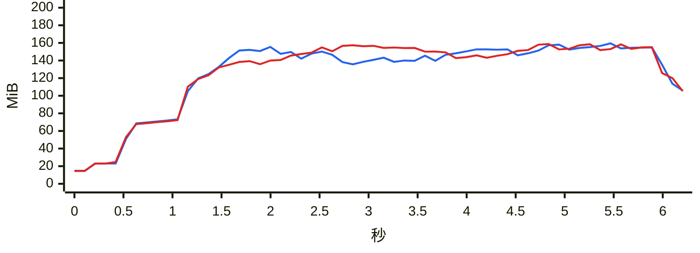

### `export messages chatlab`

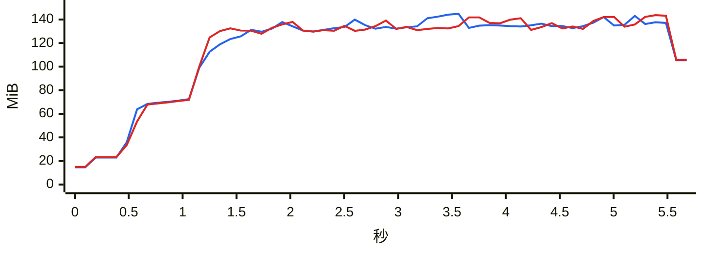

### `export messages excel`

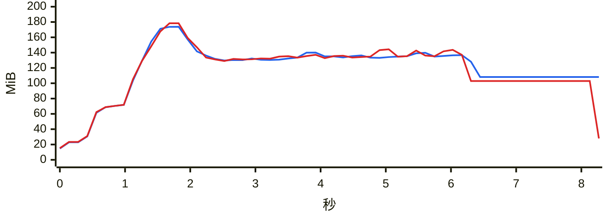

### `export messages html`

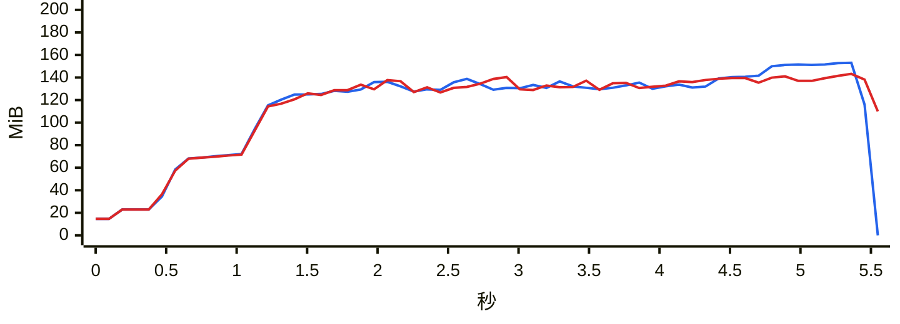

### `export messages txt`

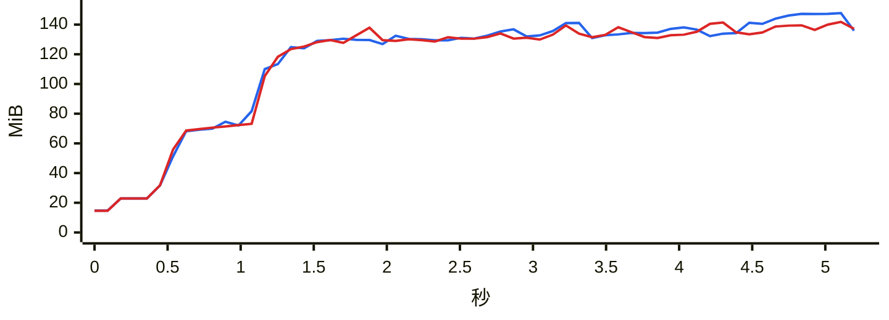

### `report annual`

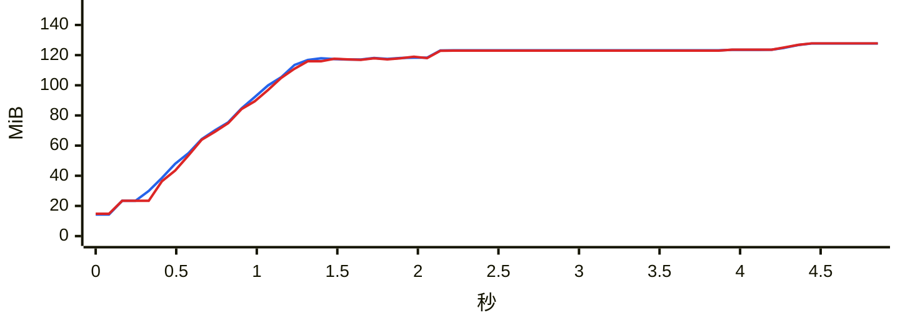

### `analytics overall`

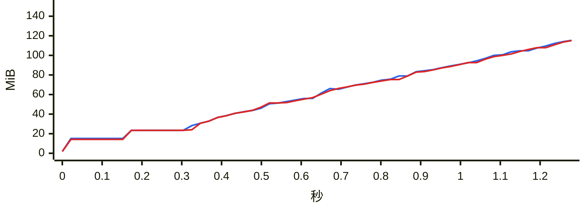

### `group members`

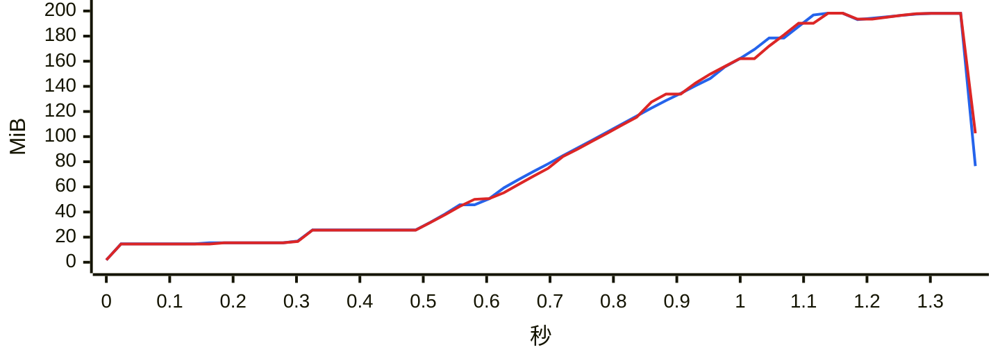

### `group ranking`

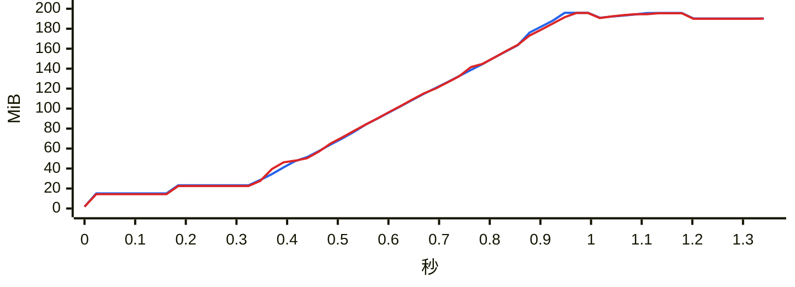

### `chat export-stats`

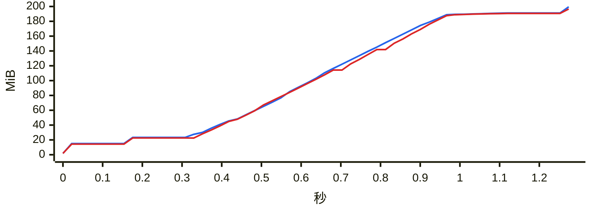

### `chat date-counts`

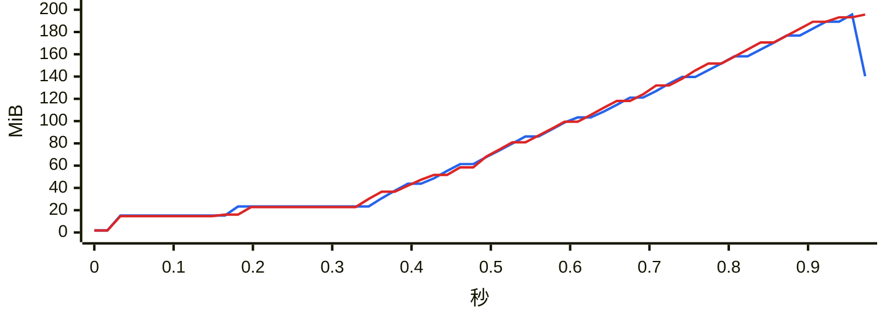

### `chat search`

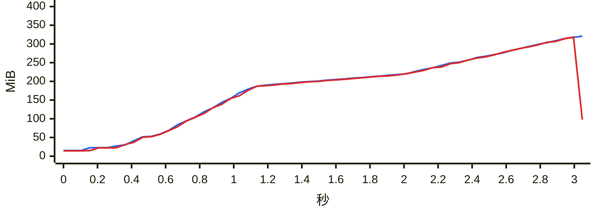

### `report dual`

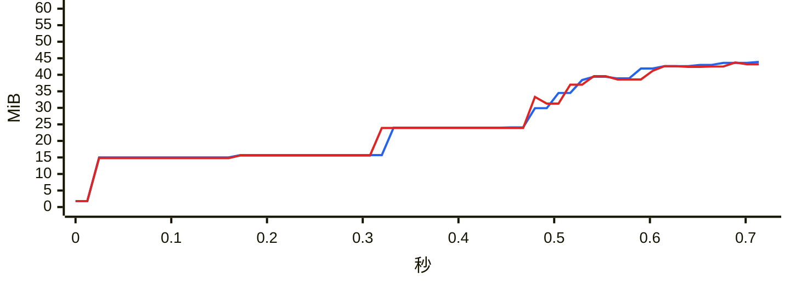

### `chat messages first page`

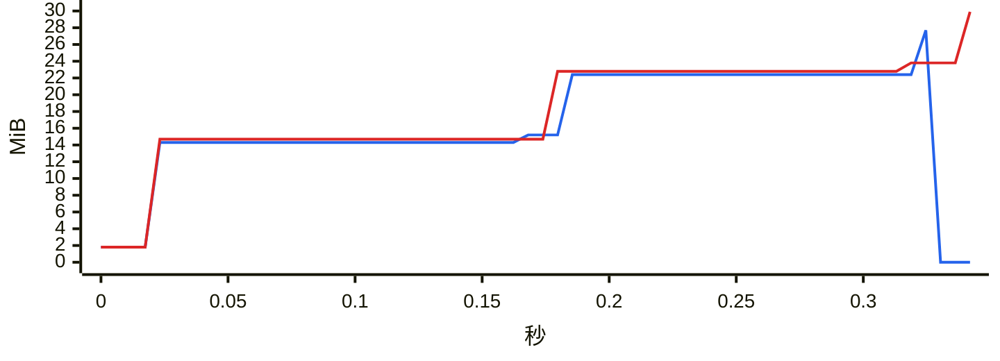

### `chat messages offset`

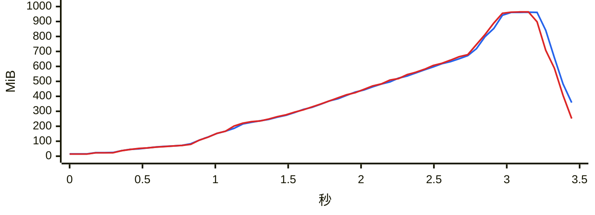
