# 基准测试：base 与 head

- base：`v3.0.1`（`afd428718d`），weflow 4.3.0
- head：`v4.0.0`（`4e8844c139`），weflow 4.3.0
- 基准账号：种子 1，325,798 条消息，316 个会话
- runner：4 个逻辑 CPU，16.0 GiB 内存，win32 win25-vs2026
- 每条命令先各运行一次不计时，再由 base 和 head 交替各运行 5 次，取成功运行的中位数
- 比值是 head / base：▲ 表示增加超过 10%，▼ 表示减少超过 10%；差值小于噪声下限时不标（耗时 20 ms，CPU 50 ms，内存 5 MiB，路由延迟 5 ms）。除了吞吐量和每秒请求数，其余指标都是越低越好

**怎么看**：同一份代码在 runner 上对比时，耗时比值在 0.99–1.02 之间，个别命令（如 json 导出）每次在两个耗时之间跳。比值超过约 10%，并且两边最快到最慢的范围不重叠，才算真正的变化。

## 二进制体积

|  | base | head | head / base |
|---|---|---|---|
| `weflow.exe` | 24.4 MiB | 24.3 MiB | 1.00× |

## 命令

**有运行失败**（输出见 `logs/`，不计入中位数）：`export media images`（head 5 次），`export messages json with images`（head 5 次），`export messages json`（head 5 次），`export messages chatlab`（head 5 次），`export messages excel`（head 5 次），`export messages html`（head 5 次），`export messages txt`（head 5 次），`report annual`（head 5 次），`analytics overall`（head 5 次），`group members`（head 5 次），`group ranking`（head 5 次），`chat export-stats`（head 5 次），`chat date-counts`（head 5 次），`chat search`（head 5 次），`report dual`（head 5 次），`chat messages first page`（head 5 次），`chat messages offset`（head 5 次）

### 耗时（ms）

从启动到退出。括号里是最快和最慢的一次。

| 命令 | base | head | head / base |
|---|---|---|---|
| `export media images` | 36,727（35,834–39,354） | - | - |
| `export messages json with images` | 40,252（39,043–42,564） | - | - |
| `export messages json` | 4,325（3,807–4,553） | - | - |
| `export messages chatlab` | 3,944（3,407–3,997） | - | - |
| `export messages excel` | 4,786（4,646–4,917） | - | - |
| `export messages html` | 3,221（3,167–3,291） | - | - |
| `export messages txt` | 3,104（3,038–3,187） | - | - |
| `report annual` | 2,575（2,560–2,594） | - | - |
| `analytics overall` | 701（680–710） | - | - |
| `group members` | 801（773–837） | - | - |
| `group ranking` | 782（768–785） | - | - |
| `chat export-stats` | 790（788–814） | - | - |
| `chat date-counts` | 565（559–577） | - | - |
| `chat search` | 1,758（1,745–1,800） | - | - |
| `report dual` | 419（404–420） | - | - |
| `chat messages first page` | 197（182–207） | - | - |
| `chat messages offset` | 2,234（2,201–2,288） | - | - |

### 第一批结果（ms）

从启动到第一个有进度的事件（`--progress`）。不输出进度的命令没有这一项。

| 命令 | base | head | head / base |
|---|---|---|---|
| `export media images` | 1,605 | - | - |
| `export messages json with images` | 644 | - | - |
| `export messages json` | 732 | - | - |
| `export messages chatlab` | 734 | - | - |
| `export messages excel` | 637 | - | - |
| `export messages html` | 627 | - | - |
| `export messages txt` | 631 | - | - |
| `report annual` | 12 | - | - |
| `analytics overall` | 91 | - | - |
| `report dual` | 13 | - | - |

### 用户态 CPU（ms）

进程及其子进程的合计（Job Object）。Windows 的 CPU 时间精度是 15.6 ms，1 秒左右的命令差几十毫秒属于噪声。

| 命令 | base | head | head / base |
|---|---|---|---|
| `export media images` | 64,828 | - | - |
| `export messages json with images` | 69,094 | - | - |
| `export messages json` | 9,203 | - | - |
| `export messages chatlab` | 7,922 | - | - |
| `export messages excel` | 8,562 | - | - |
| `export messages html` | 6,984 | - | - |
| `export messages txt` | 6,359 | - | - |
| `report annual` | 2,406 | - | - |
| `analytics overall` | 594 | - | - |
| `group members` | 719 | - | - |
| `group ranking` | 672 | - | - |
| `chat export-stats` | 719 | - | - |
| `chat date-counts` | 516 | - | - |
| `chat search` | 1,578 | - | - |
| `report dual` | 438 | - | - |
| `chat messages first page` | 203 | - | - |
| `chat messages offset` | 1,844 | - | - |

### 内核态 CPU（ms）

进程及其子进程的合计（Job Object）。Windows 的 CPU 时间精度是 15.6 ms，1 秒左右的命令差几十毫秒属于噪声。

| 命令 | base | head | head / base |
|---|---|---|---|
| `export media images` | 61,203 | - | - |
| `export messages json with images` | 61,641 | - | - |
| `export messages json` | 594 | - | - |
| `export messages chatlab` | 453 | - | - |
| `export messages excel` | 609 | - | - |
| `export messages html` | 469 | - | - |
| `export messages txt` | 391 | - | - |
| `report annual` | 250 | - | - |
| `analytics overall` | 172 | - | - |
| `group members` | 156 | - | - |
| `group ranking` | 188 | - | - |
| `chat export-stats` | 156 | - | - |
| `chat date-counts` | 109 | - | - |
| `chat search` | 266 | - | - |
| `report dual` | 31 | - | - |
| `chat messages first page` | 47 | - | - |
| `chat messages offset` | 484 | - | - |

### 峰值工作集（MiB）

主进程占用物理内存的峰值。

| 命令 | base | head | head / base |
|---|---|---|---|
| `export media images` | 278 | - | - |
| `export messages json with images` | 522 | - | - |
| `export messages json` | 160 | - | - |
| `export messages chatlab` | 154 | - | - |
| `export messages excel` | 176 | - | - |
| `export messages html` | 151 | - | - |
| `export messages txt` | 148 | - | - |
| `report annual` | 129 | - | - |
| `analytics overall` | 116 | - | - |
| `group members` | 201 | - | - |
| `group ranking` | 198 | - | - |
| `chat export-stats` | 201 | - | - |
| `chat date-counts` | 196 | - | - |
| `chat search` | 321 | - | - |
| `report dual` | 45.6 | - | - |
| `chat messages first page` | 31.8 | - | - |
| `chat messages offset` | 968 | - | - |

### 峰值提交内存（MiB）

进程及其子进程提交内存的峰值，包括还没有占用物理内存的部分。

| 命令 | base | head | head / base |
|---|---|---|---|
| `export media images` | 269 | - | - |
| `export messages json with images` | 546 | - | - |
| `export messages json` | 152 | - | - |
| `export messages chatlab` | 146 | - | - |
| `export messages excel` | 172 | - | - |
| `export messages html` | 142 | - | - |
| `export messages txt` | 139 | - | - |
| `report annual` | 115 | - | - |
| `analytics overall` | 104 | - | - |
| `group members` | 196 | - | - |
| `group ranking` | 194 | - | - |
| `chat export-stats` | 190 | - | - |
| `chat date-counts` | 189 | - | - |
| `chat search` | 329 | - | - |
| `report dual` | 32.7 | - | - |
| `chat messages first page` | 19.5 | - | - |
| `chat messages offset` | 978 | - | - |

### 峰值线程数

每 20 ms 采样一次主进程得到的最大值。

| 命令 | base | head | head / base |
|---|---|---|---|
| `export media images` | 12 | - | - |
| `export messages json with images` | 13 | - | - |
| `export messages json` | 13 | - | - |
| `export messages chatlab` | 13 | - | - |
| `export messages excel` | 13 | - | - |
| `export messages html` | 13 | - | - |
| `export messages txt` | 13 | - | - |
| `report annual` | 10 | - | - |
| `analytics overall` | 10 | - | - |
| `group members` | 10 | - | - |
| `group ranking` | 10 | - | - |
| `chat export-stats` | 10 | - | - |
| `chat date-counts` | 10 | - | - |
| `chat search` | 10 | - | - |
| `report dual` | 10 | - | - |
| `chat messages first page` | 10 | - | - |
| `chat messages offset` | 10 | - | - |

### 读取（MiB）

逻辑 I/O，包括命中系统文件缓存的部分；Windows 不按进程统计实际的磁盘 I/O。

| 命令 | base | head | head / base |
|---|---|---|---|
| `export media images` | 900 | - | - |
| `export messages json with images` | 1,325 | - | - |
| `export messages json` | 633 | - | - |
| `export messages chatlab` | 467 | - | - |
| `export messages excel` | 504 | - | - |
| `export messages html` | 479 | - | - |
| `export messages txt` | 417 | - | - |
| `report annual` | 146 | - | - |
| `analytics overall` | 142 | - | - |
| `group members` | 207 | - | - |
| `group ranking` | 207 | - | - |
| `chat export-stats` | 232 | - | - |
| `chat date-counts` | 206 | - | - |
| `chat search` | 524 | - | - |
| `report dual` | 42.7 | - | - |
| `chat messages first page` | 28.4 | - | - |
| `chat messages offset` | 429 | - | - |

### 写入（MiB）

逻辑 I/O，包括命中系统文件缓存的部分；Windows 不按进程统计实际的磁盘 I/O。

| 命令 | base | head | head / base |
|---|---|---|---|
| `export media images` | 952 | - | - |
| `export messages json with images` | 1,381 | - | - |
| `export messages json` | 431 | - | - |
| `export messages chatlab` | 99.1 | - | - |
| `export messages excel` | 98.2 | - | - |
| `export messages html` | 122 | - | - |
| `export messages txt` | 14.6 | - | - |
| `report annual` | 0.0 | - | - |
| `analytics overall` | 0.0 | - | - |
| `group members` | 0.1 | - | - |
| `group ranking` | 0.0 | - | - |
| `chat export-stats` | 0.0 | - | - |
| `chat date-counts` | 0.0 | - | - |
| `chat search` | 0.1 | - | - |
| `report dual` | 0.0 | - | - |
| `chat messages first page` | 0.1 | - | - |
| `chat messages offset` | 36.5 | - | - |

### 页错误

进程及其子进程，包括软页错误。

| 命令 | base | head | head / base |
|---|---|---|---|
| `export media images` | 10,553,166 | - | - |
| `export messages json with images` | 10,665,434 | - | - |
| `export messages json` | 128,748 | - | - |
| `export messages chatlab` | 132,487 | - | - |
| `export messages excel` | 182,551 | - | - |
| `export messages html` | 140,614 | - | - |
| `export messages txt` | 141,857 | - | - |
| `report annual` | 43,239 | - | - |
| `analytics overall` | 38,067 | - | - |
| `group members` | 63,250 | - | - |
| `group ranking` | 61,341 | - | - |
| `chat export-stats` | 56,360 | - | - |
| `chat date-counts` | 57,379 | - | - |
| `chat search` | 94,800 | - | - |
| `report dual` | 27,127 | - | - |
| `chat messages first page` | 13,770 | - | - |
| `chat messages offset` | 259,868 | - | - |

### 吞吐量（消息/秒）

命令处理的消息数除以耗时。这是唯一一个越高越好的指标。

| 命令 | base | head | head / base |
|---|---|---|---|
| `export messages json with images` | 4,969 | - | - |
| `export messages json` | 46,244 | - | - |
| `export messages chatlab` | 50,712 | - | - |
| `export messages excel` | 41,785 | - | - |
| `export messages html` | 62,094 | - | - |
| `export messages txt` | 64,426 | - | - |
| `report annual` | 126,532 | - | - |
| `group members` | 249,585 | - | - |
| `group ranking` | 255,645 | - | - |
| `chat export-stats` | 253,052 | - | - |
| `chat date-counts` | 353,995 | - | - |
| `report dual` | 23,865 | - | - |
| `chat messages first page` | 254 | - | - |
| `chat messages offset` | 22 | - | - |

## `weflow serve` 持续负载

没有完成：base：weflow serve exited (2) before it listened: error: unexpected argument '--api-only' found   tip: a similar argument exists: '--api-token' Usage: weflow-base.exe serve --port <PORT> --api-token <API_TOKEN> For more information, try '--help'.；head：weflow serve exited (2) before it listened: error: unexpected argument '--api-only' found   tip: a similar argument exists: '--api-token' Usage: weflow-head.exe serve --port <PORT> --api-token <API_TOKEN> For more information, try '--help'.。完整信息见 results.json 的 `load_failed`。

## serve_bench

各路由响应时间的中位数（ms），由 `serve_bench` 在同一个基准账号上测得。路由名是它自己的；`[api]` 是进程内的 `/api/` 路由，`[sub]` 是启动子进程的路由。退出码：base 1，head 1。非 0 表示它在自己的合成账号上有检查没通过（旧版本缺少某个路由时会这样），计时照常保留，原因见 `logs/serve-bench-*.txt`。某一边不是每次都返回 200 时（例如旧版本还没有这个 `/api/` 路由，返回 404 只要零点几毫秒），格子里注明返回的状态，不计算比值。base 没有计时结果：它的 `weflow serve` 没有启动（v5.0.0 之前的版本没有现在的命令 API），见 `logs/serve-bench-base.txt`。head 没有计时结果：它的 `weflow serve` 没有启动（v5.0.0 之前的版本没有现在的命令 API），见 `logs/serve-bench-head.txt`。
## 内存曲线

主进程的工作集，每 20 ms 采样一次（持续负载每 0.5 s 一次）。命令取耗时居中的那次运行。蓝线 base，红线 head；先结束的版本在退出后记为 0。

### `export media images`

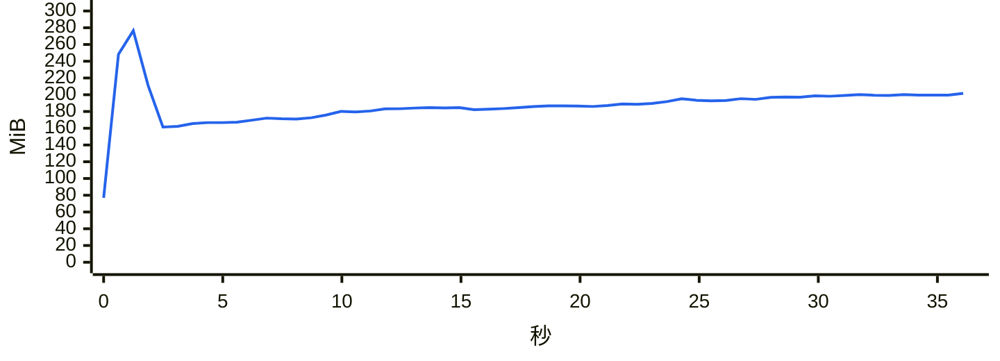

### `export messages json with images`

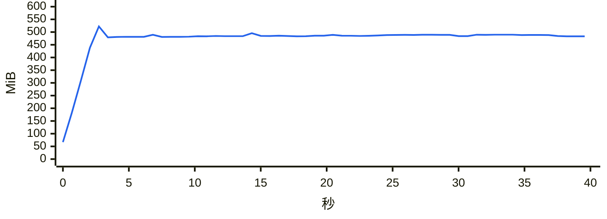

### `export messages json`

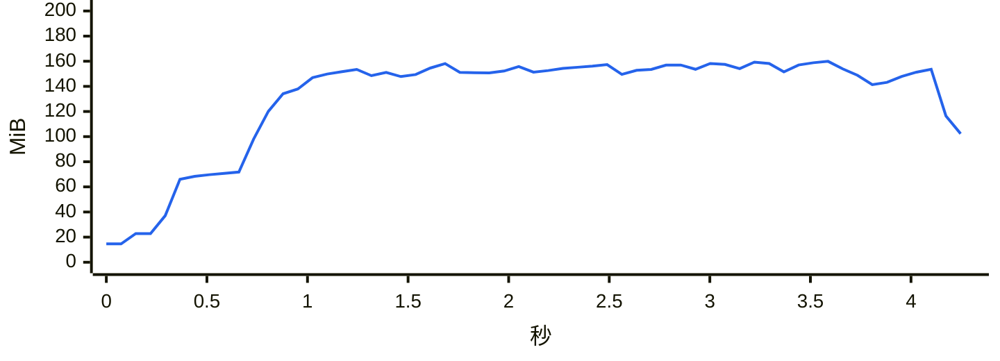

### `export messages chatlab`

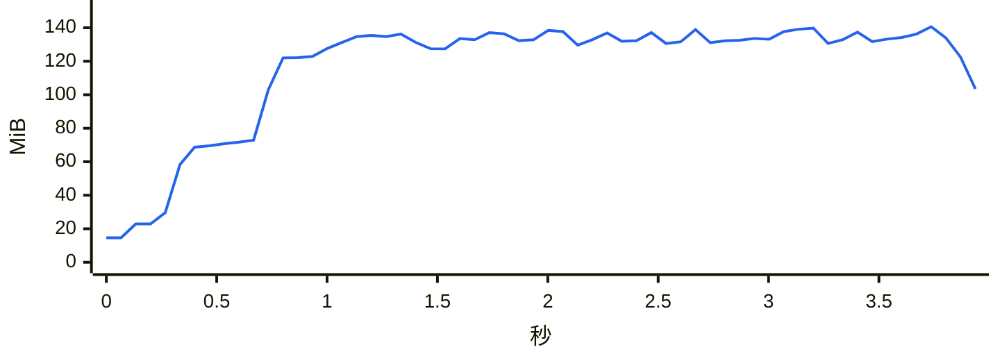

### `export messages excel`

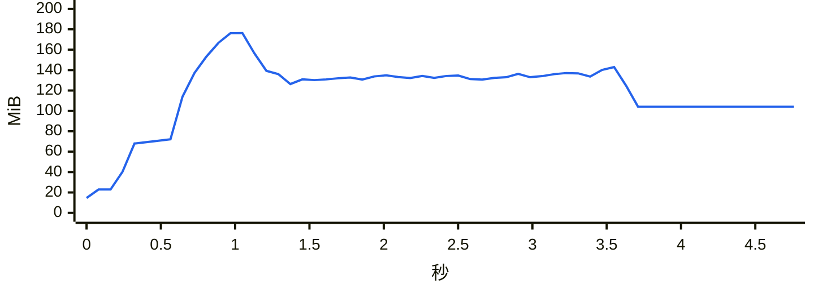

### `export messages html`

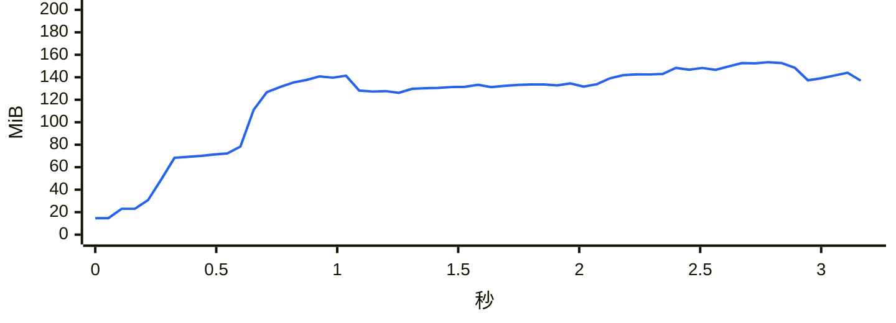

### `export messages txt`

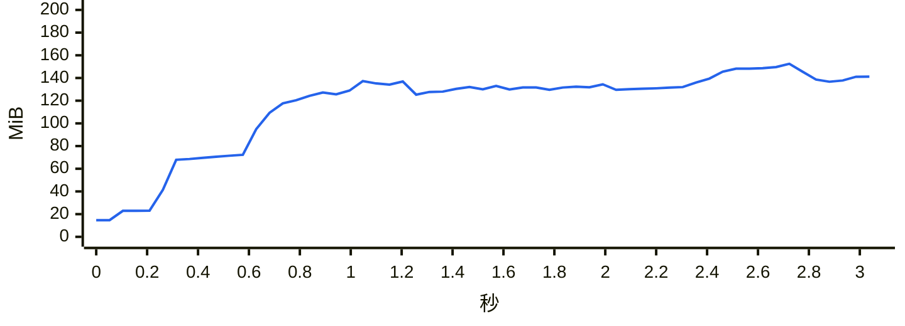

### `report annual`

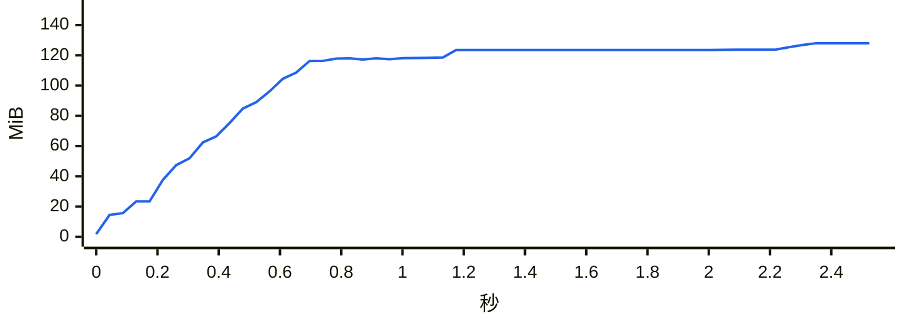

### `analytics overall`

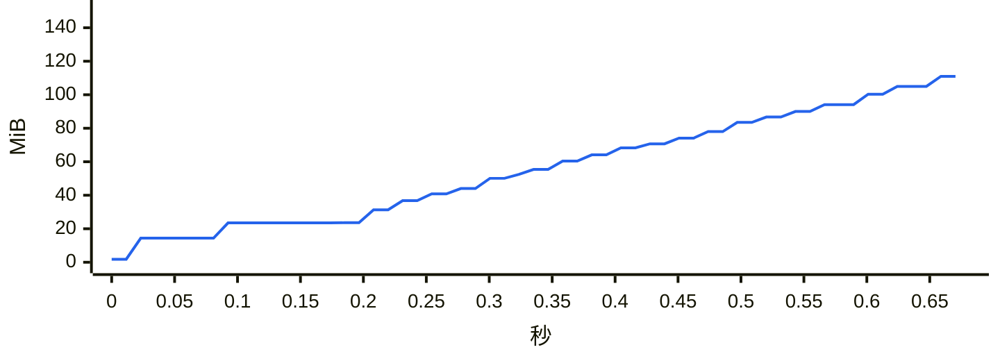

### `group members`

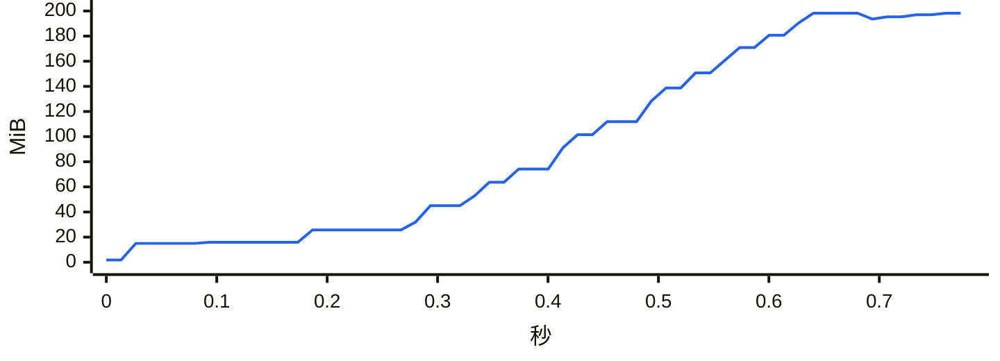

### `group ranking`

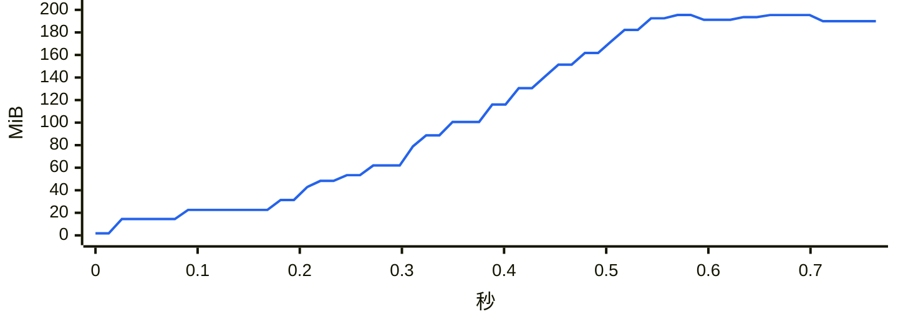

### `chat export-stats`

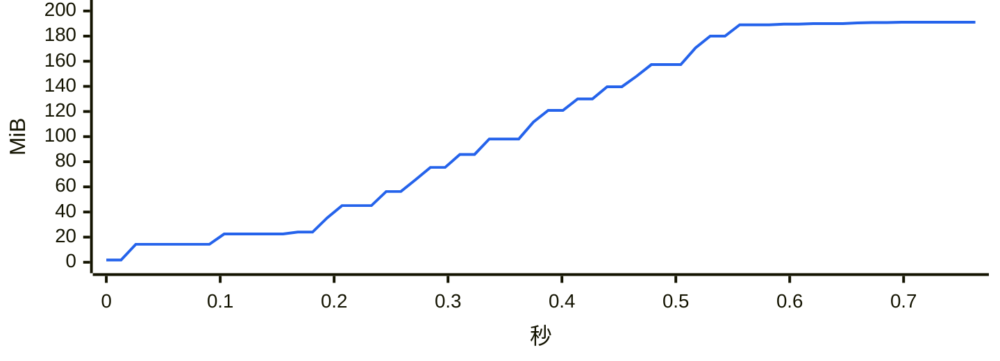

### `chat date-counts`

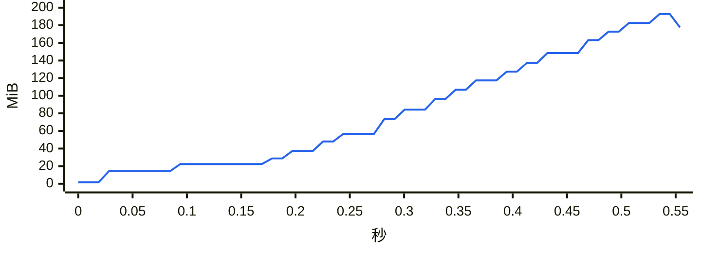

### `chat search`

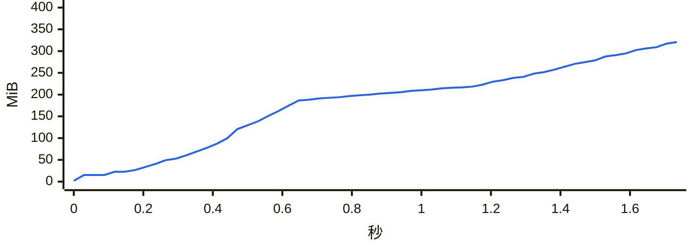

### `report dual`

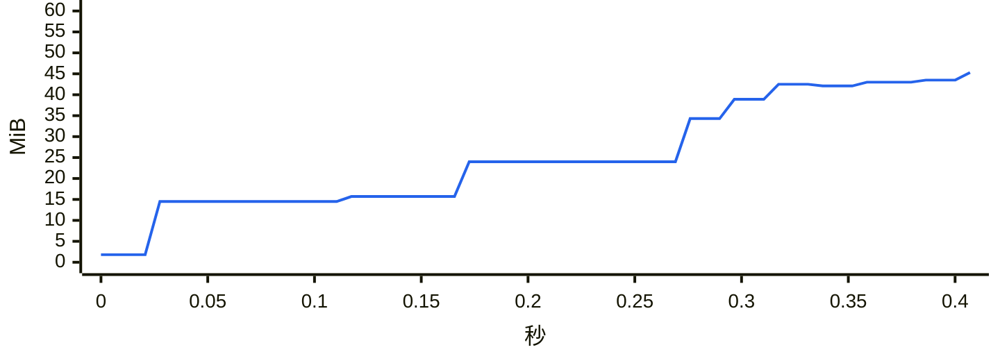

### `chat messages first page`

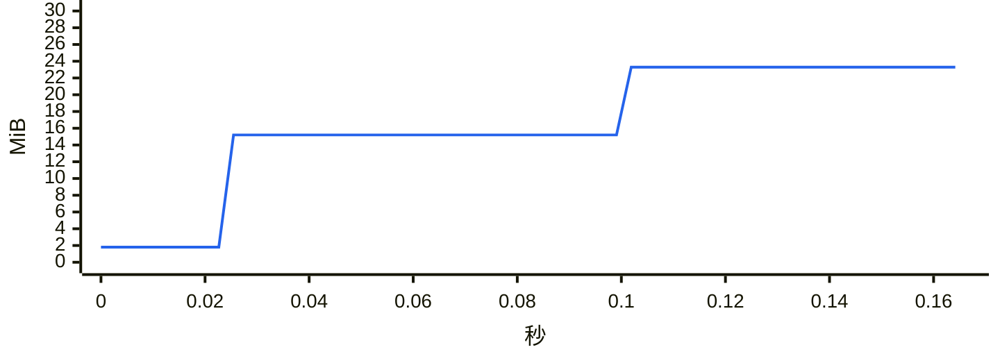

### `chat messages offset`

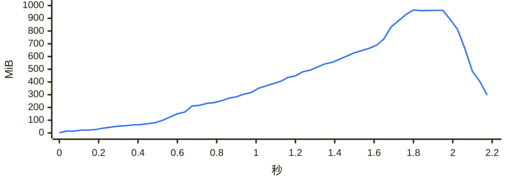
