# 基准测试：base 与 head

- base：`v4.0.0`（`4e8844c139`），weflow 4.3.0
- head：`v4.1.0`（`1161df68e4`），weflow 4.3.0
- 基准账号：种子 1，325,798 条消息，316 个会话
- runner：4 个逻辑 CPU，16.0 GiB 内存，win32 win25-vs2026
- 每条命令先各运行一次不计时，再由 base 和 head 交替各运行 5 次，取成功运行的中位数
- 比值是 head / base：▲ 表示增加超过 10%，▼ 表示减少超过 10%；差值小于噪声下限时不标（耗时 20 ms，CPU 50 ms，内存 5 MiB，路由延迟 5 ms）。除了吞吐量和每秒请求数，其余指标都是越低越好

**怎么看**：同一份代码在 runner 上对比时，耗时比值在 0.99–1.02 之间，个别命令（如 json 导出）每次在两个耗时之间跳。比值超过约 10%，并且两边最快到最慢的范围不重叠，才算真正的变化。

## 二进制体积

|  | base | head | head / base |
|---|---|---|---|
| `weflow.exe` | 24.3 MiB | 24.6 MiB | 1.01× |

## 命令

**有运行失败**（输出见 `logs/`，不计入中位数）：`export media images`（base 5 次），`export messages json with images`（base 5 次），`export messages json`（base 5 次），`export messages chatlab`（base 5 次），`export messages excel`（base 5 次），`export messages html`（base 5 次），`export messages txt`（base 5 次），`report annual`（base 5 次），`analytics overall`（base 5 次），`group members`（base 5 次），`group ranking`（base 5 次），`chat export-stats`（base 5 次），`chat date-counts`（base 5 次），`chat search`（base 5 次），`report dual`（base 5 次），`chat messages first page`（base 5 次），`chat messages offset`（base 5 次）

### 耗时（ms）

从启动到退出。括号里是最快和最慢的一次。

| 命令 | base | head | head / base |
|---|---|---|---|
| `export media images` | - | 36,570（36,143–37,969） | - |
| `export messages json with images` | - | 41,674（41,123–49,240） | - |
| `export messages json` | - | 5,197（5,114–5,269） | - |
| `export messages chatlab` | - | 4,591（4,572–4,923） | - |
| `export messages excel` | - | 6,384（6,310–6,468） | - |
| `export messages html` | - | 3,941（3,920–3,992） | - |
| `export messages txt` | - | 3,878（3,730–3,972） | - |
| `report annual` | - | 3,655（3,586–3,655） | - |
| `analytics overall` | - | 1,127（1,113–1,409） | - |
| `group members` | - | 1,342（1,330–1,358） | - |
| `group ranking` | - | 1,312（1,310–1,337） | - |
| `chat export-stats` | - | 1,289（1,273–1,320） | - |
| `chat date-counts` | - | 973（953–987） | - |
| `chat search` | - | 2,780（2,767–2,819） | - |
| `report dual` | - | 699（690–725） | - |
| `chat messages first page` | - | 330（328–359） | - |
| `chat messages offset` | - | 2,833（2,801–3,296） | - |

### 第一批结果（ms）

从启动到第一个有进度的事件（`--progress`）。不输出进度的命令没有这一项。

| 命令 | base | head | head / base |
|---|---|---|---|
| `export media images` | - | 2,349 | - |
| `export messages json with images` | - | 807 | - |
| `export messages json` | - | 714 | - |
| `export messages chatlab` | - | 864 | - |
| `export messages excel` | - | 721 | - |
| `export messages html` | - | 723 | - |
| `export messages txt` | - | 717 | - |
| `report annual` | - | 18 | - |
| `analytics overall` | - | 161 | - |
| `report dual` | - | 18 | - |

### 用户态 CPU（ms）

进程及其子进程的合计（Job Object）。Windows 的 CPU 时间精度是 15.6 ms，1 秒左右的命令差几十毫秒属于噪声。

| 命令 | base | head | head / base |
|---|---|---|---|
| `export media images` | - | 18,219 | - |
| `export messages json with images` | - | 26,797 | - |
| `export messages json` | - | 11,703 | - |
| `export messages chatlab` | - | 10,375 | - |
| `export messages excel` | - | 12,797 | - |
| `export messages html` | - | 11,125 | - |
| `export messages txt` | - | 10,391 | - |
| `report annual` | - | 3,469 | - |
| `analytics overall` | - | 1,172 | - |
| `group members` | - | 1,234 | - |
| `group ranking` | - | 1,250 | - |
| `chat export-stats` | - | 1,156 | - |
| `chat date-counts` | - | 969 | - |
| `chat search` | - | 2,531 | - |
| `report dual` | - | 719 | - |
| `chat messages first page` | - | 438 | - |
| `chat messages offset` | - | 2,281 | - |

### 内核态 CPU（ms）

进程及其子进程的合计（Job Object）。Windows 的 CPU 时间精度是 15.6 ms，1 秒左右的命令差几十毫秒属于噪声。

| 命令 | base | head | head / base |
|---|---|---|---|
| `export media images` | - | 47,047 | - |
| `export messages json with images` | - | 48,047 | - |
| `export messages json` | - | 922 | - |
| `export messages chatlab` | - | 766 | - |
| `export messages excel` | - | 1,031 | - |
| `export messages html` | - | 953 | - |
| `export messages txt` | - | 859 | - |
| `report annual` | - | 297 | - |
| `analytics overall` | - | 203 | - |
| `group members` | - | 266 | - |
| `group ranking` | - | 188 | - |
| `chat export-stats` | - | 250 | - |
| `chat date-counts` | - | 172 | - |
| `chat search` | - | 391 | - |
| `report dual` | - | 109 | - |
| `chat messages first page` | - | 78 | - |
| `chat messages offset` | - | 656 | - |

### 峰值工作集（MiB）

主进程占用物理内存的峰值。

| 命令 | base | head | head / base |
|---|---|---|---|
| `export media images` | - | 300 | - |
| `export messages json with images` | - | 605 | - |
| `export messages json` | - | 250 | - |
| `export messages chatlab` | - | 256 | - |
| `export messages excel` | - | 284 | - |
| `export messages html` | - | 266 | - |
| `export messages txt` | - | 267 | - |
| `report annual` | - | 134 | - |
| `analytics overall` | - | 120 | - |
| `group members` | - | 204 | - |
| `group ranking` | - | 209 | - |
| `chat export-stats` | - | 203 | - |
| `chat date-counts` | - | 203 | - |
| `chat search` | - | 325 | - |
| `report dual` | - | 56.1 | - |
| `chat messages first page` | - | 39.7 | - |
| `chat messages offset` | - | 959 | - |

### 峰值提交内存（MiB）

进程及其子进程提交内存的峰值，包括还没有占用物理内存的部分。

| 命令 | base | head | head / base |
|---|---|---|---|
| `export media images` | - | 443 | - |
| `export messages json with images` | - | 813 | - |
| `export messages json` | - | 455 | - |
| `export messages chatlab` | - | 446 | - |
| `export messages excel` | - | 477 | - |
| `export messages html` | - | 464 | - |
| `export messages txt` | - | 463 | - |
| `report annual` | - | 284 | - |
| `analytics overall` | - | 246 | - |
| `group members` | - | 337 | - |
| `group ranking` | - | 339 | - |
| `chat export-stats` | - | 333 | - |
| `chat date-counts` | - | 330 | - |
| `chat search` | - | 471 | - |
| `report dual` | - | 191 | - |
| `chat messages first page` | - | 162 | - |
| `chat messages offset` | - | 1,112 | - |

### 峰值线程数

每 20 ms 采样一次主进程得到的最大值。

| 命令 | base | head | head / base |
|---|---|---|---|
| `export media images` | - | 12 | - |
| `export messages json with images` | - | 12 | - |
| `export messages json` | - | 12 | - |
| `export messages chatlab` | - | 12 | - |
| `export messages excel` | - | 12 | - |
| `export messages html` | - | 12 | - |
| `export messages txt` | - | 12 | - |
| `report annual` | - | 10 | - |
| `analytics overall` | - | 10 | - |
| `group members` | - | 10 | - |
| `group ranking` | - | 10 | - |
| `chat export-stats` | - | 10 | - |
| `chat date-counts` | - | 10 | - |
| `chat search` | - | 10 | - |
| `report dual` | - | 10 | - |
| `chat messages first page` | - | 10 | - |
| `chat messages offset` | - | 10 | - |

### 读取（MiB）

逻辑 I/O，包括命中系统文件缓存的部分；Windows 不按进程统计实际的磁盘 I/O。

| 命令 | base | head | head / base |
|---|---|---|---|
| `export media images` | - | 1,157 | - |
| `export messages json with images` | - | 1,635 | - |
| `export messages json` | - | 679 | - |
| `export messages chatlab` | - | 523 | - |
| `export messages excel` | - | 557 | - |
| `export messages html` | - | 531 | - |
| `export messages txt` | - | 474 | - |
| `report annual` | - | 146 | - |
| `analytics overall` | - | 142 | - |
| `group members` | - | 207 | - |
| `group ranking` | - | 207 | - |
| `chat export-stats` | - | 232 | - |
| `chat date-counts` | - | 206 | - |
| `chat search` | - | 524 | - |
| `report dual` | - | 42.7 | - |
| `chat messages first page` | - | 28.4 | - |
| `chat messages offset` | - | 429 | - |

### 写入（MiB）

逻辑 I/O，包括命中系统文件缓存的部分；Windows 不按进程统计实际的磁盘 I/O。

| 命令 | base | head | head / base |
|---|---|---|---|
| `export media images` | - | 952 | - |
| `export messages json with images` | - | 1,381 | - |
| `export messages json` | - | 431 | - |
| `export messages chatlab` | - | 99.1 | - |
| `export messages excel` | - | 98.2 | - |
| `export messages html` | - | 122 | - |
| `export messages txt` | - | 14.6 | - |
| `report annual` | - | 0.0 | - |
| `analytics overall` | - | 0.0 | - |
| `group members` | - | 0.1 | - |
| `group ranking` | - | 0.0 | - |
| `chat export-stats` | - | 0.0 | - |
| `chat date-counts` | - | 0.0 | - |
| `chat search` | - | 0.1 | - |
| `report dual` | - | 0.0 | - |
| `chat messages first page` | - | 0.1 | - |
| `chat messages offset` | - | 36.5 | - |

### 页错误

进程及其子进程，包括软页错误。

| 命令 | base | head | head / base |
|---|---|---|---|
| `export media images` | - | 180,181 | - |
| `export messages json with images` | - | 295,385 | - |
| `export messages json` | - | 102,684 | - |
| `export messages chatlab` | - | 112,727 | - |
| `export messages excel` | - | 112,595 | - |
| `export messages html` | - | 106,352 | - |
| `export messages txt` | - | 123,008 | - |
| `report annual` | - | 37,436 | - |
| `analytics overall` | - | 32,276 | - |
| `group members` | - | 61,488 | - |
| `group ranking` | - | 59,217 | - |
| `chat export-stats` | - | 53,676 | - |
| `chat date-counts` | - | 54,449 | - |
| `chat search` | - | 91,551 | - |
| `report dual` | - | 23,253 | - |
| `chat messages first page` | - | 10,304 | - |
| `chat messages offset` | - | 248,859 | - |

### 吞吐量（消息/秒）

命令处理的消息数除以耗时。这是唯一一个越高越好的指标。

| 命令 | base | head | head / base |
|---|---|---|---|
| `export messages json with images` | - | 4,799 | - |
| `export messages json` | - | 38,484 | - |
| `export messages chatlab` | - | 43,564 | - |
| `export messages excel` | - | 31,329 | - |
| `export messages html` | - | 50,752 | - |
| `export messages txt` | - | 51,572 | - |
| `report annual` | - | 89,145 | - |
| `group members` | - | 149,076 | - |
| `group ranking` | - | 152,396 | - |
| `chat export-stats` | - | 155,156 | - |
| `chat date-counts` | - | 205,607 | - |
| `report dual` | - | 14,302 | - |
| `chat messages first page` | - | 152 | - |
| `chat messages offset` | - | 18 | - |

## `weflow serve` 持续负载

没有完成：base：weflow serve exited (2) before it listened: error: unexpected argument '--api-only' found   tip: a similar argument exists: '--api-token' Usage: weflow-base.exe serve --port <PORT> --api-token <API_TOKEN> For more information, try '--help'.；head：weflow serve exited (2) before it listened: error: unexpected argument '--api-only' found   tip: a similar argument exists: '--api-token' Usage: weflow-head.exe serve --port <PORT> --api-token <API_TOKEN> For more information, try '--help'.。完整信息见 results.json 的 `load_failed`。

## serve_bench

各路由响应时间的中位数（ms），由 `serve_bench` 在同一个基准账号上测得。路由名是它自己的；`[api]` 是进程内的 `/api/` 路由，`[sub]` 是启动子进程的路由。退出码：base 1，head 1。非 0 表示它在自己的合成账号上有检查没通过（旧版本缺少某个路由时会这样），计时照常保留，原因见 `logs/serve-bench-*.txt`。某一边不是每次都返回 200 时（例如旧版本还没有这个 `/api/` 路由，返回 404 只要零点几毫秒），格子里注明返回的状态，不计算比值。base 没有计时结果：它的 `weflow serve` 没有启动（v5.0.0 之前的版本没有现在的命令 API），见 `logs/serve-bench-base.txt`。head 没有计时结果：它的 `weflow serve` 没有启动（v5.0.0 之前的版本没有现在的命令 API），见 `logs/serve-bench-head.txt`。
## 内存曲线

主进程的工作集，每 20 ms 采样一次（持续负载每 0.5 s 一次）。命令取耗时居中的那次运行。蓝线 base，红线 head；先结束的版本在退出后记为 0。

### `export media images`

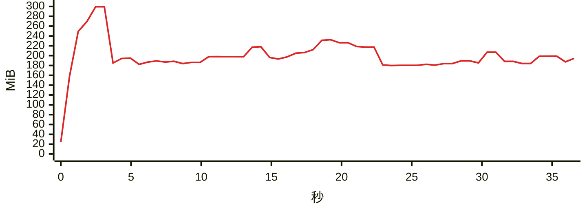

### `export messages json with images`

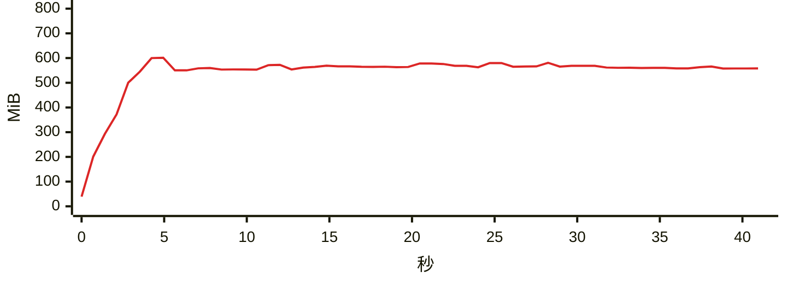

### `export messages json`

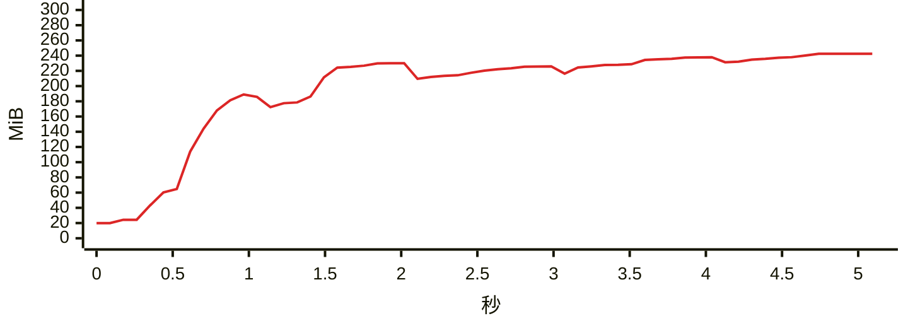

### `export messages chatlab`

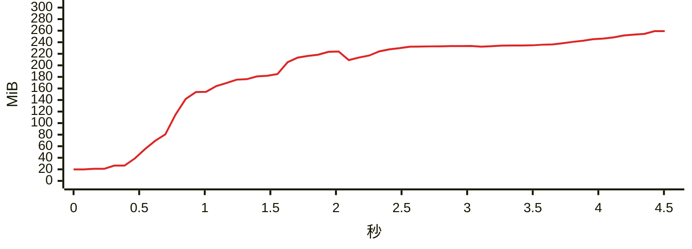

### `export messages excel`

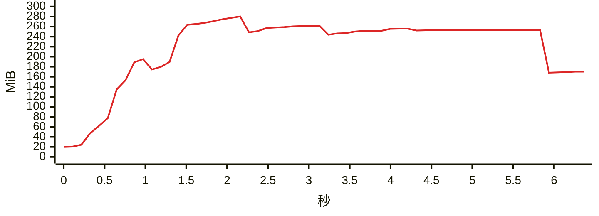

### `export messages html`

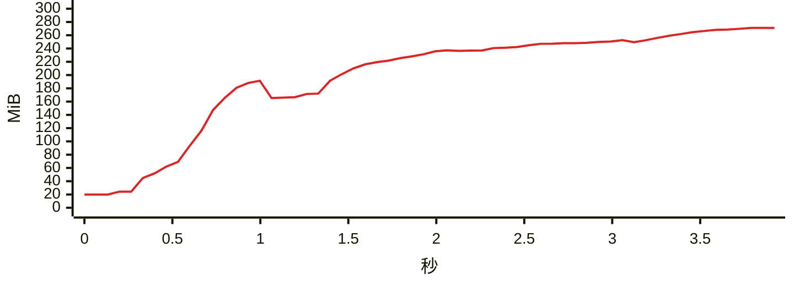

### `export messages txt`

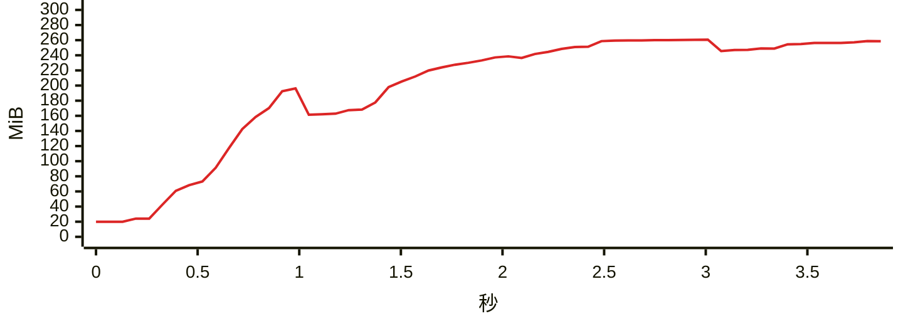

### `report annual`

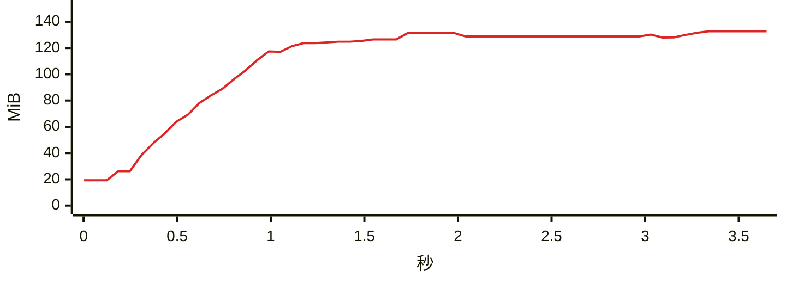

### `analytics overall`

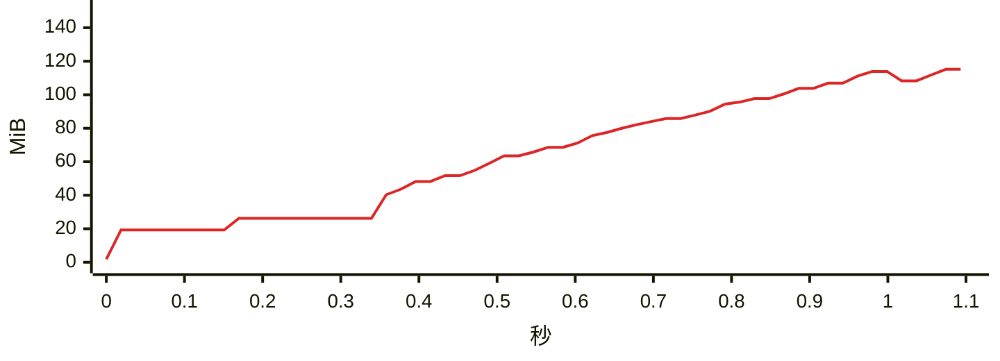

### `group members`

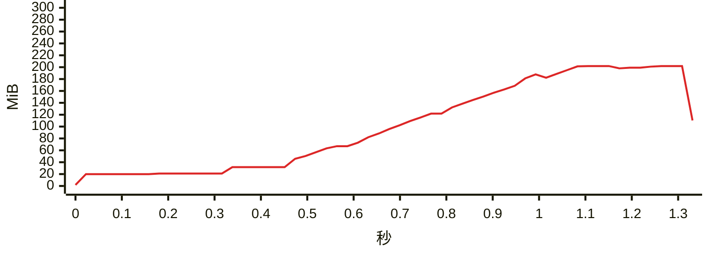

### `group ranking`

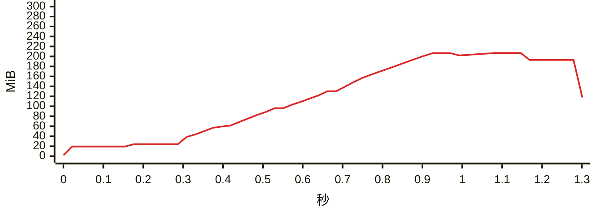

### `chat export-stats`

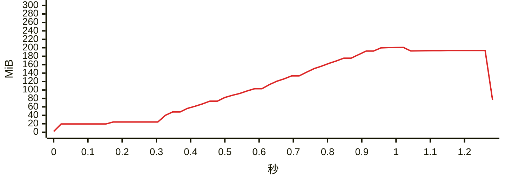

### `chat date-counts`

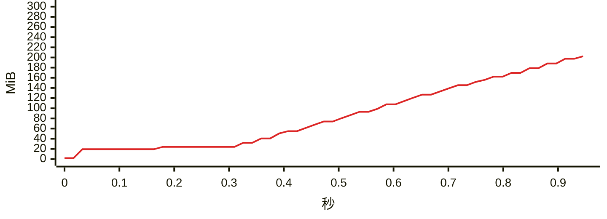

### `chat search`

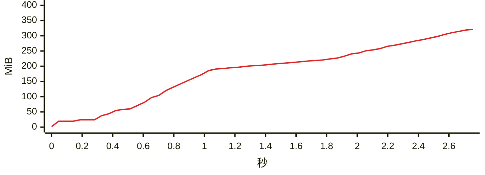

### `report dual`

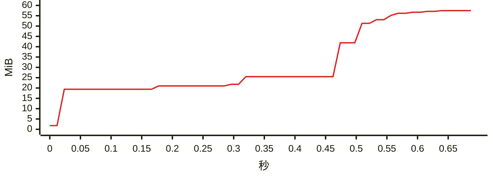

### `chat messages first page`

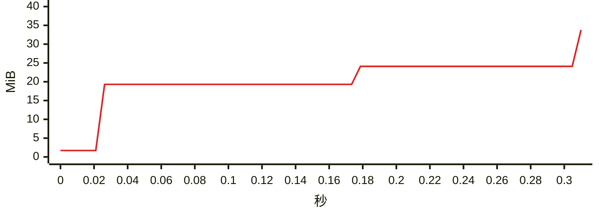

### `chat messages offset`

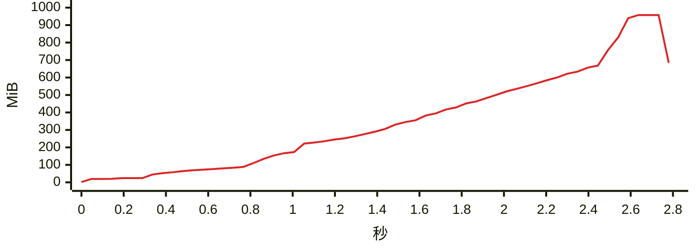
