# 基准测试：base 与 head

- base：`v4.0.0`（`4e8844c139`），weflow 4.3.0
- head：`v4.1.0`（`1161df68e4`），weflow 4.3.0
- 基准账号：种子 1，325,798 条消息，316 个会话
- runner：4 个逻辑 CPU，16.0 GiB 内存，win32 win25-vs2026
- 每条命令先各运行一次不计时，再由 base 和 head 交替各运行 5 次，取成功运行的中位数
- 比值是 head / base：▲ 表示增加超过 10%，▼ 表示减少超过 10%；差值小于噪声下限时不标（耗时 20 ms，CPU 50 ms，内存 5 MiB，路由延迟 5 ms）。除了吞吐量和每秒请求数，其余指标都是越低越好

**怎么看**：同一份代码在 runner 上对比时，耗时比值在 0.99–1.02 之间，个别命令（如 json 导出）每次在两个耗时之间跳。比值超过约 10%，并且两边最快到最慢的范围不重叠，才算真正的变化。

## 二进制体积

|  | base | head | head / base |
|---|---|---|---|
| `weflow.exe` | 24.3 MiB | 24.6 MiB | 1.01× |

## 命令

### 耗时（ms）

从启动到退出。括号里是最快和最慢的一次。

| 命令 | base | head | head / base |
|---|---|---|---|
| `export media images` | 69,037（68,179–74,277） | 42,364（41,498–50,984） | 0.61× ▼ |
| `export messages json with images` | 75,338（74,507–75,817） | 47,448（46,452–47,900） | 0.63× ▼ |
| `export messages json` | 6,239（6,169–6,313） | 5,371（5,264–5,407） | 0.86× ▼ |
| `export messages chatlab` | 5,652（5,600–5,761） | 4,854（4,752–4,892） | 0.86× ▼ |
| `export messages excel` | 8,264（8,147–8,441） | 6,755（6,727–6,892） | 0.82× ▼ |
| `export messages html` | 5,650（5,494–5,680） | 4,276（4,150–4,688） | 0.76× ▼ |
| `export messages txt` | 5,456（5,407–5,518） | 4,114（4,046–4,355） | 0.75× ▼ |
| `report annual` | 4,943（4,901–5,006） | 4,263（4,205–4,274） | 0.86× ▼ |
| `analytics overall` | 1,315（1,303–1,393） | 1,251（1,248–1,275） | 0.95× |
| `group members` | 1,398（1,376–1,417） | 1,440（1,421–1,474） | 1.03× |
| `group ranking` | 1,347（1,345–1,349） | 1,424（1,398–1,447） | 1.06× |
| `chat export-stats` | 1,308（1,265–1,325） | 1,374（1,359–1,386） | 1.05× |
| `chat date-counts` | 970（963–991） | 1,030（1,013–1,048） | 1.06× |
| `chat search` | 3,059（3,036–3,081） | 3,080（3,072–3,125） | 1.01× |
| `report dual` | 741（728–778） | 740（733–745） | 1.00× |
| `chat messages first page` | 357（338–379） | 358（337–363） | 1.00× |
| `chat messages offset` | 3,426（3,410–3,508） | 3,129（3,084–3,200） | 0.91× |

### 第一批结果（ms）

从启动到第一个有进度的事件（`--progress`）。不输出进度的命令没有这一项。

| 命令 | base | head | head / base |
|---|---|---|---|
| `export media images` | 2,530 | 2,476 | 0.98× |
| `export messages json with images` | 1,192 | 845 | 0.71× ▼ |
| `export messages json` | 1,137 | 776 | 0.68× ▼ |
| `export messages chatlab` | 1,149 | 974 | 0.85× ▼ |
| `export messages excel` | 1,145 | 800 | 0.70× ▼ |
| `export messages html` | 1,155 | 795 | 0.69× ▼ |
| `export messages txt` | 1,144 | 820 | 0.72× ▼ |
| `report annual` | 18 | 18 | 0.98× |
| `analytics overall` | 169 | 165 | 0.97× |
| `report dual` | 17 | 17 | 1.01× |

### 用户态 CPU（ms）

进程及其子进程的合计（Job Object）。Windows 的 CPU 时间精度是 15.6 ms，1 秒左右的命令差几十毫秒属于噪声。

| 命令 | base | head | head / base |
|---|---|---|---|
| `export media images` | 119,344 | 20,781 | 0.17× ▼ |
| `export messages json with images` | 126,359 | 28,141 | 0.22× ▼ |
| `export messages json` | 14,641 | 12,031 | 0.82× ▼ |
| `export messages chatlab` | 12,062 | 10,734 | 0.89× ▼ |
| `export messages excel` | 14,719 | 13,188 | 0.90× ▼ |
| `export messages html` | 12,141 | 11,906 | 0.98× |
| `export messages txt` | 11,141 | 11,203 | 1.01× |
| `report annual` | 4,625 | 3,984 | 0.86× ▼ |
| `analytics overall` | 1,266 | 1,172 | 0.93× |
| `group members` | 1,328 | 1,422 | 1.07× |
| `group ranking` | 1,312 | 1,328 | 1.01× |
| `chat export-stats` | 1,281 | 1,297 | 1.01× |
| `chat date-counts` | 969 | 984 | 1.02× |
| `chat search` | 2,781 | 2,688 | 0.97× |
| `report dual` | 812 | 797 | 0.98× |
| `chat messages first page` | 469 | 453 | 0.97× |
| `chat messages offset` | 2,875 | 2,703 | 0.94× |

### 内核态 CPU（ms）

进程及其子进程的合计（Job Object）。Windows 的 CPU 时间精度是 15.6 ms，1 秒左右的命令差几十毫秒属于噪声。

| 命令 | base | head | head / base |
|---|---|---|---|
| `export media images` | 118,000 | 60,562 | 0.51× ▼ |
| `export messages json with images` | 119,812 | 62,172 | 0.52× ▼ |
| `export messages json` | 828 | 1,094 | 1.32× ▲ |
| `export messages chatlab` | 609 | 812 | 1.33× ▲ |
| `export messages excel` | 781 | 1,188 | 1.52× ▲ |
| `export messages html` | 641 | 953 | 1.49× ▲ |
| `export messages txt` | 781 | 797 | 1.02× |
| `report annual` | 422 | 344 | 0.81× ▼ |
| `analytics overall` | 188 | 234 | 1.25× |
| `group members` | 203 | 203 | 1.00× |
| `group ranking` | 172 | 234 | 1.36× ▲ |
| `chat export-stats` | 188 | 234 | 1.25× |
| `chat date-counts` | 156 | 172 | 1.10× |
| `chat search` | 422 | 516 | 1.22× ▲ |
| `report dual` | 109 | 94 | 0.86× |
| `chat messages first page` | 62 | 47 | 0.75× |
| `chat messages offset` | 719 | 531 | 0.74× ▼ |

### 峰值工作集（MiB）

主进程占用物理内存的峰值。

| 命令 | base | head | head / base |
|---|---|---|---|
| `export media images` | 277 | 300 | 1.08× |
| `export messages json with images` | 529 | 615 | 1.16× ▲ |
| `export messages json` | 162 | 260 | 1.61× ▲ |
| `export messages chatlab` | 144 | 258 | 1.79× ▲ |
| `export messages excel` | 176 | 279 | 1.59× ▲ |
| `export messages html` | 142 | 269 | 1.89× ▲ |
| `export messages txt` | 143 | 261 | 1.82× ▲ |
| `report annual` | 129 | 135 | 1.04× |
| `analytics overall` | 116 | 120 | 1.03× |
| `group members` | 200 | 204 | 1.02× |
| `group ranking` | 198 | 201 | 1.02× |
| `chat export-stats` | 201 | 203 | 1.01× |
| `chat date-counts` | 196 | 202 | 1.03× |
| `chat search` | 320 | 325 | 1.02× |
| `report dual` | 45.8 | 55.5 | 1.21× ▲ |
| `chat messages first page` | 31.7 | 38.0 | 1.20× ▲ |
| `chat messages offset` | 968 | 958 | 0.99× |

### 峰值提交内存（MiB）

进程及其子进程提交内存的峰值，包括还没有占用物理内存的部分。

| 命令 | base | head | head / base |
|---|---|---|---|
| `export media images` | 268 | 443 | 1.65× ▲ |
| `export messages json with images` | 553 | 812 | 1.47× ▲ |
| `export messages json` | 153 | 461 | 3.02× ▲ |
| `export messages chatlab` | 136 | 443 | 3.27× ▲ |
| `export messages excel` | 172 | 467 | 2.71× ▲ |
| `export messages html` | 134 | 468 | 3.49× ▲ |
| `export messages txt` | 134 | 466 | 3.46× ▲ |
| `report annual` | 115 | 284 | 2.46× ▲ |
| `analytics overall` | 103 | 246 | 2.38× ▲ |
| `group members` | 196 | 337 | 1.73× ▲ |
| `group ranking` | 194 | 329 | 1.70× ▲ |
| `chat export-stats` | 189 | 333 | 1.76× ▲ |
| `chat date-counts` | 188 | 329 | 1.75× ▲ |
| `chat search` | 328 | 471 | 1.43× ▲ |
| `report dual` | 32.5 | 191 | 5.89× ▲ |
| `chat messages first page` | 19.2 | 161 | 8.40× ▲ |
| `chat messages offset` | 977 | 1,112 | 1.14× ▲ |

### 峰值线程数

每 20 ms 采样一次主进程得到的最大值。

| 命令 | base | head | head / base |
|---|---|---|---|
| `export media images` | 12 | 12 | 1.00× |
| `export messages json with images` | 13 | 12 | 0.92× |
| `export messages json` | 13 | 12 | 0.92× |
| `export messages chatlab` | 13 | 12 | 0.92× |
| `export messages excel` | 13 | 12 | 0.92× |
| `export messages html` | 13 | 12 | 0.92× |
| `export messages txt` | 13 | 12 | 0.92× |
| `report annual` | 10 | 10 | 1.00× |
| `analytics overall` | 10 | 10 | 1.00× |
| `group members` | 10 | 10 | 1.00× |
| `group ranking` | 10 | 10 | 1.00× |
| `chat export-stats` | 10 | 10 | 1.00× |
| `chat date-counts` | 10 | 10 | 1.00× |
| `chat search` | 10 | 10 | 1.00× |
| `report dual` | 10 | 10 | 1.00× |
| `chat messages first page` | 10 | 10 | 1.00× |
| `chat messages offset` | 10 | 10 | 1.00× |

### 读取（MiB）

逻辑 I/O，包括命中系统文件缓存的部分；Windows 不按进程统计实际的磁盘 I/O。

| 命令 | base | head | head / base |
|---|---|---|---|
| `export media images` | 900 | 1,157 | 1.29× ▲ |
| `export messages json with images` | 1,325 | 1,632 | 1.23× ▲ |
| `export messages json` | 633 | 685 | 1.08× |
| `export messages chatlab` | 467 | 529 | 1.13× ▲ |
| `export messages excel` | 504 | 561 | 1.11× ▲ |
| `export messages html` | 479 | 536 | 1.12× ▲ |
| `export messages txt` | 417 | 477 | 1.14× ▲ |
| `report annual` | 146 | 146 | 1.00× |
| `analytics overall` | 142 | 142 | 1.00× |
| `group members` | 207 | 207 | 1.00× |
| `group ranking` | 207 | 207 | 1.00× |
| `chat export-stats` | 232 | 232 | 1.00× |
| `chat date-counts` | 206 | 206 | 1.00× |
| `chat search` | 524 | 524 | 1.00× |
| `report dual` | 42.7 | 42.7 | 1.00× |
| `chat messages first page` | 28.4 | 28.4 | 1.00× |
| `chat messages offset` | 429 | 429 | 1.00× |

### 写入（MiB）

逻辑 I/O，包括命中系统文件缓存的部分；Windows 不按进程统计实际的磁盘 I/O。

| 命令 | base | head | head / base |
|---|---|---|---|
| `export media images` | 952 | 952 | 1.00× |
| `export messages json with images` | 1,381 | 1,381 | 1.00× |
| `export messages json` | 431 | 431 | 1.00× |
| `export messages chatlab` | 99.1 | 99.1 | 1.00× |
| `export messages excel` | 98.2 | 98.2 | 1.00× |
| `export messages html` | 122 | 122 | 1.00× |
| `export messages txt` | 14.6 | 14.6 | 1.00× |
| `report annual` | 0.0 | 0.0 | 1.00× |
| `analytics overall` | 0.0 | 0.0 | 1.00× |
| `group members` | 0.1 | 0.1 | 1.00× |
| `group ranking` | 0.0 | 0.0 | 1.00× |
| `chat export-stats` | 0.0 | 0.0 | 1.00× |
| `chat date-counts` | 0.0 | 0.0 | 1.00× |
| `chat search` | 0.1 | 0.1 | 1.00× |
| `report dual` | 0.0 | 0.0 | 1.00× |
| `chat messages first page` | 0.1 | 0.1 | 1.00× |
| `chat messages offset` | 36.5 | 36.5 | 1.00× |

### 页错误

进程及其子进程，包括软页错误。

| 命令 | base | head | head / base |
|---|---|---|---|
| `export media images` | 10,551,466 | 183,383 | 0.02× ▼ |
| `export messages json with images` | 10,657,175 | 294,427 | 0.03× ▼ |
| `export messages json` | 130,524 | 101,886 | 0.78× ▼ |
| `export messages chatlab` | 143,537 | 122,192 | 0.85× ▼ |
| `export messages excel` | 158,060 | 119,171 | 0.75× ▼ |
| `export messages html` | 145,565 | 109,202 | 0.75× ▼ |
| `export messages txt` | 146,608 | 103,810 | 0.71× ▼ |
| `report annual` | 43,395 | 37,687 | 0.87× ▼ |
| `analytics overall` | 37,930 | 32,301 | 0.85× ▼ |
| `group members` | 63,213 | 61,340 | 0.97× |
| `group ranking` | 61,221 | 58,097 | 0.95× |
| `chat export-stats` | 56,594 | 53,229 | 0.94× |
| `chat date-counts` | 57,499 | 54,338 | 0.95× |
| `chat search` | 94,754 | 92,069 | 0.97× |
| `report dual` | 27,083 | 22,758 | 0.84× ▼ |
| `chat messages first page` | 13,374 | 9,873 | 0.74× ▼ |
| `chat messages offset` | 259,426 | 248,674 | 0.96× |

### 吞吐量（消息/秒）

命令处理的消息数除以耗时。这是唯一一个越高越好的指标。

| 命令 | base | head | head / base |
|---|---|---|---|
| `export messages json with images` | 2,655 | 4,215 | 1.59× ▲ |
| `export messages json` | 32,055 | 37,237 | 1.16× ▲ |
| `export messages chatlab` | 35,388 | 41,205 | 1.16× ▲ |
| `export messages excel` | 24,202 | 29,607 | 1.22× ▲ |
| `export messages html` | 35,399 | 46,768 | 1.32× ▲ |
| `export messages txt` | 36,657 | 48,619 | 1.33× ▲ |
| `report annual` | 65,907 | 76,417 | 1.16× ▲ |
| `group members` | 143,021 | 138,914 | 0.97× |
| `group ranking` | 148,450 | 140,407 | 0.95× |
| `chat export-stats` | 152,886 | 145,613 | 0.95× |
| `chat date-counts` | 206,141 | 194,104 | 0.94× |
| `report dual` | 13,495 | 13,521 | 1.00× |
| `chat messages first page` | 140 | 140 | 1.00× |
| `chat messages offset` | 15 | 16 | 1.09× |

## `weflow serve` 持续负载

没有完成：base：weflow serve exited (2) before it listened: error: unexpected argument '--api-only' found   tip: a similar argument exists: '--api-token' Usage: weflow-base.exe serve --port <PORT> --api-token <API_TOKEN> For more information, try '--help'.；head：weflow serve exited (2) before it listened: error: unexpected argument '--api-only' found   tip: a similar argument exists: '--api-token' Usage: weflow-head.exe serve --port <PORT> --api-token <API_TOKEN> For more information, try '--help'.。完整信息见 results.json 的 `load_failed`。

## serve_bench

各路由响应时间的中位数（ms），由 `serve_bench` 在同一个基准账号上测得。路由名是它自己的；`[api]` 是进程内的 `/api/` 路由，`[sub]` 是启动子进程的路由。退出码：base 1，head 1。非 0 表示它在自己的合成账号上有检查没通过（旧版本缺少某个路由时会这样），计时照常保留，原因见 `logs/serve-bench-*.txt`。某一边不是每次都返回 200 时（例如旧版本还没有这个 `/api/` 路由，返回 404 只要零点几毫秒），格子里注明返回的状态，不计算比值。base 没有计时结果：它的 `weflow serve` 没有启动（v5.0.0 之前的版本没有现在的命令 API），见 `logs/serve-bench-base.txt`。head 没有计时结果：它的 `weflow serve` 没有启动（v5.0.0 之前的版本没有现在的命令 API），见 `logs/serve-bench-head.txt`。
## 内存曲线

主进程的工作集，每 20 ms 采样一次（持续负载每 0.5 s 一次）。命令取耗时居中的那次运行。蓝线 base，红线 head；先结束的版本在退出后记为 0。

### `export media images`

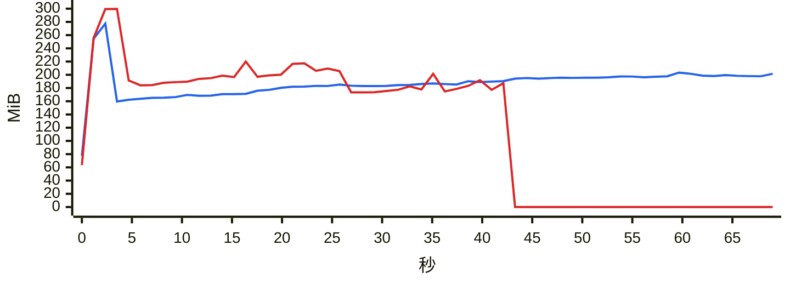

### `export messages json with images`

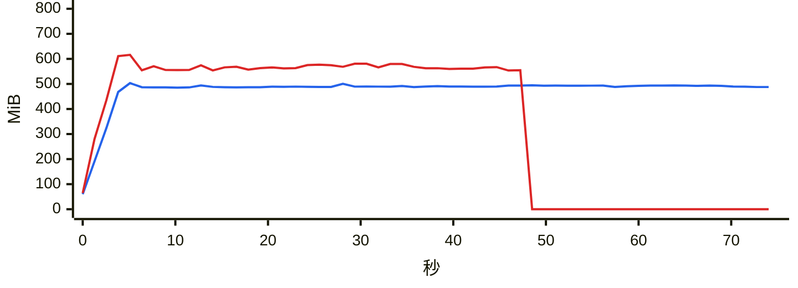

### `export messages json`

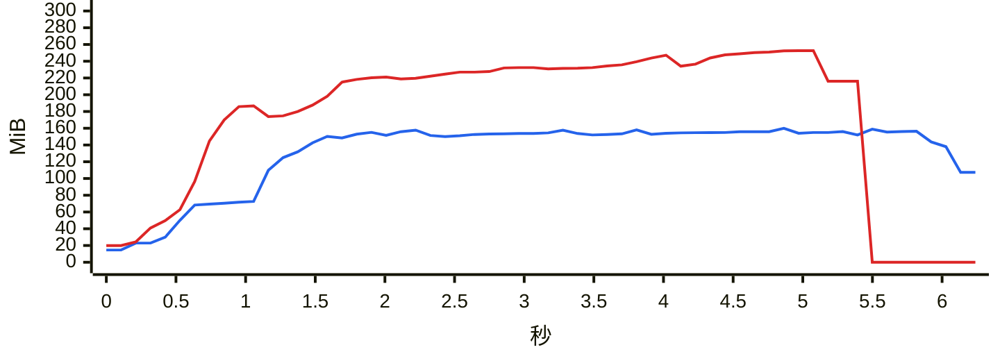

### `export messages chatlab`

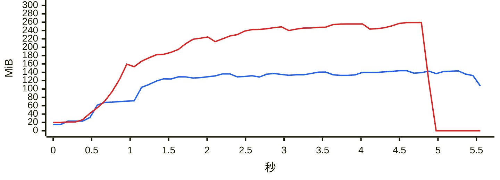

### `export messages excel`

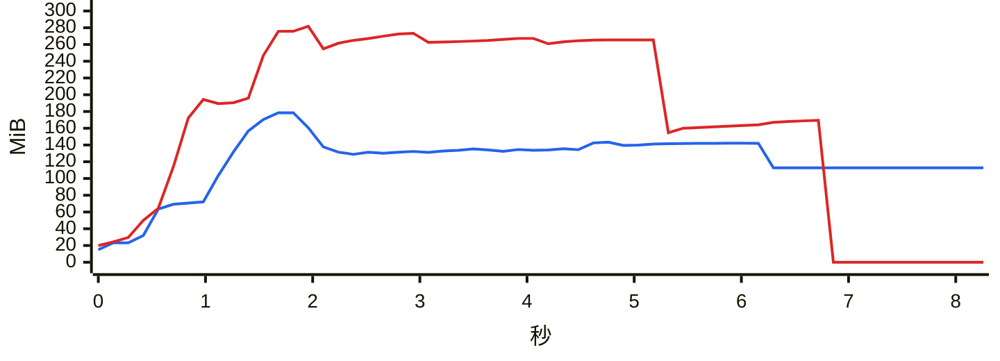

### `export messages html`

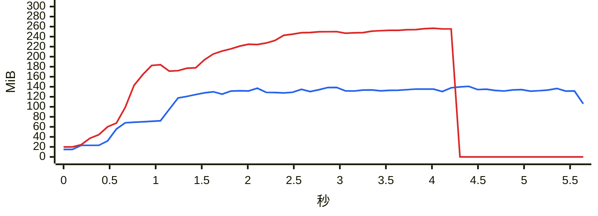

### `export messages txt`

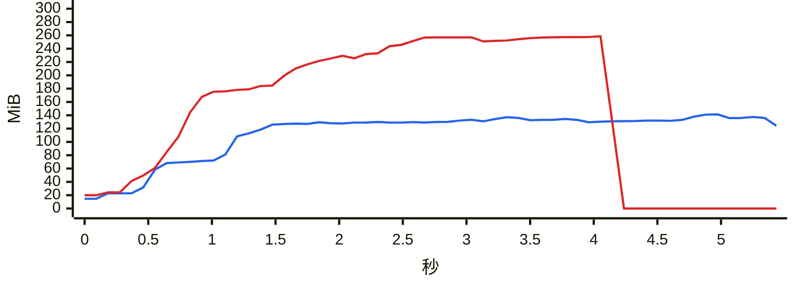

### `report annual`

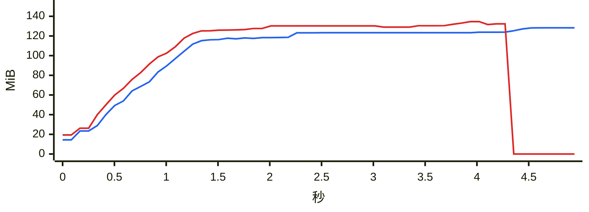

### `analytics overall`

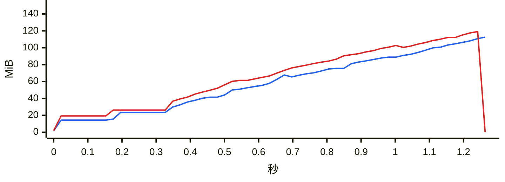

### `group members`

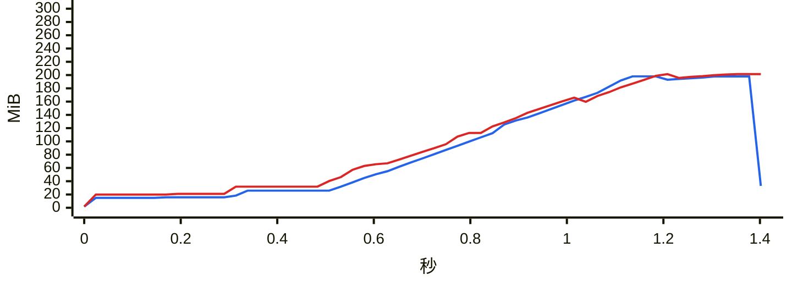

### `group ranking`

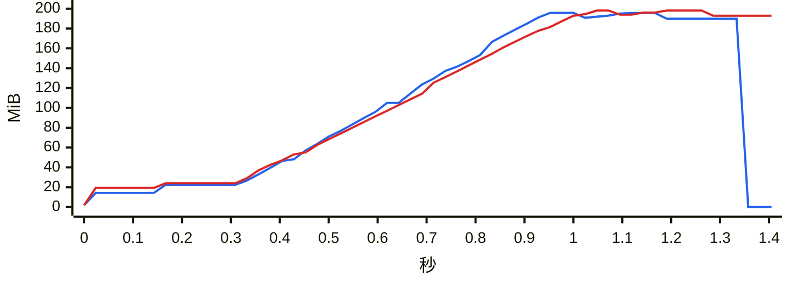

### `chat export-stats`

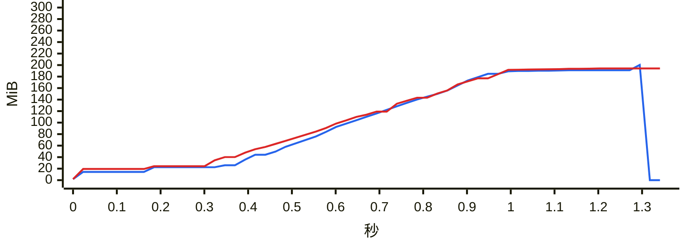

### `chat date-counts`

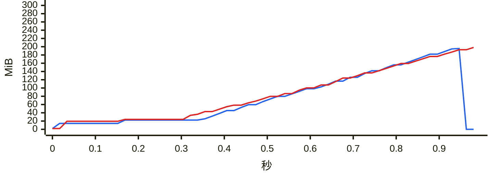

### `chat search`

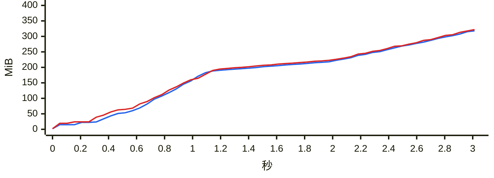

### `report dual`

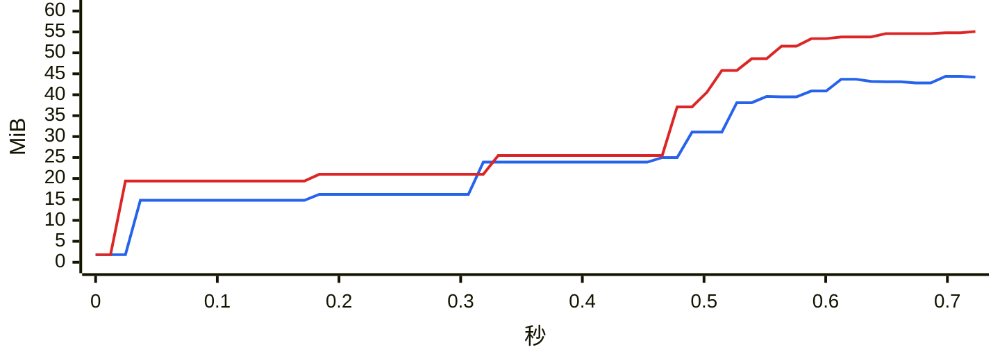

### `chat messages first page`

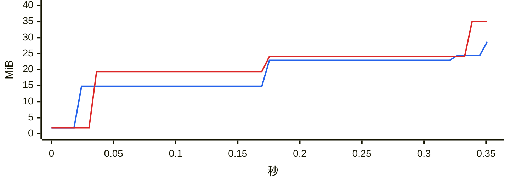

### `chat messages offset`

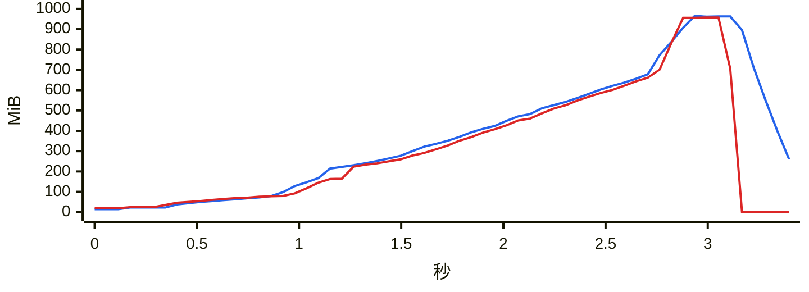
