# 基准测试：base 与 head

- base：`v4.1.0`（`1161df68e4`），weflow 4.3.0
- head：`v4.2.0`（`0ca791423b`），weflow 4.2.0
- 基准账号：种子 1，325,798 条消息，316 个会话
- runner：4 个逻辑 CPU，16.0 GiB 内存，win32 win25-vs2026
- 每条命令先各运行一次不计时，再由 base 和 head 交替各运行 5 次，取成功运行的中位数
- 比值是 head / base：▲ 表示增加超过 10%，▼ 表示减少超过 10%；差值小于噪声下限时不标（耗时 20 ms，CPU 50 ms，内存 5 MiB，路由延迟 5 ms）。除了吞吐量和每秒请求数，其余指标都是越低越好

**怎么看**：同一份代码在 runner 上对比时，耗时比值在 0.99–1.02 之间，个别命令（如 json 导出）每次在两个耗时之间跳。比值超过约 10%，并且两边最快到最慢的范围不重叠，才算真正的变化。

## 二进制体积

|  | base | head | head / base |
|---|---|---|---|
| `weflow.exe` | 24.6 MiB | 24.8 MiB | 1.01× |

## 命令

### 耗时（ms）

从启动到退出。括号里是最快和最慢的一次。

| 命令 | base | head | head / base |
|---|---|---|---|
| `export media images` | 33,337（31,086–35,563） | 20,867（20,651–21,608） | 0.63× ▼ |
| `export messages json with images` | 35,813（35,577–37,408） | 24,002（23,902–24,481） | 0.67× ▼ |
| `export messages json` | 4,290（4,158–4,347） | 4,276（4,208–4,302） | 1.00× |
| `export messages chatlab` | 3,874（3,797–3,946） | 3,855（3,841–3,933） | 1.00× |
| `export messages excel` | 5,484（5,432–5,545） | 5,498（5,461–5,544） | 1.00× |
| `export messages html` | 3,346（3,332–3,383） | 3,379（3,341–3,438） | 1.01× |
| `export messages txt` | 3,275（3,270–3,391） | 3,316（3,244–3,392） | 1.01× |
| `report annual` | 3,285（3,249–3,302） | 3,332（3,305–3,350） | 1.01× |
| `analytics overall` | 994（986–1,051） | 997（982–1,015） | 1.00× |
| `group members` | 1,180（1,176–1,188） | 1,174（1,164–1,228） | 1.00× |
| `group ranking` | 1,189（1,150–1,237） | 1,192（1,160–1,257） | 1.00× |
| `chat export-stats` | 1,122（1,116–1,150） | 1,141（1,113–1,160） | 1.02× |
| `chat date-counts` | 833（828–864） | 838（825–844） | 1.01× |
| `chat search` | 2,398（2,370–2,417） | 2,400（2,363–2,452） | 1.00× |
| `report dual` | 617（602–622） | 612（603–645） | 0.99× |
| `chat messages first page` | 304（291–332） | 296（289–314） | 0.98× |
| `chat messages offset` | 2,516（2,481–2,557） | 2,506（2,476–2,539） | 1.00× |

### 第一批结果（ms）

从启动到第一个有进度的事件（`--progress`）。不输出进度的命令没有这一项。

| 命令 | base | head | head / base |
|---|---|---|---|
| `export media images` | 1,953 | 1,904 | 0.97× |
| `export messages json with images` | 616 | 630 | 1.02× |
| `export messages json` | 653 | 633 | 0.97× |
| `export messages chatlab` | 763 | 753 | 0.99× |
| `export messages excel` | 638 | 635 | 0.99× |
| `export messages html` | 634 | 639 | 1.01× |
| `export messages txt` | 636 | 641 | 1.01× |
| `report annual` | 15 | 15 | 1.02× |
| `analytics overall` | 144 | 144 | 1.00× |
| `report dual` | 14 | 15 | 1.03× |

### 用户态 CPU（ms）

进程及其子进程的合计（Job Object）。Windows 的 CPU 时间精度是 15.6 ms，1 秒左右的命令差几十毫秒属于噪声。

| 命令 | base | head | head / base |
|---|---|---|---|
| `export media images` | 14,562 | 12,766 | 0.88× ▼ |
| `export messages json with images` | 22,391 | 19,031 | 0.85× ▼ |
| `export messages json` | 9,688 | 9,875 | 1.02× |
| `export messages chatlab` | 8,641 | 8,531 | 0.99× |
| `export messages excel` | 10,969 | 10,984 | 1.00× |
| `export messages html` | 9,328 | 9,484 | 1.02× |
| `export messages txt` | 9,094 | 8,953 | 0.98× |
| `report annual` | 3,094 | 3,156 | 1.02× |
| `analytics overall` | 953 | 984 | 1.03× |
| `group members` | 1,125 | 1,125 | 1.00× |
| `group ranking` | 1,109 | 1,125 | 1.01× |
| `chat export-stats` | 1,094 | 1,078 | 0.99× |
| `chat date-counts` | 828 | 781 | 0.94× |
| `chat search` | 2,156 | 2,125 | 0.99× |
| `report dual` | 672 | 672 | 1.00× |
| `chat messages first page` | 359 | 344 | 0.96× |
| `chat messages offset` | 2,031 | 2,078 | 1.02× |

### 内核态 CPU（ms）

进程及其子进程的合计（Job Object）。Windows 的 CPU 时间精度是 15.6 ms，1 秒左右的命令差几十毫秒属于噪声。

| 命令 | base | head | head / base |
|---|---|---|---|
| `export media images` | 42,141 | 23,859 | 0.57× ▼ |
| `export messages json with images` | 43,844 | 24,891 | 0.57× ▼ |
| `export messages json` | 875 | 797 | 0.91× |
| `export messages chatlab` | 719 | 719 | 1.00× |
| `export messages excel` | 828 | 922 | 1.11× ▲ |
| `export messages html` | 734 | 688 | 0.94× |
| `export messages txt` | 766 | 688 | 0.90× ▼ |
| `report annual` | 297 | 328 | 1.11× |
| `analytics overall` | 172 | 188 | 1.09× |
| `group members` | 188 | 203 | 1.08× |
| `group ranking` | 203 | 203 | 1.00× |
| `chat export-stats` | 141 | 188 | 1.33× |
| `chat date-counts` | 156 | 188 | 1.20× |
| `chat search` | 375 | 359 | 0.96× |
| `report dual` | 62 | 109 | 1.75× |
| `chat messages first page` | 78 | 78 | 1.00× |
| `chat messages offset` | 625 | 531 | 0.85× ▼ |

### 峰值工作集（MiB）

主进程占用物理内存的峰值。

| 命令 | base | head | head / base |
|---|---|---|---|
| `export media images` | 299 | 299 | 1.00× |
| `export messages json with images` | 619 | 614 | 0.99× |
| `export messages json` | 255 | 260 | 1.02× |
| `export messages chatlab` | 258 | 263 | 1.02× |
| `export messages excel` | 287 | 288 | 1.00× |
| `export messages html` | 266 | 271 | 1.02× |
| `export messages txt` | 265 | 270 | 1.02× |
| `report annual` | 134 | 135 | 1.01× |
| `analytics overall` | 124 | 124 | 1.00× |
| `group members` | 216 | 214 | 0.99× |
| `group ranking` | 204 | 205 | 1.01× |
| `chat export-stats` | 203 | 203 | 1.00× |
| `chat date-counts` | 206 | 202 | 0.98× |
| `chat search` | 326 | 327 | 1.00× |
| `report dual` | 54.7 | 55.4 | 1.01× |
| `chat messages first page` | 41.2 | 37.2 | 0.90× |
| `chat messages offset` | 959 | 959 | 1.00× |

### 峰值提交内存（MiB）

进程及其子进程提交内存的峰值，包括还没有占用物理内存的部分。

| 命令 | base | head | head / base |
|---|---|---|---|
| `export media images` | 443 | 443 | 1.00× |
| `export messages json with images` | 825 | 819 | 0.99× |
| `export messages json` | 452 | 447 | 0.99× |
| `export messages chatlab` | 446 | 445 | 1.00× |
| `export messages excel` | 472 | 485 | 1.03× |
| `export messages html` | 461 | 467 | 1.01× |
| `export messages txt` | 462 | 459 | 0.99× |
| `report annual` | 283 | 283 | 1.00× |
| `analytics overall` | 252 | 251 | 1.00× |
| `group members` | 352 | 349 | 0.99× |
| `group ranking` | 336 | 334 | 1.00× |
| `chat export-stats` | 333 | 333 | 1.00× |
| `chat date-counts` | 334 | 331 | 0.99× |
| `chat search` | 471 | 471 | 1.00× |
| `report dual` | 191 | 191 | 1.00× |
| `chat messages first page` | 164 | 164 | 1.00× |
| `chat messages offset` | 1,112 | 1,112 | 1.00× |

### 峰值线程数

每 20 ms 采样一次主进程得到的最大值。

| 命令 | base | head | head / base |
|---|---|---|---|
| `export media images` | 12 | 12 | 1.00× |
| `export messages json with images` | 12 | 12 | 1.00× |
| `export messages json` | 12 | 12 | 1.00× |
| `export messages chatlab` | 12 | 12 | 1.00× |
| `export messages excel` | 12 | 12 | 1.00× |
| `export messages html` | 12 | 12 | 1.00× |
| `export messages txt` | 12 | 12 | 1.00× |
| `report annual` | 10 | 10 | 1.00× |
| `analytics overall` | 10 | 10 | 1.00× |
| `group members` | 10 | 10 | 1.00× |
| `group ranking` | 10 | 10 | 1.00× |
| `chat export-stats` | 10 | 10 | 1.00× |
| `chat date-counts` | 10 | 10 | 1.00× |
| `chat search` | 10 | 10 | 1.00× |
| `report dual` | 10 | 10 | 1.00× |
| `chat messages first page` | 10 | 10 | 1.00× |
| `chat messages offset` | 10 | 10 | 1.00× |

### 读取（MiB）

逻辑 I/O，包括命中系统文件缓存的部分；Windows 不按进程统计实际的磁盘 I/O。

| 命令 | base | head | head / base |
|---|---|---|---|
| `export media images` | 1,157 | 910 | 0.79× ▼ |
| `export messages json with images` | 1,636 | 1,384 | 0.85× ▼ |
| `export messages json` | 679 | 680 | 1.00× |
| `export messages chatlab` | 524 | 525 | 1.00× |
| `export messages excel` | 561 | 561 | 1.00× |
| `export messages html` | 537 | 532 | 0.99× |
| `export messages txt` | 476 | 476 | 1.00× |
| `report annual` | 146 | 146 | 1.00× |
| `analytics overall` | 142 | 142 | 1.00× |
| `group members` | 207 | 207 | 1.00× |
| `group ranking` | 207 | 207 | 1.00× |
| `chat export-stats` | 232 | 232 | 1.00× |
| `chat date-counts` | 206 | 206 | 1.00× |
| `chat search` | 524 | 524 | 1.00× |
| `report dual` | 42.7 | 42.7 | 1.00× |
| `chat messages first page` | 28.4 | 28.4 | 1.00× |
| `chat messages offset` | 429 | 429 | 1.00× |

### 写入（MiB）

逻辑 I/O，包括命中系统文件缓存的部分；Windows 不按进程统计实际的磁盘 I/O。

| 命令 | base | head | head / base |
|---|---|---|---|
| `export media images` | 952 | 459 | 0.48× ▼ |
| `export messages json with images` | 1,381 | 887 | 0.64× ▼ |
| `export messages json` | 431 | 431 | 1.00× |
| `export messages chatlab` | 99.1 | 99.1 | 1.00× |
| `export messages excel` | 98.2 | 98.2 | 1.00× |
| `export messages html` | 122 | 122 | 1.00× |
| `export messages txt` | 14.6 | 14.6 | 1.00× |
| `report annual` | 0.0 | 0.0 | 1.00× |
| `analytics overall` | 0.0 | 0.0 | 1.00× |
| `group members` | 0.1 | 0.1 | 1.00× |
| `group ranking` | 0.0 | 0.0 | 1.00× |
| `chat export-stats` | 0.0 | 0.0 | 1.00× |
| `chat date-counts` | 0.0 | 0.0 | 1.00× |
| `chat search` | 0.1 | 0.1 | 1.00× |
| `report dual` | 0.0 | 0.0 | 1.00× |
| `chat messages first page` | 0.1 | 0.1 | 1.00× |
| `chat messages offset` | 36.5 | 36.5 | 1.00× |

### 页错误

进程及其子进程，包括软页错误。

| 命令 | base | head | head / base |
|---|---|---|---|
| `export media images` | 171,656 | 145,656 | 0.85× ▼ |
| `export messages json with images` | 286,022 | 265,394 | 0.93× |
| `export messages json` | 99,645 | 94,998 | 0.95× |
| `export messages chatlab` | 107,368 | 104,602 | 0.97× |
| `export messages excel` | 109,160 | 116,425 | 1.07× |
| `export messages html` | 103,723 | 106,860 | 1.03× |
| `export messages txt` | 112,175 | 103,885 | 0.93× |
| `report annual` | 37,381 | 37,970 | 1.02× |
| `analytics overall` | 32,040 | 31,991 | 1.00× |
| `group members` | 61,503 | 60,851 | 0.99× |
| `group ranking` | 57,983 | 58,242 | 1.00× |
| `chat export-stats` | 53,541 | 53,271 | 0.99× |
| `chat date-counts` | 55,325 | 54,319 | 0.98× |
| `chat search` | 91,134 | 91,939 | 1.01× |
| `report dual` | 23,134 | 22,859 | 0.99× |
| `chat messages first page` | 10,713 | 9,664 | 0.90× |
| `chat messages offset` | 248,815 | 248,795 | 1.00× |

### 吞吐量（消息/秒）

命令处理的消息数除以耗时。这是唯一一个越高越好的指标。

| 命令 | base | head | head / base |
|---|---|---|---|
| `export messages json with images` | 5,585 | 8,332 | 1.49× ▲ |
| `export messages json` | 46,620 | 46,774 | 1.00× |
| `export messages chatlab` | 51,627 | 51,882 | 1.00× |
| `export messages excel` | 36,468 | 36,374 | 1.00× |
| `export messages html` | 59,773 | 59,191 | 0.99× |
| `export messages txt` | 61,076 | 60,305 | 0.99× |
| `report annual` | 99,186 | 97,779 | 0.99× |
| `group members` | 169,510 | 170,299 | 1.00× |
| `group ranking` | 168,183 | 167,853 | 1.00× |
| `chat export-stats` | 178,205 | 175,244 | 0.98× |
| `chat date-counts` | 240,123 | 238,709 | 0.99× |
| `report dual` | 16,217 | 16,334 | 1.01× |
| `chat messages first page` | 165 | 169 | 1.02× |
| `chat messages offset` | 20 | 20 | 1.00× |

## `weflow serve` 持续负载

没有完成：base：weflow serve exited (2) before it listened: error: unexpected argument '--api-only' found   tip: a similar argument exists: '--api-token' Usage: weflow-base.exe serve --port <PORT> --api-token <API_TOKEN> For more information, try '--help'.；head：weflow serve exited (2) before it listened: error: unexpected argument '--api-only' found   tip: a similar argument exists: '--api-token' Usage: weflow-head.exe serve --port <PORT> --api-token <API_TOKEN> For more information, try '--help'.。完整信息见 results.json 的 `load_failed`。

## serve_bench

各路由响应时间的中位数（ms），由 `serve_bench` 在同一个基准账号上测得。路由名是它自己的；`[api]` 是进程内的 `/api/` 路由，`[sub]` 是启动子进程的路由。退出码：base 1，head 1。非 0 表示它在自己的合成账号上有检查没通过（旧版本缺少某个路由时会这样），计时照常保留，原因见 `logs/serve-bench-*.txt`。某一边不是每次都返回 200 时（例如旧版本还没有这个 `/api/` 路由，返回 404 只要零点几毫秒），格子里注明返回的状态，不计算比值。base 没有计时结果：它的 `weflow serve` 没有启动（v5.0.0 之前的版本没有现在的命令 API），见 `logs/serve-bench-base.txt`。head 没有计时结果：它的 `weflow serve` 没有启动（v5.0.0 之前的版本没有现在的命令 API），见 `logs/serve-bench-head.txt`。
## 内存曲线

主进程的工作集，每 20 ms 采样一次（持续负载每 0.5 s 一次）。命令取耗时居中的那次运行。蓝线 base，红线 head；先结束的版本在退出后记为 0。

### `export media images`

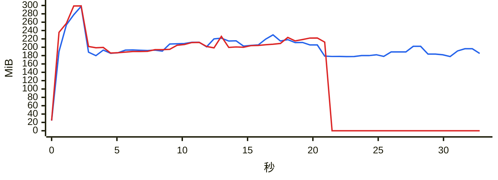

### `export messages json with images`

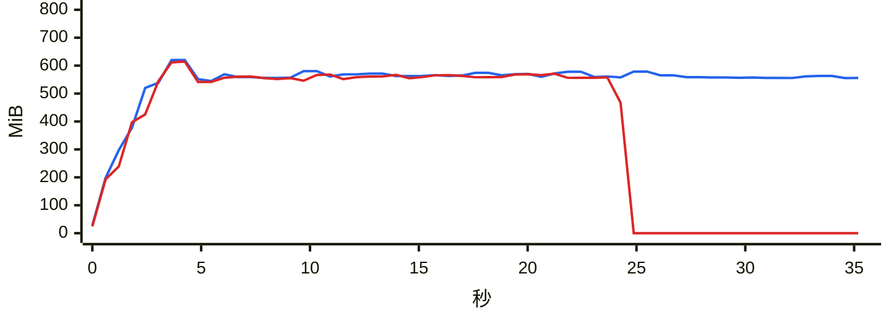

### `export messages json`

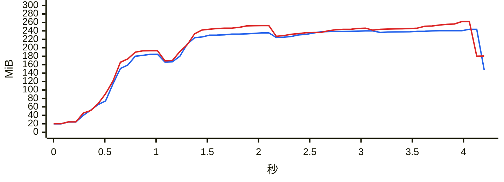

### `export messages chatlab`

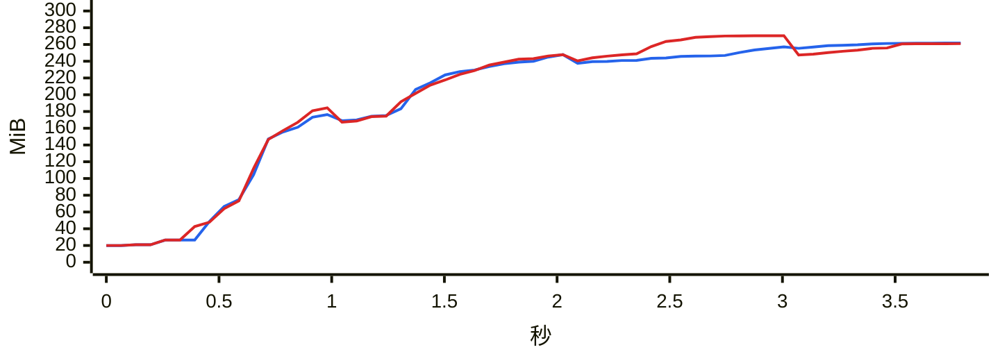

### `export messages excel`

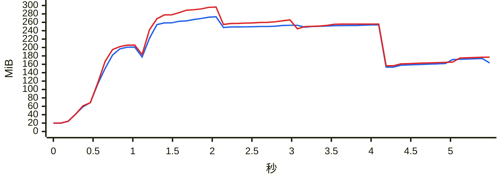

### `export messages html`

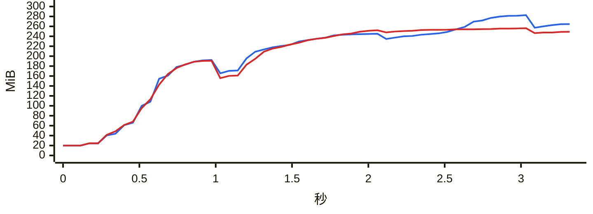

### `export messages txt`

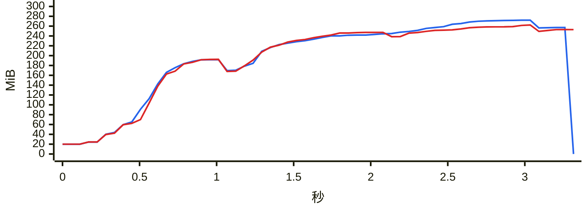

### `report annual`

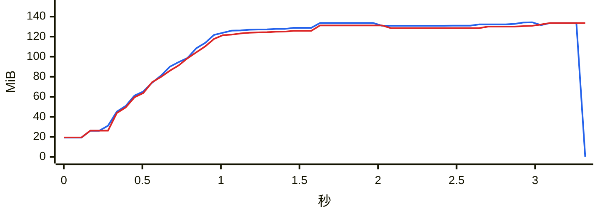

### `analytics overall`

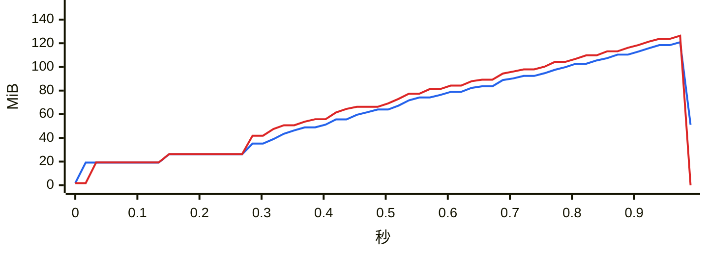

### `group members`

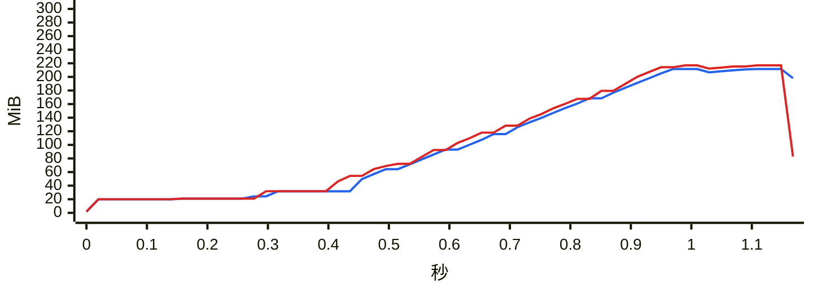

### `group ranking`

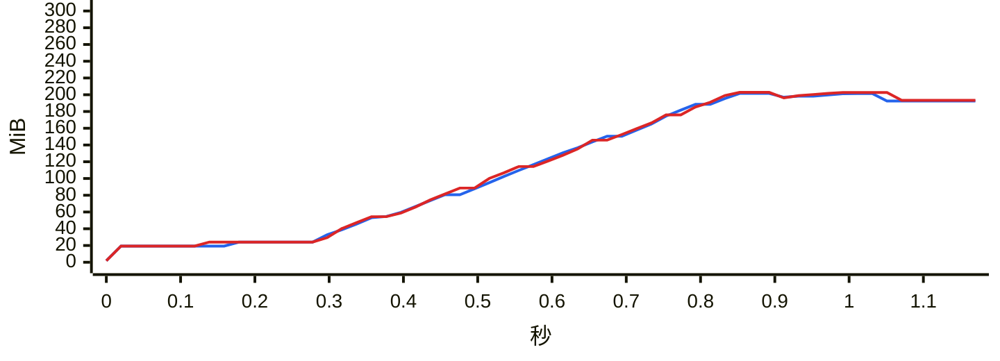

### `chat export-stats`

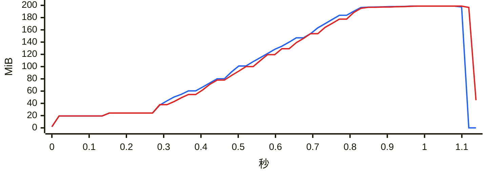

### `chat date-counts`

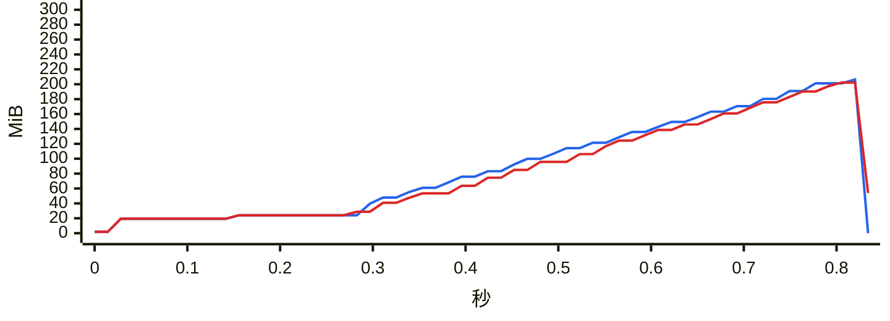

### `chat search`

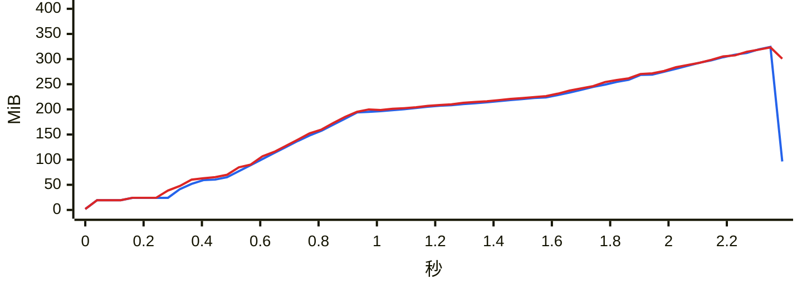

### `report dual`

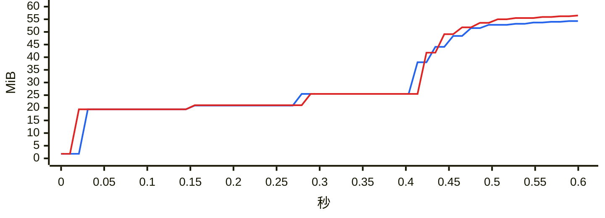

### `chat messages first page`

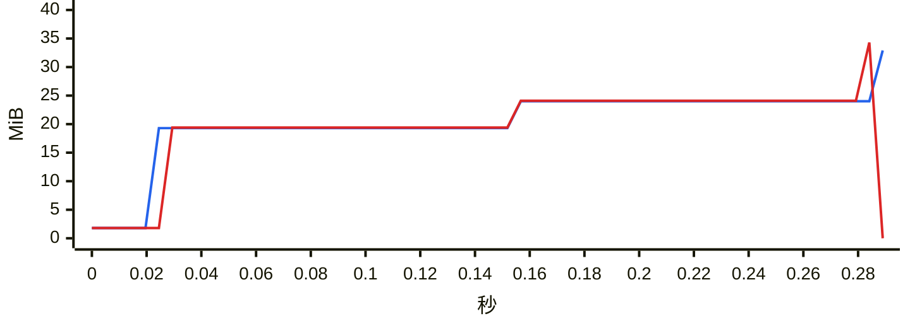

### `chat messages offset`

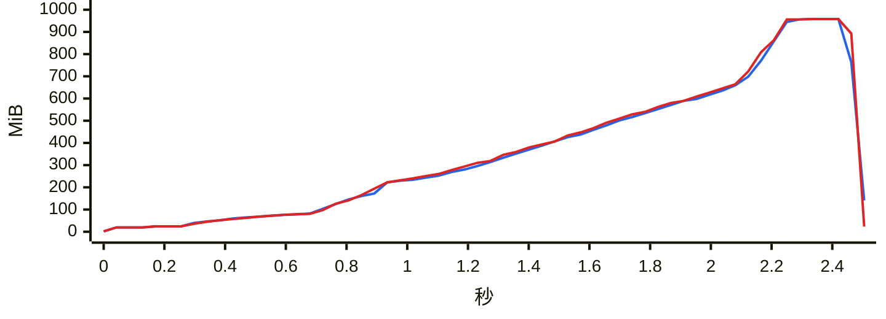
