# 基准测试：base 与 head

- base：`v4.2.0`（`0ca791423b`），weflow 4.2.0
- head：`v4.2.1`（`5d453e1366`），weflow 4.2.1
- 基准账号：种子 1，325,798 条消息，316 个会话
- runner：4 个逻辑 CPU，16.0 GiB 内存，win32 win25-vs2026
- 每条命令先各运行一次不计时，再由 base 和 head 交替各运行 5 次，取成功运行的中位数
- 比值是 head / base：▲ 表示增加超过 10%，▼ 表示减少超过 10%；差值小于噪声下限时不标（耗时 20 ms，CPU 50 ms，内存 5 MiB，路由延迟 5 ms）。除了吞吐量和每秒请求数，其余指标都是越低越好

**怎么看**：同一份代码在 runner 上对比时，耗时比值在 0.99–1.02 之间，个别命令（如 json 导出）每次在两个耗时之间跳。比值超过约 10%，并且两边最快到最慢的范围不重叠，才算真正的变化。

## 二进制体积

|  | base | head | head / base |
|---|---|---|---|
| `weflow.exe` | 24.8 MiB | 24.8 MiB | 1.00× |

## 命令

### 耗时（ms）

从启动到退出。括号里是最快和最慢的一次。

| 命令 | base | head | head / base |
|---|---|---|---|
| `export media images` | 26,752（26,222–30,656） | 26,854（26,196–28,097） | 1.00× |
| `export messages json with images` | 31,139（30,545–32,380） | 31,352（31,130–31,810） | 1.01× |
| `export messages json` | 5,466（5,419–5,602） | 5,423（5,419–5,481） | 0.99× |
| `export messages chatlab` | 4,862（4,813–4,890） | 4,897（4,882–5,167） | 1.01× |
| `export messages excel` | 6,862（6,798–6,888） | 6,831（6,767–6,893） | 1.00× |
| `export messages html` | 4,261（4,225–4,409） | 4,248（4,231–4,338） | 1.00× |
| `export messages txt` | 4,145（4,090–4,428） | 4,120（4,041–4,163） | 0.99× |
| `report annual` | 4,208（4,187–4,337） | 4,240（4,171–4,264） | 1.01× |
| `analytics overall` | 1,232（1,222–1,250） | 1,225（1,207–1,250） | 0.99× |
| `group members` | 1,423（1,415–1,432） | 1,438（1,403–1,451） | 1.01× |
| `group ranking` | 1,411（1,397–1,432） | 1,420（1,414–1,436） | 1.01× |
| `chat export-stats` | 1,367（1,323–1,402） | 1,347（1,334–1,375） | 0.99× |
| `chat date-counts` | 1,043（1,021–1,053） | 1,037（1,023–1,047） | 0.99× |
| `chat search` | 3,063（3,059–3,089） | 3,062（3,027–3,095） | 1.00× |
| `report dual` | 727（720–749） | 736（724–744） | 1.01× |
| `chat messages first page` | 355（344–357） | 360（345–371） | 1.01× |
| `chat messages offset` | 3,148（3,128–3,210） | 3,097（3,059–3,192） | 0.98× |

### 第一批结果（ms）

从启动到第一个有进度的事件（`--progress`）。不输出进度的命令没有这一项。

| 命令 | base | head | head / base |
|---|---|---|---|
| `export media images` | 2,468 | 2,447 | 0.99× |
| `export messages json with images` | 787 | 840 | 1.07× |
| `export messages json` | 810 | 811 | 1.00× |
| `export messages chatlab` | 968 | 983 | 1.02× |
| `export messages excel` | 821 | 806 | 0.98× |
| `export messages html` | 820 | 789 | 0.96× |
| `export messages txt` | 804 | 812 | 1.01× |
| `report annual` | 17 | 17 | 1.04× |
| `analytics overall` | 173 | 167 | 0.96× |
| `report dual` | 16 | 17 | 1.04× |

### 用户态 CPU（ms）

进程及其子进程的合计（Job Object）。Windows 的 CPU 时间精度是 15.6 ms，1 秒左右的命令差几十毫秒属于噪声。

| 命令 | base | head | head / base |
|---|---|---|---|
| `export media images` | 16,891 | 18,078 | 1.07× |
| `export messages json with images` | 25,469 | 25,422 | 1.00× |
| `export messages json` | 12,281 | 11,969 | 0.97× |
| `export messages chatlab` | 10,578 | 10,797 | 1.02× |
| `export messages excel` | 13,453 | 13,406 | 1.00× |
| `export messages html` | 11,844 | 11,922 | 1.01× |
| `export messages txt` | 11,219 | 11,109 | 0.99× |
| `report annual` | 3,953 | 3,922 | 0.99× |
| `analytics overall` | 1,203 | 1,172 | 0.97× |
| `group members` | 1,391 | 1,391 | 1.00× |
| `group ranking` | 1,375 | 1,344 | 0.98× |
| `chat export-stats` | 1,297 | 1,281 | 0.99× |
| `chat date-counts` | 1,031 | 984 | 0.95× |
| `chat search` | 2,766 | 2,734 | 0.99× |
| `report dual` | 797 | 781 | 0.98× |
| `chat messages first page` | 422 | 469 | 1.11× |
| `chat messages offset` | 2,734 | 2,656 | 0.97× |

### 内核态 CPU（ms）

进程及其子进程的合计（Job Object）。Windows 的 CPU 时间精度是 15.6 ms，1 秒左右的命令差几十毫秒属于噪声。

| 命令 | base | head | head / base |
|---|---|---|---|
| `export media images` | 35,125 | 34,844 | 0.99× |
| `export messages json with images` | 35,609 | 35,578 | 1.00× |
| `export messages json` | 969 | 1,078 | 1.11× ▲ |
| `export messages chatlab` | 797 | 797 | 1.00× |
| `export messages excel` | 1,016 | 1,031 | 1.02× |
| `export messages html` | 875 | 797 | 0.91× |
| `export messages txt` | 766 | 938 | 1.22× ▲ |
| `report annual` | 422 | 391 | 0.93× |
| `analytics overall` | 188 | 188 | 1.00× |
| `group members` | 203 | 188 | 0.92× |
| `group ranking` | 188 | 234 | 1.25× |
| `chat export-stats` | 234 | 203 | 0.87× |
| `chat date-counts` | 172 | 188 | 1.09× |
| `chat search` | 438 | 438 | 1.00× |
| `report dual` | 109 | 109 | 1.00× |
| `chat messages first page` | 78 | 78 | 1.00× |
| `chat messages offset` | 562 | 562 | 1.00× |

### 峰值工作集（MiB）

主进程占用物理内存的峰值。

| 命令 | base | head | head / base |
|---|---|---|---|
| `export media images` | 299 | 299 | 1.00× |
| `export messages json with images` | 614 | 612 | 1.00× |
| `export messages json` | 250 | 261 | 1.05× |
| `export messages chatlab` | 262 | 265 | 1.01× |
| `export messages excel` | 271 | 279 | 1.03× |
| `export messages html` | 276 | 276 | 1.00× |
| `export messages txt` | 269 | 268 | 1.00× |
| `report annual` | 135 | 135 | 1.00× |
| `analytics overall` | 120 | 120 | 1.00× |
| `group members` | 204 | 204 | 1.00× |
| `group ranking` | 204 | 201 | 0.98× |
| `chat export-stats` | 203 | 203 | 1.00× |
| `chat date-counts` | 202 | 206 | 1.02× |
| `chat search` | 325 | 325 | 1.00× |
| `report dual` | 55.5 | 55.4 | 1.00× |
| `chat messages first page` | 37.6 | 37.1 | 0.99× |
| `chat messages offset` | 958 | 959 | 1.00× |

### 峰值提交内存（MiB）

进程及其子进程提交内存的峰值，包括还没有占用物理内存的部分。

| 命令 | base | head | head / base |
|---|---|---|---|
| `export media images` | 443 | 443 | 1.00× |
| `export messages json with images` | 818 | 813 | 0.99× |
| `export messages json` | 448 | 455 | 1.02× |
| `export messages chatlab` | 441 | 444 | 1.01× |
| `export messages excel` | 461 | 468 | 1.01× |
| `export messages html` | 472 | 468 | 0.99× |
| `export messages txt` | 467 | 468 | 1.00× |
| `report annual` | 284 | 284 | 1.00× |
| `analytics overall` | 246 | 246 | 1.00× |
| `group members` | 337 | 337 | 1.00× |
| `group ranking` | 333 | 330 | 0.99× |
| `chat export-stats` | 333 | 333 | 1.00× |
| `chat date-counts` | 328 | 333 | 1.02× |
| `chat search` | 471 | 471 | 1.00× |
| `report dual` | 191 | 191 | 1.00× |
| `chat messages first page` | 164 | 164 | 1.00× |
| `chat messages offset` | 1,112 | 1,112 | 1.00× |

### 峰值线程数

每 20 ms 采样一次主进程得到的最大值。

| 命令 | base | head | head / base |
|---|---|---|---|
| `export media images` | 12 | 12 | 1.00× |
| `export messages json with images` | 12 | 12 | 1.00× |
| `export messages json` | 12 | 12 | 1.00× |
| `export messages chatlab` | 12 | 12 | 1.00× |
| `export messages excel` | 12 | 12 | 1.00× |
| `export messages html` | 12 | 12 | 1.00× |
| `export messages txt` | 12 | 12 | 1.00× |
| `report annual` | 10 | 10 | 1.00× |
| `analytics overall` | 10 | 10 | 1.00× |
| `group members` | 10 | 10 | 1.00× |
| `group ranking` | 10 | 10 | 1.00× |
| `chat export-stats` | 10 | 10 | 1.00× |
| `chat date-counts` | 10 | 10 | 1.00× |
| `chat search` | 10 | 10 | 1.00× |
| `report dual` | 10 | 10 | 1.00× |
| `chat messages first page` | 10 | 10 | 1.00× |
| `chat messages offset` | 10 | 10 | 1.00× |

### 读取（MiB）

逻辑 I/O，包括命中系统文件缓存的部分；Windows 不按进程统计实际的磁盘 I/O。

| 命令 | base | head | head / base |
|---|---|---|---|
| `export media images` | 910 | 910 | 1.00× |
| `export messages json with images` | 1,388 | 1,385 | 1.00× |
| `export messages json` | 685 | 685 | 1.00× |
| `export messages chatlab` | 527 | 529 | 1.00× |
| `export messages excel` | 559 | 564 | 1.01× |
| `export messages html` | 534 | 539 | 1.01× |
| `export messages txt` | 476 | 475 | 1.00× |
| `report annual` | 146 | 146 | 1.00× |
| `analytics overall` | 142 | 142 | 1.00× |
| `group members` | 207 | 207 | 1.00× |
| `group ranking` | 207 | 207 | 1.00× |
| `chat export-stats` | 232 | 232 | 1.00× |
| `chat date-counts` | 206 | 206 | 1.00× |
| `chat search` | 524 | 524 | 1.00× |
| `report dual` | 42.7 | 42.7 | 1.00× |
| `chat messages first page` | 28.4 | 28.4 | 1.00× |
| `chat messages offset` | 429 | 429 | 1.00× |

### 写入（MiB）

逻辑 I/O，包括命中系统文件缓存的部分；Windows 不按进程统计实际的磁盘 I/O。

| 命令 | base | head | head / base |
|---|---|---|---|
| `export media images` | 459 | 459 | 1.00× |
| `export messages json with images` | 887 | 887 | 1.00× |
| `export messages json` | 431 | 431 | 1.00× |
| `export messages chatlab` | 99.1 | 99.1 | 1.00× |
| `export messages excel` | 98.2 | 98.2 | 1.00× |
| `export messages html` | 122 | 122 | 1.00× |
| `export messages txt` | 14.6 | 14.6 | 1.00× |
| `report annual` | 0.0 | 0.0 | 1.00× |
| `analytics overall` | 0.0 | 0.0 | 1.00× |
| `group members` | 0.1 | 0.1 | 1.00× |
| `group ranking` | 0.0 | 0.0 | 1.00× |
| `chat export-stats` | 0.0 | 0.0 | 1.00× |
| `chat date-counts` | 0.0 | 0.0 | 1.00× |
| `chat search` | 0.1 | 0.1 | 1.00× |
| `report dual` | 0.0 | 0.0 | 1.00× |
| `chat messages first page` | 0.1 | 0.1 | 1.00× |
| `chat messages offset` | 36.5 | 36.5 | 1.00× |

### 页错误

进程及其子进程，包括软页错误。

| 命令 | base | head | head / base |
|---|---|---|---|
| `export media images` | 155,661 | 153,804 | 0.99× |
| `export messages json with images` | 268,342 | 268,910 | 1.00× |
| `export messages json` | 101,412 | 107,474 | 1.06× |
| `export messages chatlab` | 113,359 | 111,766 | 0.99× |
| `export messages excel` | 112,375 | 119,036 | 1.06× |
| `export messages html` | 112,030 | 106,830 | 0.95× |
| `export messages txt` | 114,748 | 112,992 | 0.98× |
| `report annual` | 37,563 | 37,540 | 1.00× |
| `analytics overall` | 32,825 | 32,247 | 0.98× |
| `group members` | 60,864 | 61,129 | 1.00× |
| `group ranking` | 58,145 | 58,141 | 1.00× |
| `chat export-stats` | 53,240 | 53,257 | 1.00× |
| `chat date-counts` | 54,143 | 55,238 | 1.02× |
| `chat search` | 91,781 | 91,215 | 0.99× |
| `report dual` | 22,694 | 22,541 | 0.99× |
| `chat messages first page` | 9,775 | 9,646 | 0.99× |
| `chat messages offset` | 248,821 | 248,642 | 1.00× |

### 吞吐量（消息/秒）

命令处理的消息数除以耗时。这是唯一一个越高越好的指标。

| 命令 | base | head | head / base |
|---|---|---|---|
| `export messages json with images` | 6,423 | 6,379 | 0.99× |
| `export messages json` | 36,592 | 36,878 | 1.01× |
| `export messages chatlab` | 41,137 | 40,841 | 0.99× |
| `export messages excel` | 29,145 | 29,278 | 1.00× |
| `export messages html` | 46,935 | 47,077 | 1.00× |
| `export messages txt` | 48,253 | 48,547 | 1.01× |
| `report annual` | 77,421 | 76,832 | 0.99× |
| `group members` | 140,530 | 139,036 | 0.99× |
| `group ranking` | 141,719 | 140,800 | 0.99× |
| `chat export-stats` | 146,352 | 148,485 | 1.01× |
| `chat date-counts` | 191,778 | 192,832 | 1.01× |
| `report dual` | 13,762 | 13,595 | 0.99× |
| `chat messages first page` | 141 | 139 | 0.99× |
| `chat messages offset` | 16 | 16 | 1.02× |

## `weflow serve` 持续负载

没有完成：base：weflow serve exited (2) before it listened: error: unexpected argument '--api-only' found   tip: a similar argument exists: '--api-token' Usage: weflow-base.exe serve --port <PORT> --api-token <API_TOKEN> For more information, try '--help'.；head：weflow serve exited (2) before it listened: error: unexpected argument '--api-only' found   tip: a similar argument exists: '--api-token' Usage: weflow-head.exe serve --port <PORT> --api-token <API_TOKEN> For more information, try '--help'.。完整信息见 results.json 的 `load_failed`。

## serve_bench

各路由响应时间的中位数（ms），由 `serve_bench` 在同一个基准账号上测得。路由名是它自己的；`[api]` 是进程内的 `/api/` 路由，`[sub]` 是启动子进程的路由。退出码：base 1，head 1。非 0 表示它在自己的合成账号上有检查没通过（旧版本缺少某个路由时会这样），计时照常保留，原因见 `logs/serve-bench-*.txt`。某一边不是每次都返回 200 时（例如旧版本还没有这个 `/api/` 路由，返回 404 只要零点几毫秒），格子里注明返回的状态，不计算比值。base 没有计时结果：它的 `weflow serve` 没有启动（v5.0.0 之前的版本没有现在的命令 API），见 `logs/serve-bench-base.txt`。head 没有计时结果：它的 `weflow serve` 没有启动（v5.0.0 之前的版本没有现在的命令 API），见 `logs/serve-bench-head.txt`。
## 内存曲线

主进程的工作集，每 20 ms 采样一次（持续负载每 0.5 s 一次）。命令取耗时居中的那次运行。蓝线 base，红线 head；先结束的版本在退出后记为 0。

### `export media images`

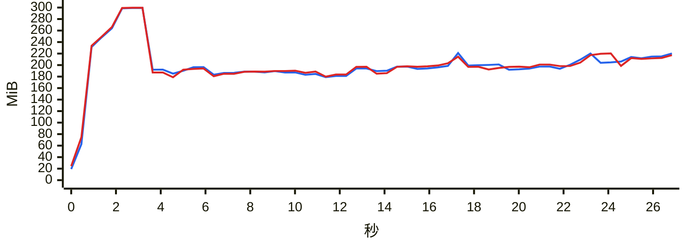

### `export messages json with images`

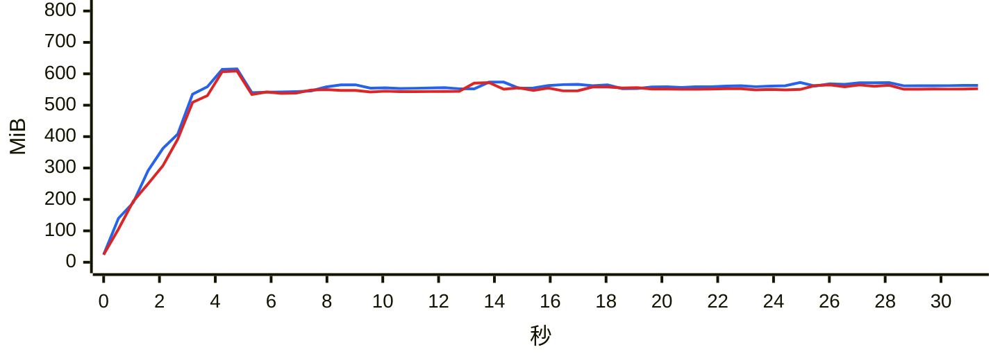

### `export messages json`

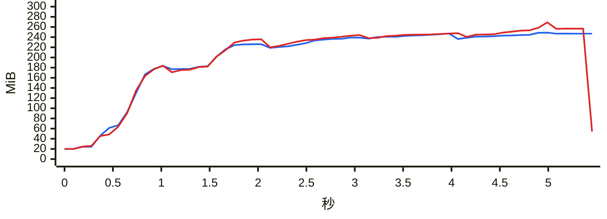

### `export messages chatlab`

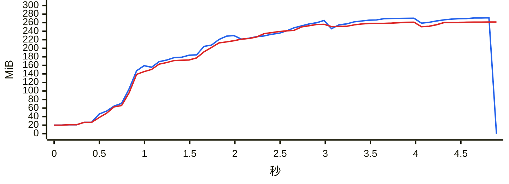

### `export messages excel`

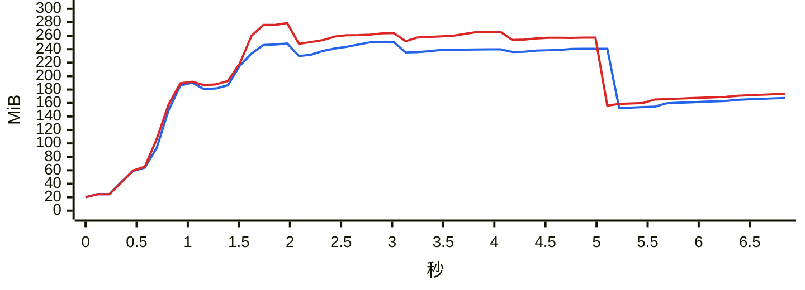

### `export messages html`

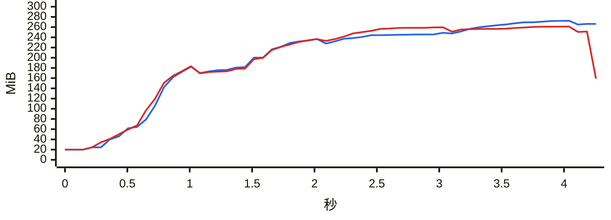

### `export messages txt`

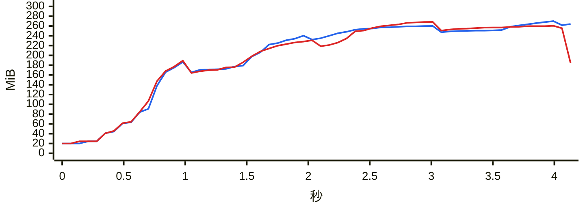

### `report annual`

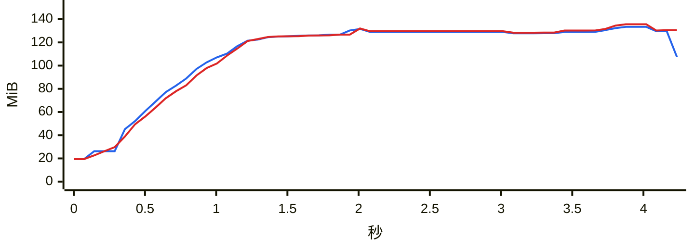

### `analytics overall`

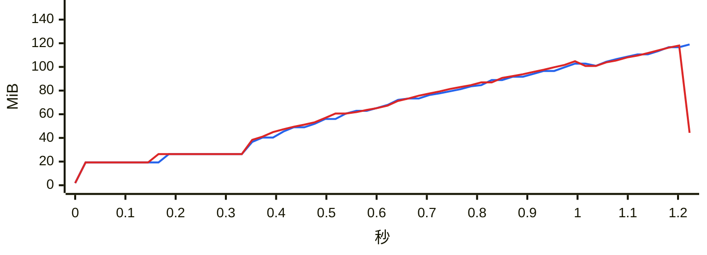

### `group members`

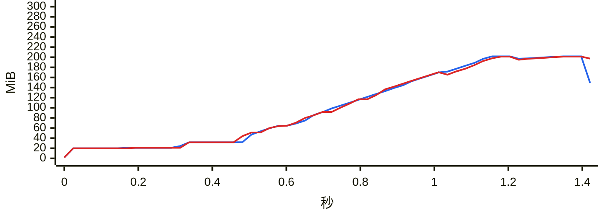

### `group ranking`

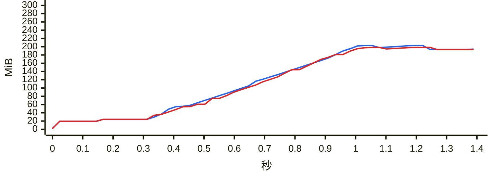

### `chat export-stats`

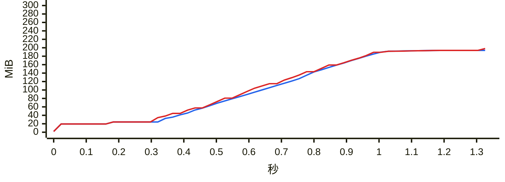

### `chat date-counts`

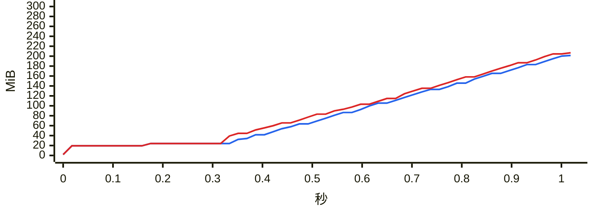

### `chat search`

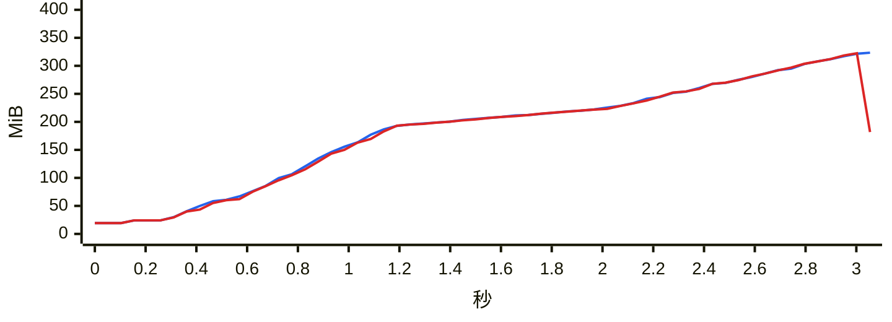

### `report dual`

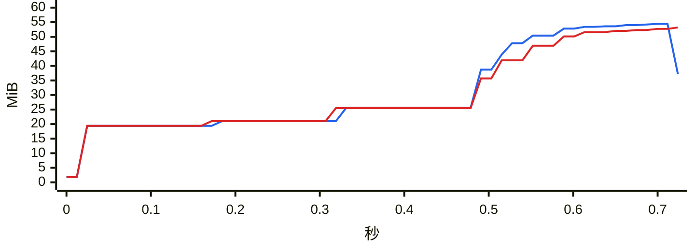

### `chat messages first page`

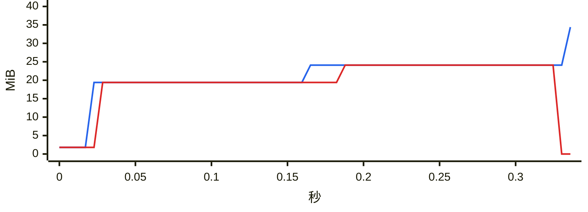

### `chat messages offset`

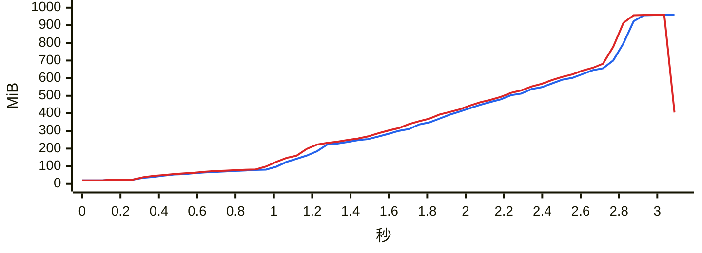
