# 基准测试：base 与 head

- base：`v4.2.1`（`5d453e1366`），weflow 4.2.1
- head：`v5.0.0`（`1d19c2da02`），weflow 5.0.0
- 基准账号：种子 1，325,798 条消息，316 个会话
- runner：4 个逻辑 CPU，16.0 GiB 内存，win32 win25-vs2026
- 每条命令先各运行一次不计时，再由 base 和 head 交替各运行 5 次，取成功运行的中位数
- 比值是 head / base：▲ 表示增加超过 10%，▼ 表示减少超过 10%；差值小于噪声下限时不标（耗时 20 ms，CPU 50 ms，内存 5 MiB，路由延迟 5 ms）。除了吞吐量和每秒请求数，其余指标都是越低越好

**怎么看**：同一份代码在 runner 上对比时，耗时比值在 0.99–1.02 之间，个别命令（如 json 导出）每次在两个耗时之间跳。比值超过约 10%，并且两边最快到最慢的范围不重叠，才算真正的变化。

## 二进制体积

|  | base | head | head / base |
|---|---|---|---|
| `weflow.exe` | 24.8 MiB | 28.4 MiB | 1.14× ▲ |

## 命令

**有运行失败**（输出见 `logs/`，不计入中位数）：`chat messages cursor`（base 5 次）

### 耗时（ms）

从启动到退出。括号里是最快和最慢的一次。

| 命令 | base | head | head / base |
|---|---|---|---|
| `export media images` | 16,254（14,939–16,867） | 15,617（15,284–15,789） | 0.96× |
| `export messages json with images` | 17,718（16,741–18,165） | 17,913（17,492–19,069） | 1.01× |
| `export messages json` | 3,307（3,029–3,730） | 3,148（2,866–3,436） | 0.95× |
| `export messages chatlab` | 2,994（2,741–3,221） | 2,524（2,477–3,052） | 0.84× ▼，范围重叠 |
| `export messages excel` | 3,906（3,837–3,918） | 3,656（3,641–3,699） | 0.94× |
| `export messages html` | 2,429（2,368–2,513） | 2,204（2,162–2,277） | 0.91× |
| `export messages txt` | 2,355（2,331–2,435） | 2,173（2,124–2,451） | 0.92× |
| `report annual` | 2,138（2,131–2,221） | 1,285（1,276–1,304） | 0.60× ▼ |
| `analytics overall` | 623（613–634） | 537（532–545） | 0.86× ▼ |
| `group members` | 779（766–795） | 609（601–614） | 0.78× ▼ |
| `group ranking` | 789（760–815） | 599（593–615） | 0.76× ▼ |
| `chat export-stats` | 751（742–758） | 571（570–582） | 0.76× ▼ |
| `chat date-counts` | 549（543–560） | 434（431–458） | 0.79× ▼ |
| `chat search` | 1,696（1,655–1,746） | 274（265–280） | 0.16× ▼ |
| `report dual` | 402（381–419） | 239（236–246） | 0.60× ▼ |
| `chat messages first page` | 194（187–202） | 108（108–110） | 0.56× ▼ |
| `chat messages offset` | 1,732（1,702–1,805） | 1,580（1,563–1,583） | 0.91× |
| `chat messages cursor` | - | 107（106–110） | - |

### 第一批结果（ms）

从启动到第一个有进度的事件（`--progress`）。不输出进度的命令没有这一项。

| 命令 | base | head | head / base |
|---|---|---|---|
| `export media images` | 1,467 | 1,367 | 0.93× |
| `export messages json with images` | 418 | 337 | 0.81× ▼ |
| `export messages json` | 443 | 276 | 0.62× ▼ |
| `export messages chatlab` | 544 | 293 | 0.54× ▼ |
| `export messages excel` | 411 | 267 | 0.65× ▼ |
| `export messages html` | 404 | 269 | 0.67× ▼ |
| `export messages txt` | 403 | 269 | 0.67× ▼ |
| `report annual` | 12 | 12 | 1.01× |
| `analytics overall` | 88 | 91 | 1.03× |
| `report dual` | 12 | 12 | 1.00× |

### 用户态 CPU（ms）

进程及其子进程的合计（Job Object）。Windows 的 CPU 时间精度是 15.6 ms，1 秒左右的命令差几十毫秒属于噪声。

| 命令 | base | head | head / base |
|---|---|---|---|
| `export media images` | 9,109 | 8,750 | 0.96× |
| `export messages json with images` | 13,531 | 13,188 | 0.97× |
| `export messages json` | 7,250 | 6,547 | 0.90× |
| `export messages chatlab` | 6,578 | 5,906 | 0.90× ▼ |
| `export messages excel` | 7,781 | 7,266 | 0.93× |
| `export messages html` | 6,766 | 6,312 | 0.93× |
| `export messages txt` | 6,578 | 5,938 | 0.90× |
| `report annual` | 2,047 | 1,094 | 0.53× ▼ |
| `analytics overall` | 547 | 438 | 0.80× ▼ |
| `group members` | 734 | 500 | 0.68× ▼ |
| `group ranking` | 734 | 516 | 0.70× ▼ |
| `chat export-stats` | 703 | 438 | 0.62× ▼ |
| `chat date-counts` | 516 | 359 | 0.70× ▼ |
| `chat search` | 1,531 | 219 | 0.14× ▼ |
| `report dual` | 391 | 188 | 0.48× ▼ |
| `chat messages first page` | 234 | 78 | 0.33× ▼ |
| `chat messages offset` | 1,406 | 1,297 | 0.92× |
| `chat messages cursor` | - | 94 | - |

### 内核态 CPU（ms）

进程及其子进程的合计（Job Object）。Windows 的 CPU 时间精度是 15.6 ms，1 秒左右的命令差几十毫秒属于噪声。

| 命令 | base | head | head / base |
|---|---|---|---|
| `export media images` | 14,750 | 15,094 | 1.02× |
| `export messages json with images` | 15,312 | 15,797 | 1.03× |
| `export messages json` | 625 | 641 | 1.02× |
| `export messages chatlab` | 562 | 406 | 0.72× ▼ |
| `export messages excel` | 609 | 578 | 0.95× |
| `export messages html` | 625 | 531 | 0.85× ▼ |
| `export messages txt` | 438 | 484 | 1.11× |
| `report annual` | 219 | 203 | 0.93× |
| `analytics overall` | 156 | 94 | 0.60× ▼ |
| `group members` | 125 | 94 | 0.75× |
| `group ranking` | 125 | 94 | 0.75× |
| `chat export-stats` | 125 | 125 | 1.00× |
| `chat date-counts` | 109 | 78 | 0.71× |
| `chat search` | 266 | 62 | 0.24× ▼ |
| `report dual` | 94 | 62 | 0.67× |
| `chat messages first page` | 47 | 16 | 0.33× |
| `chat messages offset` | 484 | 297 | 0.61× ▼ |
| `chat messages cursor` | - | 16 | - |

### 峰值工作集（MiB）

主进程占用物理内存的峰值。

| 命令 | base | head | head / base |
|---|---|---|---|
| `export media images` | 300 | 300 | 1.00× |
| `export messages json with images` | 611 | 621 | 1.02× |
| `export messages json` | 257 | 257 | 1.00× |
| `export messages chatlab` | 269 | 260 | 0.97× |
| `export messages excel` | 276 | 288 | 1.04× |
| `export messages html` | 273 | 278 | 1.02× |
| `export messages txt` | 275 | 274 | 0.99× |
| `report annual` | 139 | 138 | 0.99× |
| `analytics overall` | 124 | 126 | 1.01× |
| `group members` | 214 | 215 | 1.01× |
| `group ranking` | 205 | 209 | 1.02× |
| `chat export-stats` | 206 | 207 | 1.00× |
| `chat date-counts` | 204 | 206 | 1.01× |
| `chat search` | 326 | 67.2 | 0.21× ▼ |
| `report dual` | 55.5 | 58.9 | 1.06× |
| `chat messages first page` | 38.6 | 42.1 | 1.09× |
| `chat messages offset` | 959 | 949 | 0.99× |
| `chat messages cursor` | - | 41.7 | - |

### 峰值提交内存（MiB）

进程及其子进程提交内存的峰值，包括还没有占用物理内存的部分。

| 命令 | base | head | head / base |
|---|---|---|---|
| `export media images` | 443 | 443 | 1.00× |
| `export messages json with images` | 817 | 829 | 1.01× |
| `export messages json` | 453 | 451 | 1.00× |
| `export messages chatlab` | 446 | 439 | 0.98× |
| `export messages excel` | 469 | 478 | 1.02× |
| `export messages html` | 468 | 466 | 1.00× |
| `export messages txt` | 469 | 463 | 0.99× |
| `report annual` | 284 | 283 | 1.00× |
| `analytics overall` | 250 | 251 | 1.00× |
| `group members` | 348 | 351 | 1.01× |
| `group ranking` | 335 | 339 | 1.01× |
| `chat export-stats` | 333 | 333 | 1.00× |
| `chat date-counts` | 332 | 334 | 1.01× |
| `chat search` | 471 | 190 | 0.40× ▼ |
| `report dual` | 191 | 198 | 1.04× |
| `chat messages first page` | 163 | 163 | 1.00× |
| `chat messages offset` | 1,112 | 1,101 | 0.99× |
| `chat messages cursor` | - | 163 | - |

### 峰值线程数

每 20 ms 采样一次主进程得到的最大值。

| 命令 | base | head | head / base |
|---|---|---|---|
| `export media images` | 12 | 12 | 1.00× |
| `export messages json with images` | 12 | 12 | 1.00× |
| `export messages json` | 12 | 11 | 0.92× |
| `export messages chatlab` | 12 | 11 | 0.92× |
| `export messages excel` | 12 | 11 | 0.92× |
| `export messages html` | 12 | 11 | 0.92× |
| `export messages txt` | 12 | 11 | 0.92× |
| `report annual` | 10 | 8 | 0.80× ▼ |
| `analytics overall` | 10 | 8 | 0.80× ▼ |
| `group members` | 10 | 8 | 0.80× ▼ |
| `group ranking` | 10 | 8 | 0.80× ▼ |
| `chat export-stats` | 10 | 8 | 0.80× ▼ |
| `chat date-counts` | 10 | 8 | 0.80× ▼ |
| `chat search` | 10 | 8 | 0.80× ▼ |
| `report dual` | 10 | 8 | 0.80× ▼ |
| `chat messages first page` | 10 | 8 | 0.80× ▼ |
| `chat messages offset` | 10 | 8 | 0.80× ▼ |
| `chat messages cursor` | - | 8 | - |

### 读取（MiB）

逻辑 I/O，包括命中系统文件缓存的部分；Windows 不按进程统计实际的磁盘 I/O。

| 命令 | base | head | head / base |
|---|---|---|---|
| `export media images` | 910 | 910 | 1.00× |
| `export messages json with images` | 1,381 | 1,384 | 1.00× |
| `export messages json` | 681 | 678 | 1.00× |
| `export messages chatlab` | 525 | 524 | 1.00× |
| `export messages excel` | 558 | 557 | 1.00× |
| `export messages html` | 537 | 536 | 1.00× |
| `export messages txt` | 478 | 476 | 1.00× |
| `report annual` | 146 | 146 | 1.00× |
| `analytics overall` | 142 | 142 | 1.00× |
| `group members` | 207 | 206 | 1.00× |
| `group ranking` | 207 | 206 | 1.00× |
| `chat export-stats` | 232 | 232 | 1.00× |
| `chat date-counts` | 206 | 206 | 1.00× |
| `chat search` | 524 | 104 | 0.20× ▼ |
| `report dual` | 42.7 | 42.6 | 1.00× |
| `chat messages first page` | 28.4 | 31.2 | 1.10× ▲ |
| `chat messages offset` | 429 | 198 | 0.46× ▼ |
| `chat messages cursor` | - | 30.9 | - |

### 写入（MiB）

逻辑 I/O，包括命中系统文件缓存的部分；Windows 不按进程统计实际的磁盘 I/O。

| 命令 | base | head | head / base |
|---|---|---|---|
| `export media images` | 459 | 459 | 1.00× |
| `export messages json with images` | 887 | 887 | 1.00× |
| `export messages json` | 431 | 431 | 1.00× |
| `export messages chatlab` | 99.1 | 99.1 | 1.00× |
| `export messages excel` | 98.2 | 98.2 | 1.00× |
| `export messages html` | 122 | 122 | 1.00× |
| `export messages txt` | 14.6 | 14.6 | 1.00× |
| `report annual` | 0.0 | 0.0 | 1.00× |
| `analytics overall` | 0.0 | 0.0 | 1.00× |
| `group members` | 0.1 | 0.1 | 1.00× |
| `group ranking` | 0.0 | 0.0 | 1.00× |
| `chat export-stats` | 0.0 | 0.0 | 1.00× |
| `chat date-counts` | 0.0 | 0.0 | 1.00× |
| `chat search` | 0.1 | 0.1 | 1.01× |
| `report dual` | 0.0 | 0.0 | 1.00× |
| `chat messages first page` | 0.1 | 0.1 | 1.03× |
| `chat messages offset` | 36.5 | 39.3 | 1.07× |
| `chat messages cursor` | - | 0.1 | - |

### 页错误

进程及其子进程，包括软页错误。

| 命令 | base | head | head / base |
|---|---|---|---|
| `export media images` | 135,906 | 133,268 | 0.98× |
| `export messages json with images` | 257,059 | 253,007 | 0.98× |
| `export messages json` | 100,589 | 95,823 | 0.95× |
| `export messages chatlab` | 102,047 | 104,731 | 1.03× |
| `export messages excel` | 105,269 | 107,576 | 1.02× |
| `export messages html` | 107,050 | 101,150 | 0.94× |
| `export messages txt` | 105,883 | 109,057 | 1.03× |
| `report annual` | 38,039 | 36,744 | 0.97× |
| `analytics overall` | 32,062 | 32,483 | 1.01× |
| `group members` | 60,771 | 61,051 | 1.00× |
| `group ranking` | 58,018 | 59,090 | 1.02× |
| `chat export-stats` | 52,957 | 53,182 | 1.00× |
| `chat date-counts` | 54,727 | 55,222 | 1.01× |
| `chat search` | 91,906 | 17,416 | 0.19× ▼ |
| `report dual` | 23,283 | 23,795 | 1.02× |
| `chat messages first page` | 10,046 | 11,011 | 1.10× |
| `chat messages offset` | 248,753 | 258,785 | 1.04× |
| `chat messages cursor` | - | 10,915 | - |

### 吞吐量（消息/秒）

命令处理的消息数除以耗时。这是唯一一个越高越好的指标。

| 命令 | base | head | head / base |
|---|---|---|---|
| `export messages json with images` | 11,288 | 11,165 | 0.99× |
| `export messages json` | 60,478 | 63,534 | 1.05× |
| `export messages chatlab` | 66,803 | 79,231 | 1.19× ▲ |
| `export messages excel` | 51,198 | 54,709 | 1.07× |
| `export messages html` | 82,323 | 90,754 | 1.10× ▲ |
| `export messages txt` | 84,908 | 92,039 | 1.08× |
| `report annual` | 152,393 | 253,605 | 1.66× ▲ |
| `group members` | 256,709 | 328,669 | 1.28× ▲ |
| `group ranking` | 253,347 | 333,846 | 1.32× ▲ |
| `chat export-stats` | 266,250 | 350,309 | 1.32× ▲ |
| `chat date-counts` | 364,487 | 460,692 | 1.26× ▲ |
| `report dual` | 24,850 | 41,760 | 1.68× ▲ |
| `chat messages first page` | 258 | 462 | 1.79× ▲ |
| `chat messages offset` | 29 | 32 | 1.10× |
| `chat messages cursor` | - | 466 | - |

## `weflow serve` 持续负载

没有完成：base：weflow serve exited (2) before it listened: error: unexpected argument '--api-only' found   tip: a similar argument exists: '--api-token' Usage: weflow-base.exe serve --port <PORT> --api-token <API_TOKEN> For more information, try '--help'.。完整信息见 results.json 的 `load_failed`。

## serve_bench

各路由响应时间的中位数（ms），由 `serve_bench` 在同一个基准账号上测得。路由名是它自己的；`[api]` 是进程内的 `/api/` 路由，`[sub]` 是启动子进程的路由。退出码：base 1，head 0。非 0 表示它在自己的合成账号上有检查没通过（旧版本缺少某个路由时会这样），计时照常保留，原因见 `logs/serve-bench-*.txt`。某一边不是每次都返回 200 时（例如旧版本还没有这个 `/api/` 路由，返回 404 只要零点几毫秒），格子里注明返回的状态，不计算比值。base 没有计时结果：它的 `weflow serve` 没有启动（v5.0.0 之前的版本没有现在的命令 API），见 `logs/serve-bench-base.txt`。

| 路由 | base | head | head / base |
|---|---|---|---|
| `16 pages at once (all of them) [api]` | - | 90 | - |
| `16 pages at once (all of them) [sub]` | - | 56 | - |
| `20 images at once (all of them) [api]` | - | 8.5 | - |
| `20 images at once (all of them) [sub]` | - | 33 | - |
| `analytics overall [api]` | - | 0.4（状态 {404: 1}） | - |
| `analytics overall [sub]` | - | 468 | - |
| `analytics rankings [api]` | - | 0.2（状态 {404: 1}） | - |
| `analytics rankings [sub]` | - | 22 | - |
| `analytics time [api]` | - | 0.2（状态 {404: 1}） | - |
| `analytics time [sub]` | - | 20 | - |
| `biz pay-records [api]` | - | 0.2（状态 {404: 5}） | - |
| `biz pay-records [sub]` | - | 27 | - |
| `cache list [api]` | - | 0.2（状态 {404: 5}） | - |
| `cache list [sub]` | - | 15 | - |
| `chat date-counts [api]` | - | 58 | - |
| `chat date-counts [sub]` | - | 366 | - |
| `chat dates [api]` | - | 65 | - |
| `chat dates [sub]` | - | 362 | - |
| `chat detail --fast [api]` | - | 1.0 | - |
| `chat detail --fast [sub]` | - | 42 | - |
| `chat resources, all conversations [api]` | - | 57 | - |
| `chat resources, all conversations [sub]` | - | 136 | - |
| `chat resources, all conversations, far page [api]` | - | 100 | - |
| `chat resources, all conversations, far page [sub]` | - | 176 | - |
| `chat resources, all conversations, file [api]` | - | 70 | - |
| `chat resources, all conversations, file [sub]` | - | 133 | - |
| `chat resources, all conversations, image [api]` | - | 36 | - |
| `chat resources, all conversations, image [sub]` | - | 80 | - |
| `chat resources, all conversations, video [api]` | - | 37 | - |
| `chat resources, all conversations, video [sub]` | - | 89 | - |
| `chat resources, all conversations, voice [api]` | - | 21 | - |
| `chat resources, all conversations, voice [sub]` | - | 66 | - |
| `chat resources, one conversation [api]` | - | 37 | - |
| `chat resources, one conversation [sub]` | - | 110 | - |
| `chat statuses of 60 conversations [api]` | - | 0.2（状态 {404: 5}） | - |
| `chat statuses of 60 conversations [sub]` | - | 14 | - |
| `chat tab-counts [api]` | - | 0.2（状态 {404: 5}） | - |
| `chat tab-counts [sub]` | - | 15 | - |
| `config profiles [api]` | - | 0.2（状态 {404: 5}） | - |
| `config profiles [sub]` | - | 14 | - |
| `contacts, all [api]` | - | 8.3 | - |
| `contacts, all [sub]` | - | 31 | - |
| `contacts, all, br [api]` | - | 11 | - |
| `contacts, all, gzip [api]` | - | 18 | - |
| `contacts, all, the fields of a list [api]` | - | 8.0 | - |
| `contacts, all, the fields of a list, br [api]` | - | 9.3 | - |
| `counts of 60 conversations [api]` | - | 8.0 | - |
| `counts of 60 conversations [sub]` | - | 50 | - |
| `db test [api]` | - | 0.2（状态 {404: 5}） | - |
| `db test [sub]` | - | 14 | - |
| `first conversation opened after start (first page) [api]` | - | 4.9 | - |
| `first page, 1 at once (all of them) [api]` | - | 3.0 | - |
| `first page, 1 at once (all of them) [sub]` | - | 33 | - |
| `first page, 16 at once (all of them) [api]` | - | 20 | - |
| `first page, 16 at once (all of them) [sub]` | - | 49 | - |
| `first page, 32 at once (all of them) [api]` | - | 39 | - |
| `first page, 32 at once (all of them) [sub]` | - | 49 | - |
| `first page, 6 at once (all of them) [api]` | - | 9.0 | - |
| `first page, 6 at once (all of them) [sub]` | - | 51 | - |
| `first page, 64 at once (all of them) [api]` | - | 77 | - |
| `first read after start (sessions, 50) [api]` | - | 94 | - |
| `group list [api]` | - | 0.2（状态 {404: 5}） | - |
| `group list [sub]` | - | 19 | - |
| `group members [api]` | - | 1.5 | - |
| `group members [sub]` | - | 25 | - |
| `image, again (each) [api]` | - | 1.0 | - |
| `image, again (each) [sub]` | - | 31 | - |
| `image, first time (each) [api]` | - | 2.1 | - |
| `image, first time (each) [sub]` | - | 33 | - |
| `latest 20 (polling) [api]` | - | 1.7 | - |
| `latest 20 (polling) [sub]` | - | 31 | - |
| `messages, first page [api]` | - | 2.3 | - |
| `messages, first page [sub]` | - | 31 | - |
| `messages, first page, br [api]` | - | 2.6 | - |
| `messages, first page, gzip [api]` | - | 2.6 | - |
| `messages, first page, the fields shown [api]` | - | 1.9 | - |
| `messages, first page, the fields shown, br [api]` | - | 2.3 | - |
| `messages, page in the middle [api]` | - | 1,278 | - |
| `messages, page in the middle [sub]` | - | 1,522 | - |
| `messages, page in the middle, from a cursor [api]` | - | 2.3 | - |
| `messages, page in the middle, from a cursor [sub]` | - | 33 | - |
| `one contact [api]` | - | 0.6 | - |
| `one contact [sub]` | - | 15 | - |
| `one message [api]` | - | 1.5 | - |
| `one message [sub]` | - | 29 | - |
| `push engine, CPU ms per second while listened to [api]` | - | 0.0 | - |
| `report annual years [api]` | - | 0.2（状态 {404: 5}） | - |
| `report annual years [sub]` | - | 267 | - |
| `search in the conversation [api]` | - | 2.0 | - |
| `search in the conversation [sub]` | - | 32 | - |
| `search in the conversation, a word found nowhere [api]` | - | 45 | - |
| `search in the conversation, a word found nowhere [sub]` | - | 117 | - |
| `server start (until it listens) [-]` | - | 13 | - |
| `sessions, 50 [api]` | - | 11 | - |
| `sessions, 50 [sub]` | - | 39 | - |
| `sessions, all [api]` | - | 10 | - |
| `sessions, all [sub]` | - | 40 | - |
| `sns post-counts --prefer-cache [api]` | - | 0.5 | - |
| `sns post-counts --prefer-cache [sub]` | - | 23 | - |
| `sns stats --fast [api]` | - | 0.5 | - |
| `sns stats --fast [sub]` | - | 24 | - |
| `sns timeline, 20 [api]` | - | 37 | - |
| `sns timeline, 20 [sub]` | - | 58 | - |
| `sns timeline, 20, far page [api]` | - | 5.6 | - |
| `sns timeline, 20, far page [sub]` | - | 58 | - |
| `sns users [api]` | - | 3.6 | - |
| `sns users [sub]` | - | 24 | - |
| `thumbnail of the image (each) [api]` | - | 0.9 | - |
| `thumbnail of the image (each) [sub]` | - | 31 | - |
| `thumbnail of the video (each) [api]` | - | 1.2 | - |
| `video, 1 MB from its middle (each) [api]` | - | 1.5 | - |
| `video, its first 1 MB (each) [api]` | - | 1.7 | - |
## 内存曲线

主进程的工作集，每 20 ms 采样一次（持续负载每 0.5 s 一次）。命令取耗时居中的那次运行。蓝线 base，红线 head；先结束的版本在退出后记为 0。

### `export media images`

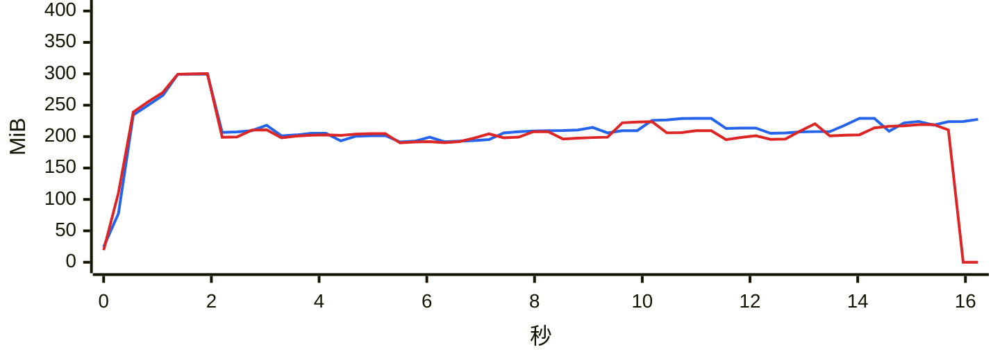

### `export messages json with images`

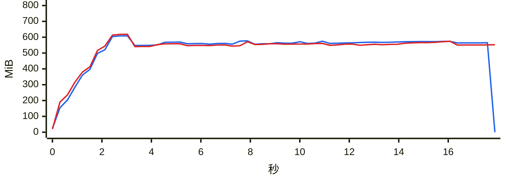

### `export messages json`

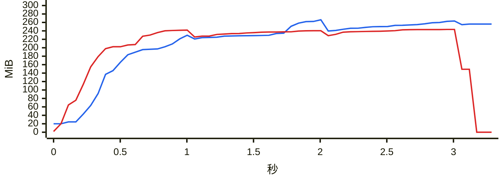

### `export messages chatlab`

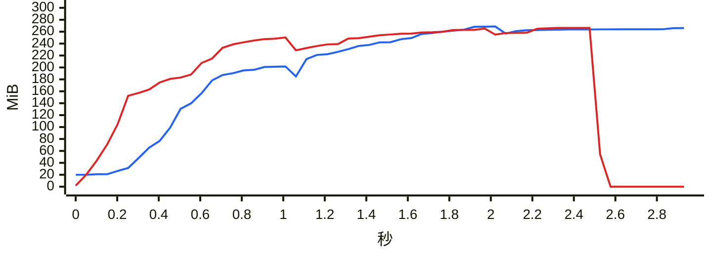

### `export messages excel`

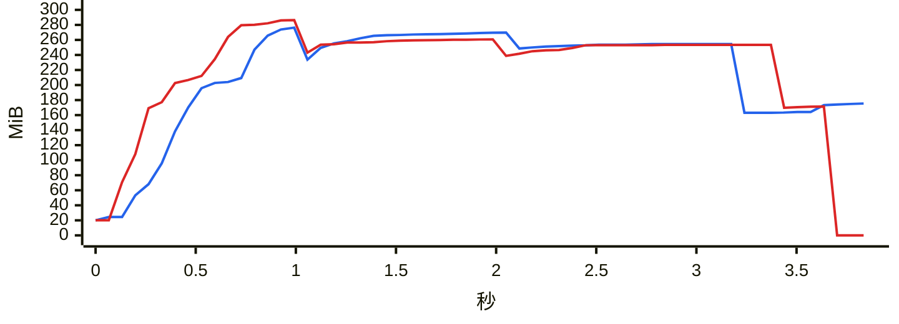

### `export messages html`

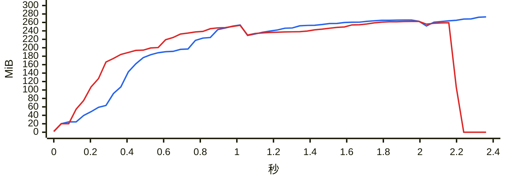

### `export messages txt`

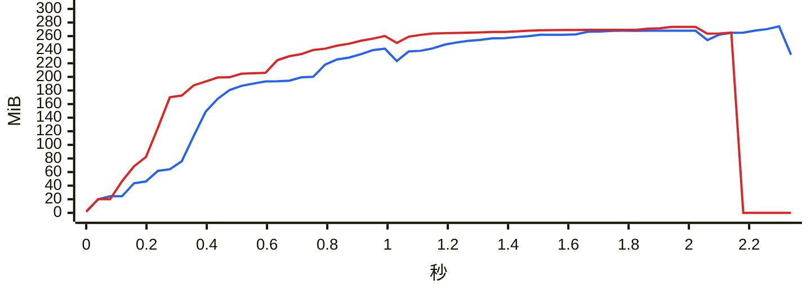

### `report annual`

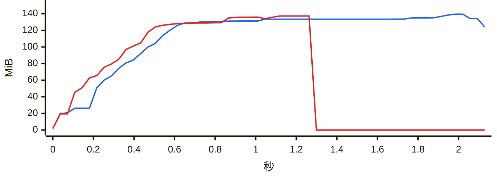

### `analytics overall`

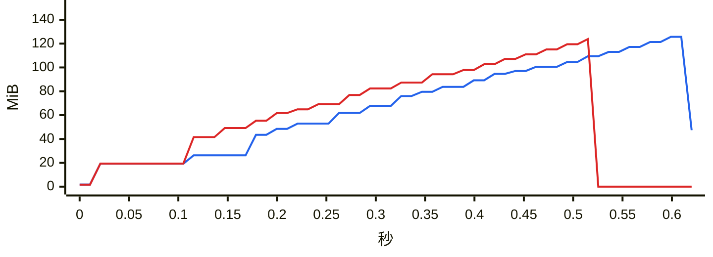

### `group members`

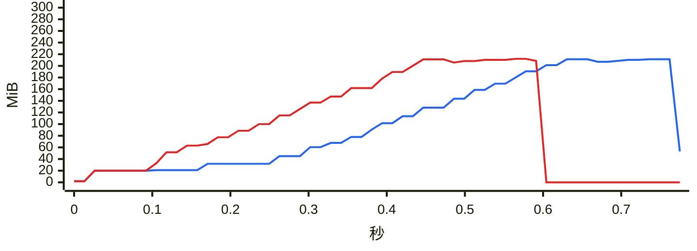

### `group ranking`

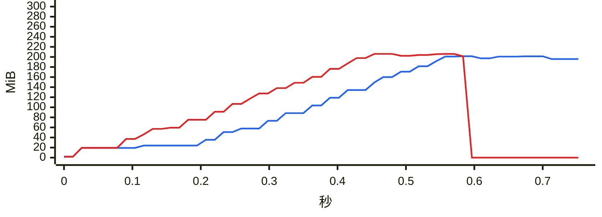

### `chat export-stats`

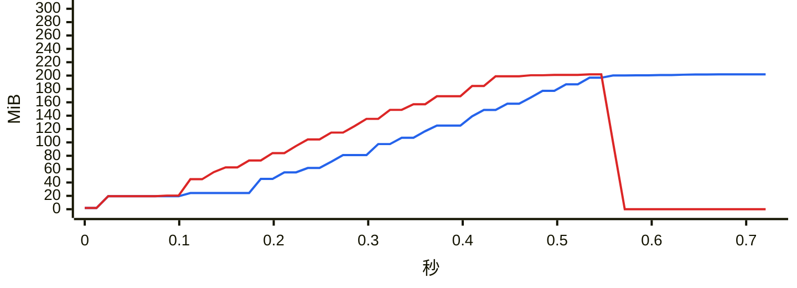

### `chat date-counts`

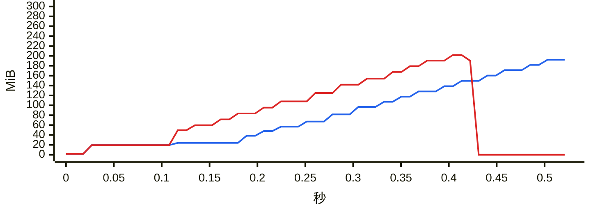

### `chat search`

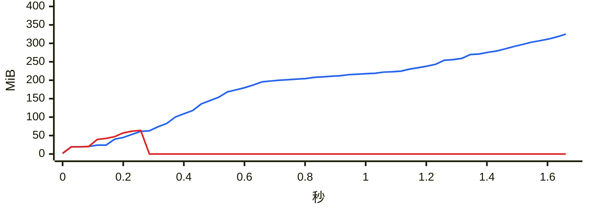

### `report dual`

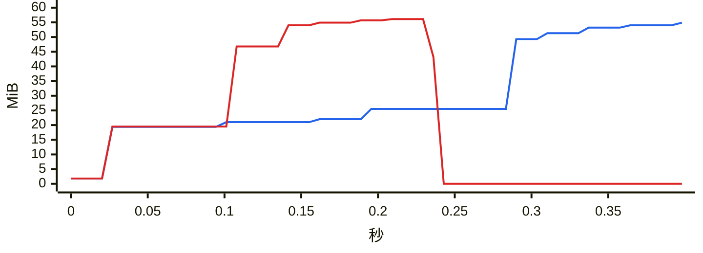

### `chat messages first page`

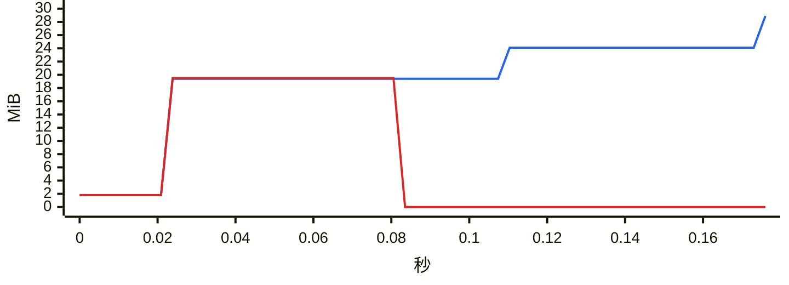

### `chat messages offset`

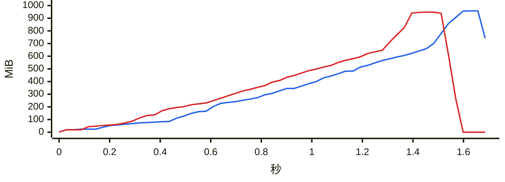

### `chat messages cursor`

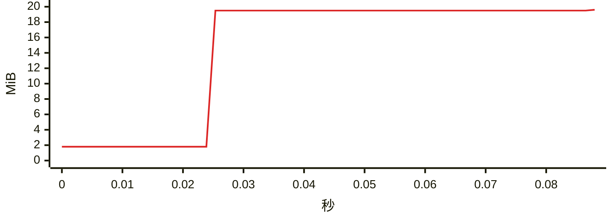
