# 基准测试：base 与 head

- base：`v5.0.0`（`1d19c2da02`），weflow 5.0.0
- head：`v5.0.1`（`6115746c5f`），weflow 5.0.1
- 基准账号：种子 1，325,798 条消息，316 个会话
- runner：4 个逻辑 CPU，16.0 GiB 内存，win32 win25-vs2026
- 每条命令先各运行一次不计时，再由 base 和 head 交替各运行 5 次，取成功运行的中位数
- 比值是 head / base：▲ 表示增加超过 10%，▼ 表示减少超过 10%；差值小于噪声下限时不标（耗时 20 ms，CPU 50 ms，内存 5 MiB，路由延迟 5 ms）。除了吞吐量和每秒请求数，其余指标都是越低越好

**怎么看**：同一份代码在 runner 上对比时，耗时比值在 0.99–1.02 之间，个别命令（如 json 导出）每次在两个耗时之间跳。比值超过约 10%，并且两边最快到最慢的范围不重叠，才算真正的变化。

## 二进制体积

|  | base | head | head / base |
|---|---|---|---|
| `weflow.exe` | 28.4 MiB | 28.7 MiB | 1.01× |

## 命令

### 耗时（ms）

从启动到退出。括号里是最快和最慢的一次。

| 命令 | base | head | head / base |
|---|---|---|---|
| `export media images` | 25,946（25,579–27,534） | 25,878（25,265–26,304） | 1.00× |
| `export messages json with images` | 30,678（30,316–32,082） | 31,688（30,167–36,553） | 1.03× |
| `export messages json` | 5,121（5,063–5,918） | 5,111（5,066–5,121） | 1.00× |
| `export messages chatlab` | 4,454（4,348–4,884） | 4,480（4,391–4,683） | 1.01× |
| `export messages excel` | 6,490（6,453–6,533） | 5,471（5,386–5,585） | 0.84× ▼ |
| `export messages html` | 3,907（3,887–3,918） | 3,959（3,911–4,456） | 1.01× |
| `export messages txt` | 3,736（3,679–3,875） | 3,784（3,757–3,840） | 1.01× |
| `report annual` | 2,529（2,513–2,537） | 2,520（2,498–2,539） | 1.00× |
| `analytics overall` | 1,066（1,063–1,099） | 1,075（1,069–1,079） | 1.01× |
| `group members` | 1,127（1,126–1,131） | 1,129（1,119–1,135） | 1.00× |
| `group ranking` | 1,109（1,106–1,119） | 1,108（1,105–1,115） | 1.00× |
| `chat export-stats` | 1,044（1,039–1,056） | 1,049（1,043–1,055） | 1.00× |
| `chat date-counts` | 847（839–859） | 843（839–853） | 1.00× |
| `chat search` | 564（556–566） | 555（551–562） | 0.98× |
| `report dual` | 424（421–427） | 424（421–438） | 1.00× |
| `chat messages first page` | 198（197–204） | 196（195–206） | 0.99× |
| `chat messages offset` | 2,790（2,766–2,818） | 2,850（2,842–2,861） | 1.02× |
| `chat messages cursor` | 197（196–204） | 197（195–204） | 1.00× |

### 第一批结果（ms）

从启动到第一个有进度的事件（`--progress`）。不输出进度的命令没有这一项。

| 命令 | base | head | head / base |
|---|---|---|---|
| `export media images` | 2,329 | 2,271 | 0.98× |
| `export messages json with images` | 575 | 588 | 1.02× |
| `export messages json` | 520 | 518 | 1.00× |
| `export messages chatlab` | 566 | 578 | 1.02× |
| `export messages excel` | 517 | 520 | 1.01× |
| `export messages html` | 530 | 511 | 0.96× |
| `export messages txt` | 513 | 517 | 1.01× |
| `report annual` | 17 | 17 | 1.02× |
| `analytics overall` | 165 | 170 | 1.03× |
| `report dual` | 17 | 17 | 1.01× |

### 用户态 CPU（ms）

进程及其子进程的合计（Job Object）。Windows 的 CPU 时间精度是 15.6 ms，1 秒左右的命令差几十毫秒属于噪声。

| 命令 | base | head | head / base |
|---|---|---|---|
| `export media images` | 17,141 | 17,781 | 1.04× |
| `export messages json with images` | 25,484 | 25,797 | 1.01× |
| `export messages json` | 11,266 | 11,391 | 1.01× |
| `export messages chatlab` | 10,047 | 10,188 | 1.01× |
| `export messages excel` | 12,422 | 11,375 | 0.92× |
| `export messages html` | 10,859 | 10,938 | 1.01× |
| `export messages txt` | 10,062 | 10,203 | 1.01× |
| `report annual` | 2,156 | 2,156 | 1.00× |
| `analytics overall` | 891 | 891 | 1.00× |
| `group members` | 938 | 953 | 1.02× |
| `group ranking` | 969 | 953 | 0.98× |
| `chat export-stats` | 859 | 875 | 1.02× |
| `chat date-counts` | 703 | 688 | 0.98× |
| `chat search` | 453 | 422 | 0.93× |
| `report dual` | 344 | 359 | 1.05× |
| `chat messages first page` | 156 | 156 | 1.00× |
| `chat messages offset` | 2,297 | 2,375 | 1.03× |
| `chat messages cursor` | 141 | 172 | 1.22× |

### 内核态 CPU（ms）

进程及其子进程的合计（Job Object）。Windows 的 CPU 时间精度是 15.6 ms，1 秒左右的命令差几十毫秒属于噪声。

| 命令 | base | head | head / base |
|---|---|---|---|
| `export media images` | 34,516 | 34,688 | 1.00× |
| `export messages json with images` | 35,641 | 35,359 | 0.99× |
| `export messages json` | 906 | 891 | 0.98× |
| `export messages chatlab` | 688 | 797 | 1.16× ▲ |
| `export messages excel` | 984 | 1,156 | 1.17× ▲ |
| `export messages html` | 766 | 828 | 1.08× |
| `export messages txt` | 688 | 703 | 1.02× |
| `report annual` | 375 | 312 | 0.83× ▼ |
| `analytics overall` | 172 | 172 | 1.00× |
| `group members` | 188 | 188 | 1.00× |
| `group ranking` | 156 | 172 | 1.10× |
| `chat export-stats` | 188 | 172 | 0.92× |
| `chat date-counts` | 141 | 156 | 1.11× |
| `chat search` | 125 | 141 | 1.12× |
| `report dual` | 94 | 62 | 0.67× |
| `chat messages first page` | 47 | 31 | 0.67× |
| `chat messages offset` | 453 | 469 | 1.03× |
| `chat messages cursor` | 47 | 47 | 1.00× |

### 峰值工作集（MiB）

主进程占用物理内存的峰值。

| 命令 | base | head | head / base |
|---|---|---|---|
| `export media images` | 300 | 300 | 1.00× |
| `export messages json with images` | 615 | 615 | 1.00× |
| `export messages json` | 258 | 258 | 1.00× |
| `export messages chatlab` | 267 | 266 | 0.99× |
| `export messages excel` | 286 | 290 | 1.02× |
| `export messages html` | 270 | 271 | 1.00× |
| `export messages txt` | 276 | 288 | 1.04× |
| `report annual` | 135 | 134 | 1.00× |
| `analytics overall` | 122 | 122 | 1.00× |
| `group members` | 215 | 215 | 1.00× |
| `group ranking` | 208 | 208 | 1.00× |
| `chat export-stats` | 203 | 203 | 1.00× |
| `chat date-counts` | 205 | 205 | 1.00× |
| `chat search` | 65.9 | 66.0 | 1.00× |
| `report dual` | 56.8 | 57.4 | 1.01× |
| `chat messages first page` | 40.5 | 40.8 | 1.01× |
| `chat messages offset` | 949 | 949 | 1.00× |
| `chat messages cursor` | 40.3 | 40.5 | 1.01× |

### 峰值提交内存（MiB）

进程及其子进程提交内存的峰值，包括还没有占用物理内存的部分。

| 命令 | base | head | head / base |
|---|---|---|---|
| `export media images` | 443 | 443 | 1.00× |
| `export messages json with images` | 830 | 825 | 1.00× |
| `export messages json` | 445 | 452 | 1.02× |
| `export messages chatlab` | 444 | 448 | 1.01× |
| `export messages excel` | 469 | 475 | 1.01× |
| `export messages html` | 467 | 459 | 0.98× |
| `export messages txt` | 461 | 480 | 1.04× |
| `report annual` | 284 | 281 | 0.99× |
| `analytics overall` | 251 | 251 | 1.00× |
| `group members` | 350 | 351 | 1.00× |
| `group ranking` | 338 | 338 | 1.00× |
| `chat export-stats` | 333 | 333 | 1.00× |
| `chat date-counts` | 333 | 333 | 1.00× |
| `chat search` | 190 | 190 | 1.00× |
| `report dual` | 195 | 195 | 1.00× |
| `chat messages first page` | 162 | 162 | 1.00× |
| `chat messages offset` | 1,101 | 1,101 | 1.00× |
| `chat messages cursor` | 161 | 162 | 1.00× |

### 峰值线程数

每 20 ms 采样一次主进程得到的最大值。

| 命令 | base | head | head / base |
|---|---|---|---|
| `export media images` | 12 | 12 | 1.00× |
| `export messages json with images` | 12 | 12 | 1.00× |
| `export messages json` | 11 | 11 | 1.00× |
| `export messages chatlab` | 11 | 11 | 1.00× |
| `export messages excel` | 11 | 11 | 1.00× |
| `export messages html` | 11 | 11 | 1.00× |
| `export messages txt` | 11 | 11 | 1.00× |
| `report annual` | 8 | 8 | 1.00× |
| `analytics overall` | 8 | 8 | 1.00× |
| `group members` | 8 | 8 | 1.00× |
| `group ranking` | 8 | 8 | 1.00× |
| `chat export-stats` | 8 | 8 | 1.00× |
| `chat date-counts` | 8 | 8 | 1.00× |
| `chat search` | 8 | 8 | 1.00× |
| `report dual` | 8 | 8 | 1.00× |
| `chat messages first page` | 8 | 8 | 1.00× |
| `chat messages offset` | 8 | 8 | 1.00× |
| `chat messages cursor` | 8 | 8 | 1.00× |

### 读取（MiB）

逻辑 I/O，包括命中系统文件缓存的部分；Windows 不按进程统计实际的磁盘 I/O。

| 命令 | base | head | head / base |
|---|---|---|---|
| `export media images` | 910 | 910 | 1.00× |
| `export messages json with images` | 1,388 | 1,384 | 1.00× |
| `export messages json` | 681 | 683 | 1.00× |
| `export messages chatlab` | 525 | 528 | 1.01× |
| `export messages excel` | 560 | 562 | 1.00× |
| `export messages html` | 541 | 538 | 1.00× |
| `export messages txt` | 479 | 481 | 1.00× |
| `report annual` | 146 | 146 | 1.00× |
| `analytics overall` | 142 | 142 | 1.00× |
| `group members` | 206 | 206 | 1.00× |
| `group ranking` | 206 | 206 | 1.00× |
| `chat export-stats` | 232 | 232 | 1.00× |
| `chat date-counts` | 206 | 206 | 1.00× |
| `chat search` | 104 | 104 | 1.00× |
| `report dual` | 42.6 | 42.6 | 1.00× |
| `chat messages first page` | 31.2 | 31.2 | 1.00× |
| `chat messages offset` | 198 | 198 | 1.00× |
| `chat messages cursor` | 30.9 | 30.9 | 1.00× |

### 写入（MiB）

逻辑 I/O，包括命中系统文件缓存的部分；Windows 不按进程统计实际的磁盘 I/O。

| 命令 | base | head | head / base |
|---|---|---|---|
| `export media images` | 459 | 459 | 1.00× |
| `export messages json with images` | 887 | 887 | 1.00× |
| `export messages json` | 431 | 431 | 1.00× |
| `export messages chatlab` | 99.1 | 99.1 | 1.00× |
| `export messages excel` | 98.2 | 98.4 | 1.00× |
| `export messages html` | 122 | 122 | 1.00× |
| `export messages txt` | 14.6 | 14.6 | 1.00× |
| `report annual` | 0.0 | 0.0 | 1.00× |
| `analytics overall` | 0.0 | 0.0 | 1.00× |
| `group members` | 0.1 | 0.1 | 1.00× |
| `group ranking` | 0.0 | 0.0 | 1.00× |
| `chat export-stats` | 0.0 | 0.0 | 1.00× |
| `chat date-counts` | 0.0 | 0.0 | 1.00× |
| `chat search` | 0.1 | 0.1 | 1.00× |
| `report dual` | 0.0 | 0.0 | 1.00× |
| `chat messages first page` | 0.1 | 0.1 | 1.00× |
| `chat messages offset` | 39.3 | 39.3 | 1.00× |
| `chat messages cursor` | 0.1 | 0.1 | 1.00× |

### 页错误

进程及其子进程，包括软页错误。

| 命令 | base | head | head / base |
|---|---|---|---|
| `export media images` | 154,342 | 151,999 | 0.98× |
| `export messages json with images` | 281,219 | 269,500 | 0.96× |
| `export messages json` | 111,333 | 103,055 | 0.93× |
| `export messages chatlab` | 116,001 | 114,027 | 0.98× |
| `export messages excel` | 115,480 | 112,669 | 0.98× |
| `export messages html` | 108,700 | 106,549 | 0.98× |
| `export messages txt` | 108,489 | 110,208 | 1.02× |
| `report annual` | 37,651 | 37,645 | 1.00× |
| `analytics overall` | 32,661 | 32,701 | 1.00× |
| `group members` | 61,150 | 61,224 | 1.00× |
| `group ranking` | 59,069 | 59,103 | 1.00× |
| `chat export-stats` | 54,186 | 54,133 | 1.00× |
| `chat date-counts` | 55,013 | 54,993 | 1.00× |
| `chat search` | 17,104 | 17,112 | 1.00× |
| `report dual` | 23,228 | 23,810 | 1.03× |
| `chat messages first page` | 10,547 | 10,632 | 1.01× |
| `chat messages offset` | 258,833 | 259,520 | 1.00× |
| `chat messages cursor` | 10,583 | 10,606 | 1.00× |

### 吞吐量（消息/秒）

命令处理的消息数除以耗时。这是唯一一个越高越好的指标。

| 命令 | base | head | head / base |
|---|---|---|---|
| `export messages json with images` | 6,519 | 6,311 | 0.97× |
| `export messages json` | 39,053 | 39,134 | 1.00× |
| `export messages chatlab` | 44,900 | 44,638 | 0.99× |
| `export messages excel` | 30,815 | 36,556 | 1.19× ▲ |
| `export messages html` | 51,195 | 50,514 | 0.99× |
| `export messages txt` | 53,535 | 52,852 | 0.99× |
| `report annual` | 128,831 | 129,292 | 1.00× |
| `group members` | 177,395 | 177,103 | 1.00× |
| `group ranking` | 180,376 | 180,560 | 1.00× |
| `chat export-stats` | 191,545 | 190,609 | 1.00× |
| `chat date-counts` | 236,045 | 237,141 | 1.00× |
| `report dual` | 23,603 | 23,579 | 1.00× |
| `chat messages first page` | 253 | 256 | 1.01× |
| `chat messages offset` | 18 | 18 | 0.98× |
| `chat messages cursor` | 254 | 254 | 1.00× |

## `weflow serve` 持续负载

每个版本启动一个 `weflow serve`，用 4 个并发连续请求 90 秒，混合消息分页、会话列表、全局搜索、日期统计和联系人。内存按时间分成四段，各取中位数：第 2 段（缓存已经热了）到第 4 段持续上升，才说明内存不稳定。

|  | base | head | head / base |
|---|---|---|---|
| 每秒请求数 | 1.5 | 1.6 | 1.09× |
| 错误数 | 0 | 0 | - |
| 延迟 p50 (ms) | 532 | 185 | 0.35× ▼ |
| 延迟 p95 (ms) | 10,219 | 8,990 | 0.88× ▼ |
| 延迟 p99 (ms) | 23,183 | 24,406 | 1.05× |
| 启动到开始监听 (ms) | 19 | 19 | 1.04× |
| 工作集，第 1 段中位数 (MiB) | 898 | 942 | 1.05× |
| 工作集，第 2 段中位数 (MiB) | 880 | 904 | 1.03× |
| 工作集，第 3 段中位数 (MiB) | 939 | 1,001 | 1.07× |
| 工作集，第 4 段中位数 (MiB) | 905 | 843 | 0.93× |
| 第 2 段到第 4 段的增长 (MiB) | 24 | -62 | - |
| 峰值工作集 (MiB) | 1,851 | 1,856 | 1.00× |
| 峰值线程数 | 12 | 13 | 1.08× |
| CPU 时间 (ms) | 123,453 | 121,531 | 0.98× |

各路由：请求次数，延迟 p50 / p95（ms）。

| 路由 | base | head | p50 head / base |
|---|---|---|---|
| `/api/chat/messages`，大群任意一页 | 40 次，4,466 / 9,096 | 38 次，5,132 / 10,312 | 1.15× ▲ |
| `/api/chat/messages`，其他会话第一页 | 31 次，7.2 / 3,135 | 34 次，6.9 / 3,925 | 0.96× |
| `/api/chat/sessions` | 19 次，532 / 8,567 | 21 次，100 / 4,297 | 0.19× ▼ |
| `/api/chat/search`，全部会话 | 10 次，11,567 / 36,537 | 11 次，5,552 / 36,114 | 0.48× ▼ |
| `/api/chat/date-counts` | 14 次，17 / 3,941 | 15 次，14 / 3,273 | 0.83× |
| `/api/chat/contacts` | 21 次，19 / 43 | 24 次，24 / 45 | 1.25× |

## serve_bench

各路由响应时间的中位数（ms），由 `serve_bench` 在同一个基准账号上测得。路由名是它自己的；`[api]` 是进程内的 `/api/` 路由，`[sub]` 是启动子进程的路由。退出码：base 0，head 0。某一边不是每次都返回 200 时（例如旧版本还没有这个 `/api/` 路由，返回 404 只要零点几毫秒），格子里注明返回的状态，不计算比值。

| 路由 | base | head | head / base |
|---|---|---|---|
| `16 pages at once (all of them) [api]` | 145 | 142 | 0.98× |
| `16 pages at once (all of them) [sub]` | 96 | 101 | 1.05× |
| `20 images at once (all of them) [api]` | 18 | 18 | 0.99× |
| `20 images at once (all of them) [sub]` | 53 | 53 | 1.00× |
| `analytics overall [api]` | 0.6（状态 {404: 1}） | 0.5（状态 {404: 1}） | - |
| `analytics overall [sub]` | 923 | 927 | 1.00× |
| `analytics rankings [api]` | 0.5（状态 {404: 1}） | 0.4（状态 {404: 1}） | - |
| `analytics rankings [sub]` | 34 | 31 | 0.90× |
| `analytics time [api]` | 0.4（状态 {404: 1}） | 0.4（状态 {404: 1}） | - |
| `analytics time [sub]` | 24 | 24 | 0.99× |
| `biz pay-records [api]` | 0.4（状态 {404: 5}） | 0.4（状态 {404: 5}） | - |
| `biz pay-records [sub]` | 42 | 43 | 1.02× |
| `cache list [api]` | 0.4（状态 {404: 5}） | 0.4（状态 {404: 5}） | - |
| `cache list [sub]` | 18 | 19 | 1.06× |
| `chat date-counts [api]` | 76 | 75 | 1.00× |
| `chat date-counts [sub]` | 695 | 699 | 1.01× |
| `chat dates [api]` | 76 | 75 | 0.99× |
| `chat dates [sub]` | 699 | 702 | 1.01× |
| `chat detail --fast [api]` | 1.6 | 1.6 | 0.97× |
| `chat detail --fast [sub]` | 72 | 72 | 1.00× |
| `chat resources, all conversations [api]` | 98 | 99 | 1.01× |
| `chat resources, all conversations [sub]` | 266 | 265 | 1.00× |
| `chat resources, all conversations, far page [api]` | 169 | 172 | 1.02× |
| `chat resources, all conversations, far page [sub]` | 353 | 357 | 1.01× |
| `chat resources, all conversations, file [api]` | 125 | 127 | 1.02× |
| `chat resources, all conversations, file [sub]` | 258 | 256 | 0.99× |
| `chat resources, all conversations, image [api]` | 58 | 60 | 1.03× |
| `chat resources, all conversations, image [sub]` | 135 | 137 | 1.02× |
| `chat resources, all conversations, video [api]` | 74 | 73 | 0.99× |
| `chat resources, all conversations, video [sub]` | 178 | 197 | 1.11× ▲ |
| `chat resources, all conversations, voice [api]` | 39 | 39 | 1.01× |
| `chat resources, all conversations, voice [sub]` | 125 | 126 | 1.01× |
| `chat resources, one conversation [api]` | 60 | 61 | 1.01× |
| `chat resources, one conversation [sub]` | 219 | 219 | 1.00× |
| `chat statuses of 60 conversations [api]` | 0.4（状态 {404: 5}） | 0.4（状态 {404: 5}） | - |
| `chat statuses of 60 conversations [sub]` | 21 | 21 | 1.01× |
| `chat tab-counts [api]` | 0.4（状态 {404: 5}） | 0.5（状态 {404: 5}） | - |
| `chat tab-counts [sub]` | 21 | 23 | 1.10× |
| `config profiles [api]` | 0.4（状态 {404: 5}） | 0.4（状态 {404: 5}） | - |
| `config profiles [sub]` | 19 | 18 | 0.96× |
| `contacts, all [api]` | 16 | 15 | 0.97× |
| `contacts, all [sub]` | 46 | 45 | 1.00× |
| `contacts, all, br [api]` | 20 | 21 | 1.02× |
| `contacts, all, gzip [api]` | 30 | 19 | 0.62× ▼ |
| `contacts, all, the fields of a list [api]` | 13 | 13 | 1.02× |
| `contacts, all, the fields of a list, br [api]` | 16 | 16 | 1.01× |
| `counts of 60 conversations [api]` | 18 | 18 | 1.00× |
| `counts of 60 conversations [sub]` | 96 | 97 | 1.02× |
| `db test [api]` | 0.4（状态 {404: 5}） | 0.4（状态 {404: 5}） | - |
| `db test [sub]` | 18 | 18 | 1.05× |
| `first conversation opened after start (first page) [api]` | 9.8 | 9.7 | 0.99× |
| `first page, 1 at once (all of them) [api]` | 4.3 | 4.2 | 0.98× |
| `first page, 1 at once (all of them) [sub]` | 52 | 52 | 0.99× |
| `first page, 16 at once (all of them) [api]` | 36 | 36 | 1.01× |
| `first page, 16 at once (all of them) [sub]` | 91 | 94 | 1.03× |
| `first page, 32 at once (all of them) [api]` | 69 | 71 | 1.03× |
| `first page, 32 at once (all of them) [sub]` | 93 | 94 | 1.00× |
| `first page, 6 at once (all of them) [api]` | 15 | 16 | 1.11× |
| `first page, 6 at once (all of them) [sub]` | 89 | 90 | 1.01× |
| `first page, 64 at once (all of them) [api]` | 140 | 139 | 0.99× |
| `first read after start (sessions, 50) [api]` | 201 | 179 | 0.89× ▼ |
| `group list [api]` | 0.4（状态 {404: 5}） | 0.4（状态 {404: 5}） | - |
| `group list [sub]` | 26 | 26 | 0.98× |
| `group members [api]` | 2.1 | 2.2 | 1.06× |
| `group members [sub]` | 38 | 38 | 1.01× |
| `image, again (each) [api]` | 1.8 | 1.7 | 0.96× |
| `image, again (each) [sub]` | 49 | 49 | 0.99× |
| `image, first time (each) [api]` | 3.1 | 3.1 | 1.01× |
| `image, first time (each) [sub]` | 51 | 51 | 1.00× |
| `latest 20 (polling) [api]` | 2.8 | 2.9 | 1.03× |
| `latest 20 (polling) [sub]` | 49 | 49 | 1.01× |
| `messages, first page [api]` | 4.0 | 4.0 | 0.99× |
| `messages, first page [sub]` | 52 | 52 | 0.99× |
| `messages, first page, br [api]` | 4.9 | 5.1 | 1.05× |
| `messages, first page, gzip [api]` | 4.7 | 4.2 | 0.90× |
| `messages, first page, the fields shown [api]` | 3.6 | 3.7 | 1.01× |
| `messages, first page, the fields shown, br [api]` | 4.4 | 4.4 | 1.01× |
| `messages, page in the middle [api]` | 2,284 | 2,365 | 1.04× |
| `messages, page in the middle [sub]` | 2,642 | 2,709 | 1.03× |
| `messages, page in the middle, from a cursor [api]` | 3.8 | 3.9 | 1.01× |
| `messages, page in the middle, from a cursor [sub]` | 51 | 51 | 1.00× |
| `one contact [api]` | 1.1 | 1.1 | 1.01× |
| `one contact [sub]` | 21 | 20 | 0.95× |
| `one message [api]` | 2.3 | 2.4 | 1.04× |
| `one message [sub]` | 45 | 45 | 1.02× |
| `push engine, CPU ms per second while listened to [api]` | 0.0 | 0.0 | - |
| `report annual years [api]` | 0.4（状态 {404: 5}） | 0.4（状态 {404: 5}） | - |
| `report annual years [sub]` | 528 | 532 | 1.01× |
| `search in the conversation [api]` | 3.4 | 3.7 | 1.11× |
| `search in the conversation [sub]` | 52 | 52 | 1.01× |
| `search in the conversation, a word found nowhere [api]` | 72 | 72 | 1.00× |
| `search in the conversation, a word found nowhere [sub]` | 211 | 210 | 1.00× |
| `server start (until it listens) [-]` | 18 | 20 | 1.09× |
| `sessions, 50 [api]` | 20 | 19 | 0.98× |
| `sessions, 50 [sub]` | 64 | 63 | 0.99× |
| `sessions, all [api]` | 18 | 18 | 1.02× |
| `sessions, all [sub]` | 65 | 64 | 0.99× |
| `sns post-counts --prefer-cache [api]` | 0.9 | 0.9 | 1.08× |
| `sns post-counts --prefer-cache [sub]` | 35 | 37 | 1.04× |
| `sns stats --fast [api]` | 0.6 | 0.7 | 1.05× |
| `sns stats --fast [sub]` | 36 | 36 | 1.01× |
| `sns timeline, 20 [api]` | 54 | 53 | 0.97× |
| `sns timeline, 20 [sub]` | 88 | 87 | 0.98× |
| `sns timeline, 20, far page [api]` | 7.7 | 7.6 | 0.99× |
| `sns timeline, 20, far page [sub]` | 89 | 86 | 0.98× |
| `sns users [api]` | 4.7 | 4.7 | 1.01× |
| `sns users [sub]` | 36 | 38 | 1.04× |
| `thumbnail of the image (each) [api]` | 1.6 | 1.5 | 0.95× |
| `thumbnail of the image (each) [sub]` | 49 | 48 | 0.99× |
| `thumbnail of the video (each) [api]` | 2.6 | 2.0 | 0.77× |
| `video, 1 MB from its middle (each) [api]` | 2.3 | 2.3 | 0.98× |
| `video, its first 1 MB (each) [api]` | 2.6 | 2.5 | 0.95× |
## 内存曲线

主进程的工作集，每 20 ms 采样一次（持续负载每 0.5 s 一次）。命令取耗时居中的那次运行。蓝线 base，红线 head；先结束的版本在退出后记为 0。

### `export media images`

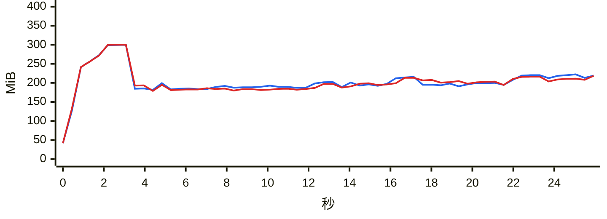

### `export messages json with images`

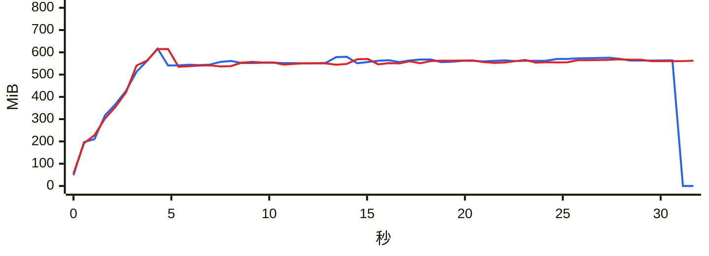

### `export messages json`

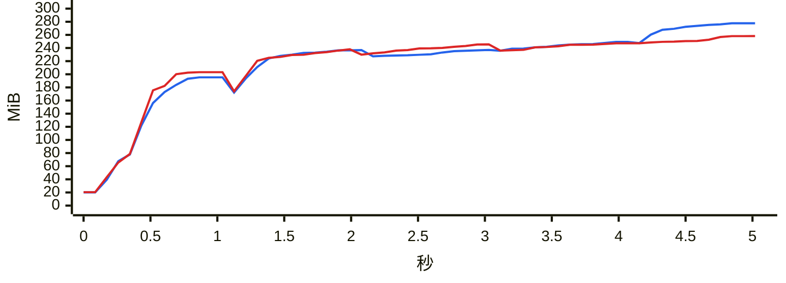

### `export messages chatlab`

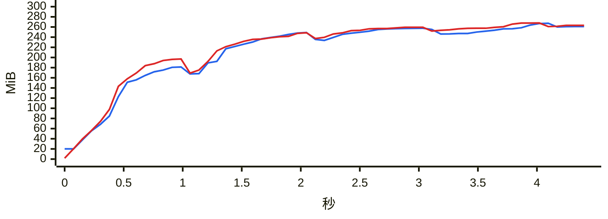

### `export messages excel`

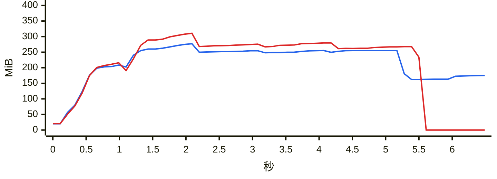

### `export messages html`

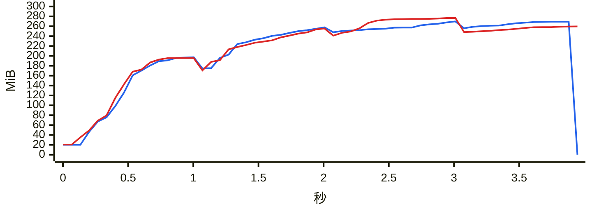

### `export messages txt`

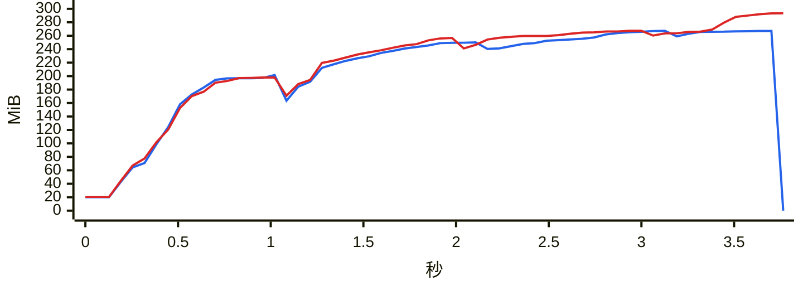

### `report annual`

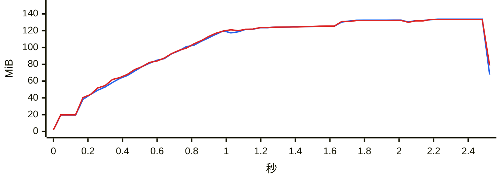

### `analytics overall`

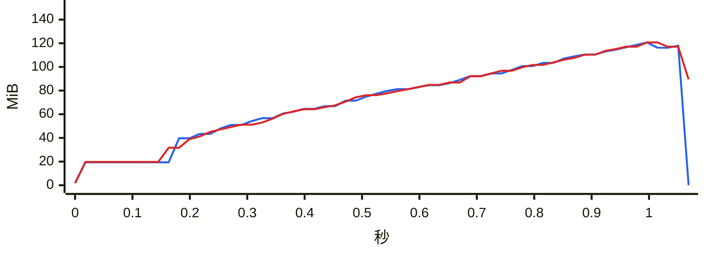

### `group members`

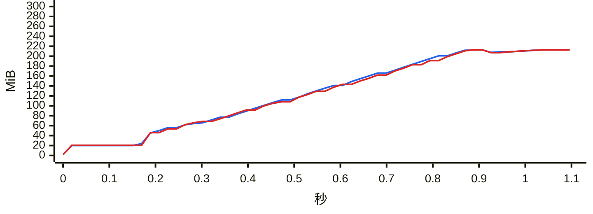

### `group ranking`

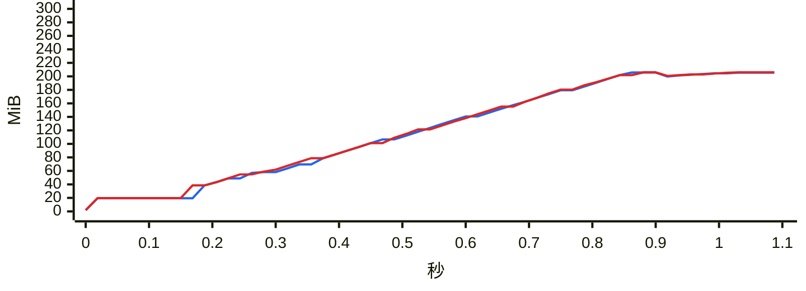

### `chat export-stats`

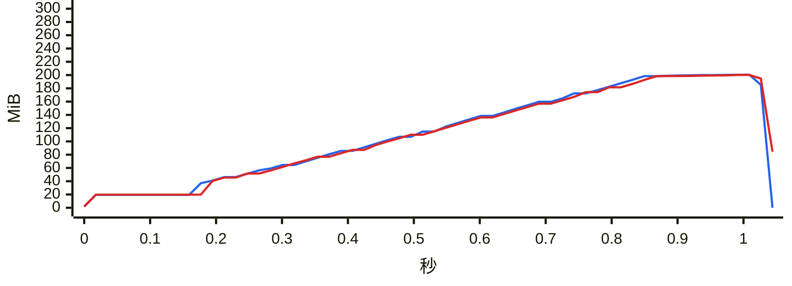

### `chat date-counts`

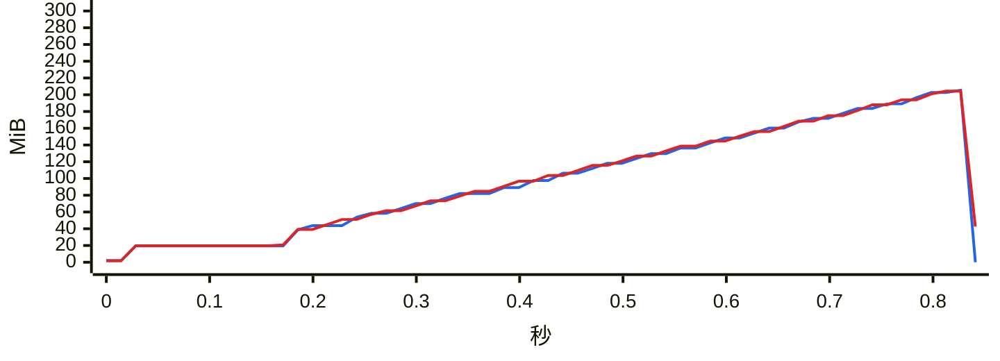

### `chat search`

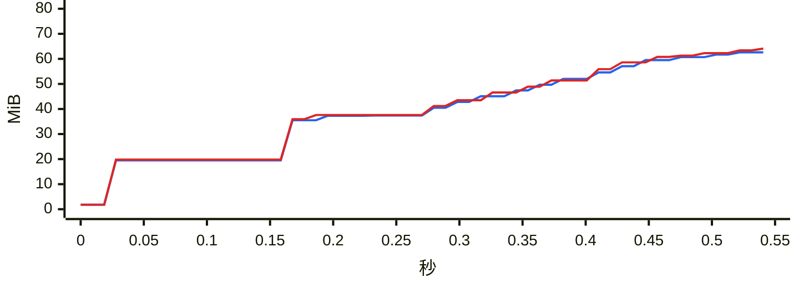

### `report dual`

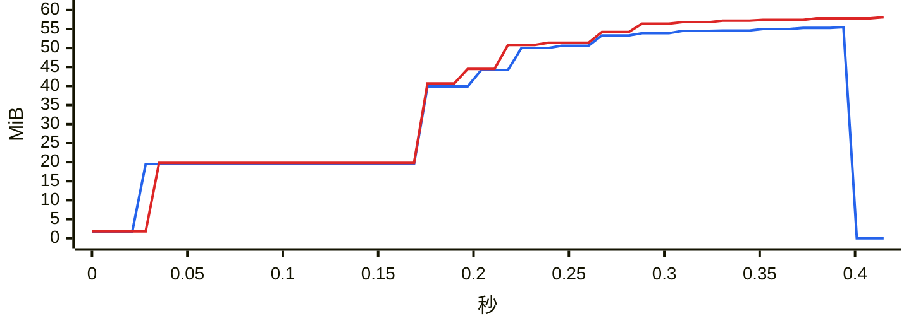

### `chat messages first page`

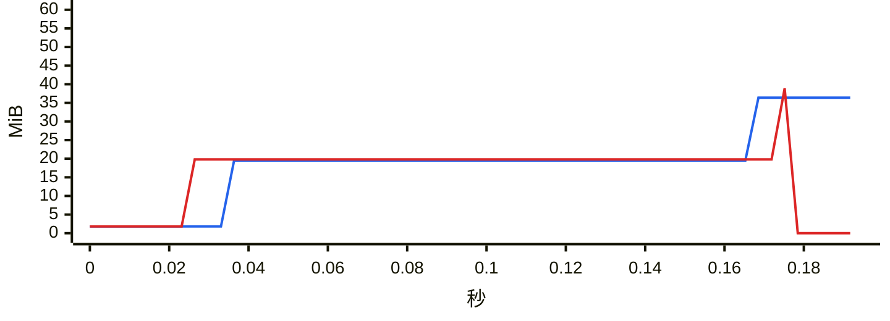

### `chat messages offset`

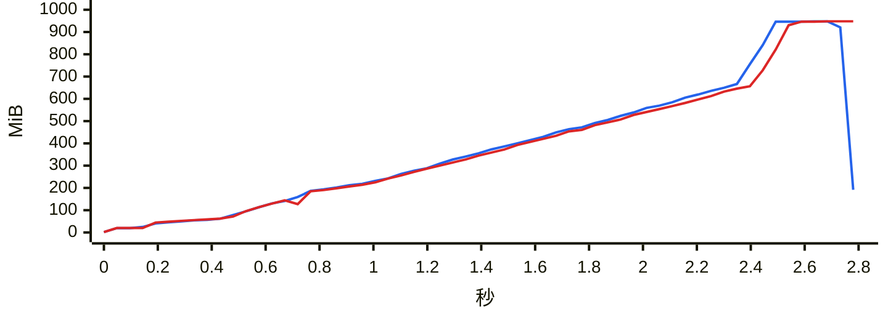

### `chat messages cursor`

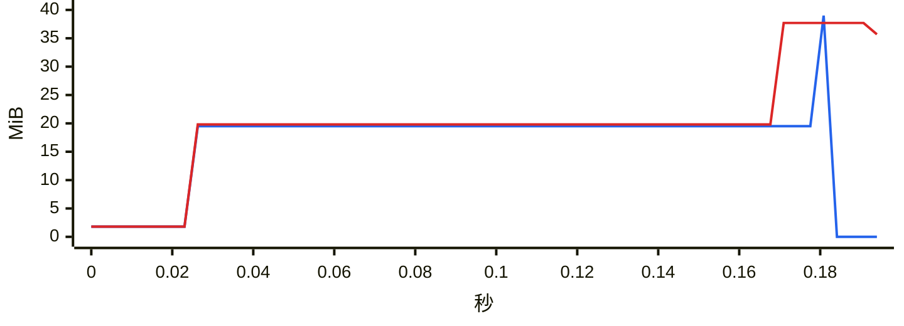

### `weflow serve` 持续负载

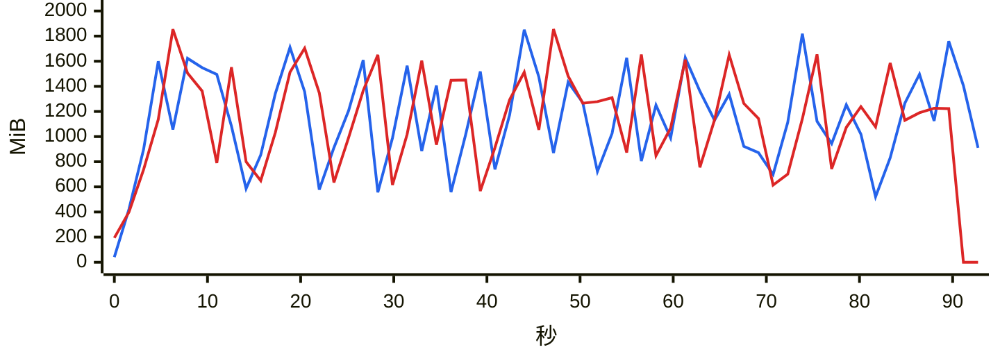
