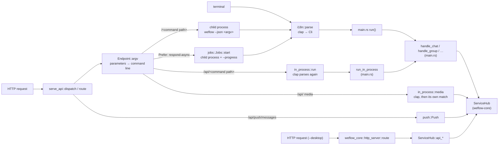

# weflow serve: execution paths and responsibilities

**English** | [简体中文](zh-CN/serve-architecture.md)

This page records the actual call paths between the CLI, the command API (`weflow serve`), the desktop API (`weflow serve --desktop`) and `ServiceHub`, and which layer handles authentication, errors, progress, cancellation and the rest. It is the result of the audit in #396 and the groundwork for #397 (a shared, typed business entry point) and #398 (background jobs and the HTTP adapter); once those land, #404 updates it to the final structure. How to use the API: [serve-api.md](serve-api.md); the desktop API: [HTTP-API.md](HTTP-API.md).

Every `file:line` here refers to the baseline commit of the audit, [`9603b05`](https://github.com/334456777/WeFlow/tree/9603b054f1f2aa96bfdfff6be9d18826b08267b2).

## Overview



Every business path of the command API (command routes, `/api/` reads and media, background jobs) first turns the request into a CLI command line (`Endpoint::argv`) and hands it to clap: once in the child process, or once in the server's own process for `/api/`. Only the desktop API, the message push, `/health`, `/openapi.json` and looking up or cancelling `/jobs` do without clap.

## Paths

| Path | Entry | Dispatch | Runs | clap | JSON | Output |
|---|---|---|---|---|---|---|
| Terminal command | `main` (`main.rs:1508`) | `run` (`main.rs:1638`) → `handle_*` | this process | `i18n::parse`, once | `json_document` (`main.rs:4163`) builds the document | one line with `--json`, else `print_response` for people |
| Command route `/<command path>` | `route` (`serve_api.rs:965`) | `Endpoints::get` → `Endpoint::argv` (`serve_api.rs:449`) | a child process per request (`run` / `spawn`, `serve_api.rs:1636`, `:1655`) | once, in the child | printed by the child; the parent runs `serde_json::from_slice` only for the status code (`serve_api.rs:1311`) and forwards stdout as it is | `document_response`, status from `status_for` (`serve_api.rs:1664`) |
| In-process read `/api/<command path>` | same | `Endpoint::argv` → `in_process::run` (`in_process.rs:143`) | this process, `block_on(run_in_process)` inside `spawn_blocking` | a clone of the localized command tree, parsed, per request (`in_process.rs:124`, `:130`) | `json_document` → `json_line` | `in_process_document` (`serve_api.rs:1373`) |
| In-process media `/api/chat/*-data`, `/api/sns/media` | same | `in_process::media` (`in_process.rs:192`) | this process | same | none, the file itself | `media_response` (`serve_api.rs:1434`, ETag, Range) |
| Background job (`Prefer: respond-async`) | same | `Jobs::start` (`jobs.rs:253`) | a child process with `--json --progress` | once, in the child | `from_slice` once stdout is read; each NDJSON line of stderr becomes an event | `/jobs/{id}`, `/jobs/{id}/events` (SSE), `/jobs/{id}/file` |
| Message push `/api/push/messages` | `route` (`serve_api.rs:1026`) | `push::Push::stream` | this process; `PushEngine` on the hub of the in-process reads | none | event JSON | SSE |
| Status `/health`, `/health/events` | `route` (`serve_api.rs:968`) | `status::Status` | this process | none | — | JSON / SSE |
| Desktop API `/api/v1/*` | `weflow_core::http_server::route` (`http_server.rs:170`) | a `match` on the path | this process; `ServiceHub::api_*` in `spawn_blocking` | none | `api::Params` → `Value` | its own answer shape (`{"error": …}`), see [HTTP-API.md](HTTP-API.md) |

Details that are easy to miss:

- When an `/api/` request does not parse (a missing argument, a wrong type), or parses into a command with arguments that do not run in process (`chat detail` without `fast`, `sns timeline` with `with-media`), `in_process::run` returns `None` and a child process runs it (`serve_api.rs:1287`). An `/api/` request with a wrong parameter is therefore parsed twice and starts a process before it reports the error.
- A command route parses stdout only to find the status code and then forwards the bytes as they are; only `?fields=` serializes again (`serve_api.rs:1329`).
- The media routes do not go through `handle_chat`: `in_process::media` repeats in its own `match` what `chat image-data`, `voice-data` and `video-data` do to get the file (compare `main.rs:2508`–`2596`), only without writing it. The two can easily drift apart.
- `Endpoints::new` (`serve_api.rs:287`) builds the route table from the English command tree at startup; `in_process::command_tree` keeps a localized tree of its own and clones it for every request. `/openapi.json` is generated from `Endpoints` and clap's help texts too (`serve_api/openapi.rs`).

### Reproducible examples

On a clean checkout each of these tests covers one path, on a synthetic account, without real WeChat data:

```sh
cargo test -p weflow-cli --test serve_api commands_answer_like_the_terminal
cargo test -p weflow-cli --test serve_api reads_run_in_process_with_the_same_answers
cargo test -p weflow-cli --test serve_api media_come_back_as_files_from_the_process
cargo test -p weflow-cli --test serve_api jobs_run_in_the_background
cargo test -p weflow-cli --test serve_api new_messages_are_pushed_as_events
cargo test -p weflow-cli --test serve_api desktop_mode_serves_the_desktop_api
```

Against a running `weflow serve` (its address and token are in the `server_started` event it prints; `crates/weflow-cli/examples/dev_account.rs` makes a synthetic account, and `bun run dev` in `web/` does that by itself; replace `wxid_bob` below with any conversation of the account), the `Server-Timing` header names the path a request took, and `?std=in` returns the request's command line without running it:

```sh
curl -si -H "Authorization: Bearer $TOKEN" "http://127.0.0.1:18108/chat/sessions?limit=1" | grep -i server-timing
# server-timing: cmd;desc="child process";dur=…, total;dur=…
curl -si -H "Authorization: Bearer $TOKEN" "http://127.0.0.1:18108/api/chat/sessions?limit=1" | grep -i server-timing
# server-timing: wait;desc="in line for a place";dur=…, cmd;desc="in process";dur=…, total;dur=…
curl -s -H "Authorization: Bearer $TOKEN" "http://127.0.0.1:18108/chat/messages?session-id=wxid_bob&limit=2&std=in"
# {"argv":["weflow","--json","chat","messages","--limit=2","--","wxid_bob"],"stdin":null}
```

## Where HTTP depends on the CLI

The command API lives in the `weflow-cli` binary crate and uses the types and functions of `main.rs` directly. These are the dependencies #397 removes:

| Where | Depends on | How often |
|---|---|---|
| `serve_api.rs:288` `Endpoints::new` | `crate::Cli::command()`: routes, method rules (`METHODS`, 123 entries keyed by command name) and parameters all come from the clap tree | once at startup |
| `serve_api.rs:449` `Endpoint::argv` | the request's parameters written as a `--name=value` command line | every business request |
| `in_process.rs:124`, `:130` | a clone of `crate::i18n::build_command::<crate::Cli>`, `try_get_matches_from` + `Cli::from_arg_matches` | every `/api/` request |
| `in_process.rs:143` | `crate::runs_in_process`, `crate::run_in_process`, `crate::json_document` | every `/api/` read |
| `in_process.rs:91`, `:103` | `crate::open_hub` (`main.rs:1554`): the hub is built again when the config file changes | a file-time check per `/api/` request |
| `in_process.rs:192`–`:308` | `crate::ChatSubcommand`, `crate::SnsSubcommand`, `crate::image_variant`, `crate::video_file` | every media request |
| `serve_api.rs:1616`–`:1661`, `jobs.rs:319` | `std::env::current_exe()` and the argv, to start a child | every command route request and job |

The `handle_*` functions of `main.rs` do three things at once: they turn clap arguments into `ServiceHub` calls, hold a few business rules, and have output side effects. For instance:

- Argument conversion: `date_range_args` (`main.rs:3024`) turns dates into seconds, and the caller takes 1 off the end (`main.rs:2448`–`2452`); `chat sessions --limit` cuts the list after reading every conversation (`main.rs:2336`).
- Business rules: `chat message` takes exactly one of `--local-id` and `--server-id` (`main.rs:2414`); `image_variant` turns `--thumb` / `--variant` into an `ImageVariant` (`main.rs:1581`).
- Output side effects: `chat image-data`, `voice-data` and `video-data` write files (`main.rs:2523`–`2595`); `key --save` writes the keys to the config and leaves them out of the result (`main.rs:2614`).

As long as these rules stay in the CLI layer, the only way for HTTP to reuse them is to keep writing command lines.

## Responsibilities

| Responsibility | Command route | `/api/` reads and media | Background job | Desktop API |
|---|---|---|---|---|
| Authentication | `authorized` (`serve_api.rs:724`): `Authorization: Bearer` or the `access_token` query parameter, compared in constant time; `/health`, `/health/events` and `/ui/` need no token | same | same | its own token check in `http_server.rs`; with no token configured everything but `/health` is refused |
| Host check | on a loopback address, `local_host` (`serve_api.rs:810`) refuses a `Host` that is not this machine (DNS rebinding) | same | same | none |
| Parameter checks | `Endpoint::argv` refuses unknown parameters and bad switch values (400); clap in the child reports the rest | `Endpoint::argv` + `in_process::parse`; a parse failure falls back to the child to report it | as command routes, the error in the job's result | each route parses `api::Params` itself |
| Method rules | `Endpoint::verb` (`serve_api.rs:406`), 405 otherwise | media routes are always `GET` | as command routes | written per route |
| Refusing writes to WeChat's databases | `REFUSED` (`serve_api.rs:89`) only marks them; the command itself refuses (`unsupported`, 501) | not among the in-process reads | as command routes | not offered |
| Sensitive data | `key … --save` keeps keys out of the result; the database keys the server derived reach a child only through its stdin (`KEYS_ON_STDIN`, `serve_api.rs:1631`), never the environment or a file; `?std=in` drops `access_token`; `--log-requests` leaves out the query | no child process | as command routes | — |
| Error mapping | the child's `json_document` → `status_for` (error code first, then exit code) | the same `json_document` + `status_for` | `status_for` decides `succeeded` / `failed`; a cancel is 499 with `user_interrupt` | `ApiError { status, message }`, another shape |
| Progress | none (synchronous requests have no `--progress`) | none | NDJSON on the child's stderr → `Job::stderr_line` → SSE; `output::set_progress_mode` is process-wide | none |
| Cancellation | when the client goes away the request's future is dropped and `kill_on_drop` kills the child | **not cancelled**: the work in `spawn_blocking` runs to its end, see risk 2 below | `DELETE /jobs/{id}`: a queued job ends at once, a running one has its process killed through a `watch` | none |
| Limits | `tasks` (`POST`, 1 by default) / `reads` semaphores, `429` at once when full | `Line`: up to 256 waiting for at most 10 s, then `429`; media have their own | a job starts once it has a place of `tasks` / `reads`, and can be cancelled while queued | none |
| Releasing resources | the child's exit frees everything; the folder of `?return=file` is emptied at startup | databases stay open per path in `weflow-native`; the hub is built again when the config changes | `serve-files/<id>/` is removed on failure, cancel, forget, or beyond `KEEP_FINISHED` (100) | the hub stays open |
| Language | `Accept-Language` → the child's `WEFLOW_LANG` | the server's language at startup (`locale` is a `OnceLock`), whatever the request | as command routes | not applicable |

## Risks

1. **A race at the end of a job.** `Job::finish` (`jobs.rs:181`) sets the final status under the lock, releases it, builds the result document, and takes the lock again to send the `result` event. An `event_stream` (`jobs.rs:509`) that subscribes between the two sees a finished job whose replay has no `result` yet, so the stream ends and the client never gets the result. The window is small but real; #398 should change the status and send the event under one lock, with a test.
2. **An `/api/` request keeps running after its client is gone.** When the client disconnects, axum drops the request's future and with it both places of the `Line`; the work in `spawn_blocking` goes on. Paging or searching that keeps cancelling requests can therefore run more reads at once than `--max-reads`. #398 has to choose between passing a cancel flag down and keeping the places with the blocking work until it ends.
3. **Media code is repeated.** See the details above.
4. **An `/api/` request with a wrong parameter starts a child process.** Only the error is affected, not a normal read, but the time of a frequent route then depends on whether its parameters are right.
5. **Languages differ.** The same request may get its error in another language with or without `/api/`. [serve-api.md](serve-api.md#in-process-reads) says so; a migration keeps it, or changes it on purpose and says so in its PR, but never changes it silently.

## Tests and gaps

Covered now (`crates/weflow-cli/tests/serve_api.rs`, and the unit tests of `serve_api.rs`, `in_process.rs` and `jobs.rs`):

- `/api/` and command routes byte for byte: `reads_run_in_process_with_the_same_answers` compares the body and key headers of 26 requests, including cursor pages across shards and one bad cursor.
- Methods, parameters, command lines: `every_command_has_a_method`, `builds_the_command_line`, `methods_follow_the_arguments`, `status_follows_the_error_code_then_the_exit_code`; `the_list_matches_the_cli` keeps `COMMANDS` in step with `runs_in_process`.
- Authentication and host: `health_needs_no_token_and_everything_else_does`, `only_requests_to_this_machine_are_answered`, `tokens_are_checked_from_the_header_or_the_query`.
- Refused writes: `refused_commands_are_marked_and_refused`; keys handed over on stdin: `commands_answer_with_the_keys_the_server_hands_over`.
- Jobs: `jobs_run_in_the_background`, `files_come_back_with_the_result`, `jobs_are_cancelled_and_limited` (cancelling a queued and a running job, a client that goes away kills its command, `429`).
- Media and ranges: `media_come_back_as_files_from_the_process`, `videos_are_sent_in_the_parts_asked_for`, `byte_ranges_are_read_as_rfc_9110_has_them`.
- Push and status: `new_messages_are_pushed_as_events`, `health_events_say_hello_then_beat_without_a_token`, `event_streams_say_bye_when_the_server_stops`.

Gaps (for #403's regression matrix):

- `/api/` and command routes agreeing on **errors**: a missing required parameter, an unknown parameter, a refused token, an empty result. Only one bad cursor is compared now.
- The race of risk 1: subscribing to the events of a job just as it ends.
- Cancelling twice, a cancel and the end at the same moment, looking up a job after cancelling a finished one.
- Risk 2: reads actually running, and memory, after many `/api/` requests are dropped.
- A media route and the CLI command giving the same file for the same message (each is tested on its own now).
- Reads the WebUI makes that still start a child process: `analytics overall / rankings / time / excluded / exclude-candidates`, `group list / member / member-messages / hours / media`, `biz messages / pay-records`, `insight footprint / get`, `report annual years`, `config get / profiles`, `cache list`, `runtime info`, `chat statuses`, `db detect / test / wxid`. Each pays for starting a process and opening the databases every time.

## Migration plan

### Step 1: a shared, typed business entry point (#397)

- In `weflow-core`, a request type for each migrated command, such as `ChatMessagesRequest { session_id, limit, offset, before, after, since, parsed }`, and one function that runs a request on a `&ServiceHub` and returns `AppResult<Value>`. The argument conversions and business rules listed above move there.
- CLI: the clap structs convert into request types (`From` / `TryFrom`), which then run; formatting the output stays in the CLI.
- HTTP: request types are deserialized straight from the query and the JSON body (kebab-case field names, the parameter names of today), without a command line or clap. `Endpoints` stays for now for routes, method rules and `/openapi.json`, built only at startup.
- Order: first the 18 reads and 4 media routes of `/api/` (frequent, and guarded by the byte-for-byte test); then the WebUI reads above that still start a process, judged by whether they only read, need no process-wide state, ask for no confirmation and end in bounded time.
- Compatibility: parameter names, answer bodies, status codes and headers stay as they are; `?std=in` still returns the equivalent command line. The media routes and `handle_chat` share the same code to get a file.

### Step 2: background jobs and the HTTP adapter (#398)

- The job lifecycle separated from axum: a state machine (queued, running, succeeded, failed, cancelled) whose final state is written once, with the status and its event changed under one lock (fixes risk 1).
- Two ways of running: a child process (today's behaviour) and in process (for long tasks migrated later; needs a cancel flag and a progress callback).
- The HTTP layer only routes, authenticates, maps requests and answers, and carries SSE.
- A separate crate: the command API depends on symbols of the binary crate such as `crate::Cli` and cannot be moved out as it is; after step 1 its only dependency on the CLI is `Endpoints` (the clap tree). Whether to make it `weflow-serve` (depending on `weflow-core`, depended on by `weflow-cli`) is decided then, from the dependency direction, build time and test cost.

### Paths that keep a child process

These keep running in a child process; a migration PR says why:

- **Long tasks and exports** (`export *`, `report * generate`, `backup *`, `sns export`, `group export-*`): a crash does not take the server down, and killing the process on cancel reliably frees memory and file handles.
- **Key commands** (`key db`, `key image`, `key scan-image`): they attach to WeChat's process or scan its memory and must be isolated.
- **Commands that rely on process-wide state**: the `--json` output mode, the progress mode (`weflow_core::output`) and the language (`weflow_core::locale`) are per process; `std=out` / `std=err` need the terminal rendering, and a language per request needs a process of its own.
- **Commands that ask for confirmation or run until a signal**: the `cache clear` family needs `--yes` without a terminal; `image auto-download start` runs until Ctrl+C.

## Handed to other tasks

**#403 (baseline and regression matrix)**: the gaps above, and these measurable scenarios:

- The clap round trip of each `/api/` request (about 0.1 ms in a first measurement, see the [appendix](#appendix-cost-of-the-clap-round-trip)), as a benchmark that can be run again before and after a change.
- Cold and warm latency distributions of the 18 `/api/` reads, and of the WebUI reads above that still start a process.
- Time from starting a job to its first progress, time to cancel, the replay after an SSE reconnect.
- 16 pages of messages asked for at once; reads actually running and peak memory after many `/api/` requests are dropped.
- Existing tool: `serve_bench` (always both a synthetic and a real account, see [native-cli.md](native-cli.md#tests)).

**#404 (docs)**, verified facts:

- [serve-api.md](serve-api.md#how-it-runs) says each request "runs `weflow` again as a child process"; that holds only for routes without `/api/`, and should say that `/api/`, the push and `/health` are not among them. [In-process reads](serve-api.md#in-process-reads) says they come from "the same parsing and the same handler", which holds for the reads, but the media routes have code of their own to get the file.
- `web/README.md` (lines 7 and 88) and `web/src/App.tsx` (line 3) still say the screens show sample records and only the connection state reads the real server; in fact the conversations, messages, contacts, Moments, analytics, exports, settings and other screens call the real API. `src/mock/data.ts` is still used by production code: the sample conversation list shown while not connected (`App.tsx:173`, `:920`), the category browser (`App.tsx:413`) and the default date range (`App.tsx:250`) come from it.

## Appendix: cost of the clap round trip

On the baseline commit, a temporary unit test (not committed) measured the clap round trip of a typical `/api/` request of `chat messages` (`session-id`, `limit=50`, `before`, `parsed=true`): `Endpoint::argv` writes the command line, then `in_process::parse`. Windows 11, Intel Core i7-10700F, release build, the mean of 2000 runs, three rounds in a row:

| Step | Per request |
|---|---|
| Cloning the localized command tree (`command_tree()`) | about 60 µs |
| Command line + clone + parse + `runs_in_process` | about 96 µs |

Requests of this kind take about 2–5 ms in the server on a large account ([serve-api.md](serve-api.md#in-process-reads)), so the clap round trip is 2–5% of them, six tenths of it cloning the tree. What this means for #397:

- Removing the clap round trip of `/api/` is mainly about structure, and saves about 0.1 ms of CPU per request on the side; it does not lower latency noticeably and should not be claimed as a speed-up.
- The real gap in latency is in the WebUI reads that still start a child process: each starts a process, reads the configuration and opens the databases cold, about 20–40 ms ([serve-api.md](serve-api.md#how-it-runs)). Moving the suitable ones to the shared in-process entry point gains an order of magnitude more.
