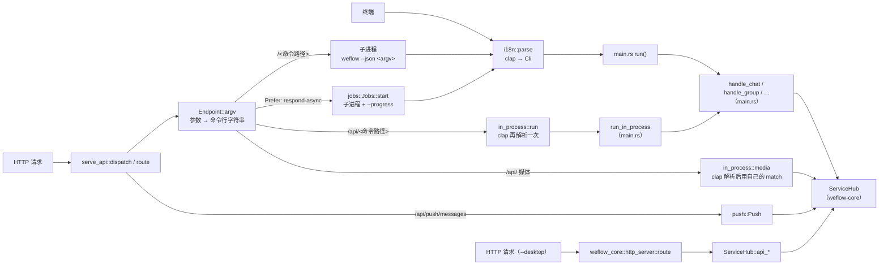

# weflow serve 的执行路径与职责边界

[English](../serve-architecture.md) | **简体中文**

本文记录 CLI、命令 API（`weflow serve`）、桌面端 API（`weflow serve --desktop`）与 `ServiceHub` 之间的真实调用路径，以及鉴权、错误、进度、取消等职责分别由哪一层负责。它是 #396 的审计结果，也是 #397（共用的类型化业务入口）和 #398（后台任务与 HTTP 适配层）的施工依据；这两项落地后，由 #404 把本文更新成最终结构。接口本身的用法见 [serve-api.md](serve-api.md)，桌面端 API 见 [HTTP-API.md](HTTP-API.md)。

文中的 `文件:行号` 都指审计时的基线提交 [`9603b05`](https://github.com/334456777/WeFlow/tree/9603b054f1f2aa96bfdfff6be9d18826b08267b2)。

## 总览



命令 API 的每一条业务路径（命令路由、`/api/` 读与媒体、后台任务）都要先把请求变成 CLI 命令行（`Endpoint::argv`），再交给 clap 解析：子进程里解析一次，`/api/` 在服务进程里解析一次。不经过 clap 的只有桌面端 API、消息推送、`/health`、`/openapi.json` 以及 `/jobs` 的查询和取消。

## 执行路径

| 路径 | 入口 | 分发 | 执行方式 | clap | JSON 转换 | 输出 |
|---|---|---|---|---|---|---|
| 终端命令 | `main`（`main.rs:1508`） | `run`（`main.rs:1638`）→ `handle_*` | 本进程 | `i18n::parse` 一次 | `json_document`（`main.rs:4163`）构造文档 | `--json` 打印一行；否则 `print_response` 人类可读 |
| 命令路由 `/<命令路径>` | `route`（`serve_api.rs:965`） | `Endpoints::get` → `Endpoint::argv`（`serve_api.rs:449`） | 子进程，每个请求一个（`run` / `spawn`，`serve_api.rs:1636`、`:1655`） | 子进程里一次 | 子进程打印 → 父进程 `serde_json::from_slice` 只为读状态码（`serve_api.rs:1311`），原样转发 stdout | `document_response`，状态码由 `status_for`（`serve_api.rs:1664`）定 |
| 进程内读 `/api/<命令路径>` | 同上 | `Endpoint::argv` → `in_process::run`（`in_process.rs:143`） | 本进程，`spawn_blocking` 里 `block_on(run_in_process)` | 每个请求克隆一次本地化的命令树再解析（`in_process.rs:124`、`:130`） | `json_document` → `json_line` 序列化 | `in_process_document`（`serve_api.rs:1373`） |
| 进程内媒体 `/api/chat/*-data`、`/api/sns/media` | 同上 | `in_process::media`（`in_process.rs:192`） | 本进程 | 同上 | 无，直接回文件 | `media_response`（`serve_api.rs:1434`，ETag、Range） |
| 后台任务（`Prefer: respond-async`） | 同上 | `Jobs::start`（`jobs.rs:253`） | 子进程，`--json --progress` | 子进程里一次 | stdout 读完后 `from_slice`；stderr 每行 NDJSON 变成事件 | `/jobs/{id}`、`/jobs/{id}/events`（SSE）、`/jobs/{id}/file` |
| 消息推送 `/api/push/messages` | `route`（`serve_api.rs:1026`） | `push::Push::stream` | 本进程，`PushEngine` 用进程内读的 hub | 无 | 事件 JSON | SSE |
| 状态 `/health`、`/health/events` | `route`（`serve_api.rs:968`） | `status::Status` | 本进程 | 无 | — | JSON / SSE |
| 桌面端 API `/api/v1/*` | `weflow_core::http_server::route`（`http_server.rs:170`） | 按路径 `match` | 本进程，`spawn_blocking` 调 `ServiceHub::api_*` | 无 | `api::Params` → `Value` | 另一套返回格式（`{"error": …}`），见 [HTTP-API.md](HTTP-API.md) |

几个容易忽略的细节：

- `/api/` 解析失败（缺参数、类型不对），或者解析出的命令带了不能进程内跑的参数（`chat detail` 不带 `fast`、`sns timeline` 带 `with-media`），`in_process::run` 返回 `None`，请求改由子进程执行（`serve_api.rs:1287`）。所以一个写错参数的 `/api/` 请求要解析两次，还要起一个进程，才能报出错误。
- 命令路由只为读状态码解析一遍 stdout，再把原始字节转发出去；带 `?fields=` 时才重新序列化（`serve_api.rs:1329`）。
- 媒体路由没有走 `handle_chat`：`in_process::media` 用自己的 `match` 重复了 `chat image-data`、`voice-data`、`video-data` 的取数部分（对照 `main.rs:2508`–`2596`），只是不写文件。两边将来改动时容易不同步。
- `Endpoints::new`（`serve_api.rs:287`）在启动时用英文命令树生成路由表；`in_process::command_tree` 另外缓存一棵本地化的命令树，每个请求克隆一次。`/openapi.json` 也是从 `Endpoints` 和 clap 的帮助文字生成的（`serve_api/openapi.rs`）。

### 可复现的例子

在干净检出上，下列测试各覆盖一条路径，都用合成账号，不需要真实微信数据：

```sh
cargo test -p weflow-cli --test serve_api commands_answer_like_the_terminal
cargo test -p weflow-cli --test serve_api reads_run_in_process_with_the_same_answers
cargo test -p weflow-cli --test serve_api media_come_back_as_files_from_the_process
cargo test -p weflow-cli --test serve_api jobs_run_in_the_background
cargo test -p weflow-cli --test serve_api new_messages_are_pushed_as_events
cargo test -p weflow-cli --test serve_api desktop_mode_serves_the_desktop_api
```

对着运行中的 `weflow serve`（地址和令牌见启动时打印的 `server_started` 事件；合成账号可以用 `crates/weflow-cli/examples/dev_account.rs` 生成，`web/` 下的 `bun run dev` 会自动做这一步；下面的 `wxid_bob` 换成账号里的任一会话），`Server-Timing` 头会注明请求走了哪条路径；`?std=in` 返回请求对应的命令行，但不执行：

```sh
curl -si -H "Authorization: Bearer $TOKEN" "http://127.0.0.1:18108/chat/sessions?limit=1" | grep -i server-timing
# server-timing: cmd;desc="child process";dur=…, total;dur=…
curl -si -H "Authorization: Bearer $TOKEN" "http://127.0.0.1:18108/api/chat/sessions?limit=1" | grep -i server-timing
# server-timing: wait;desc="in line for a place";dur=…, cmd;desc="in process";dur=…, total;dur=…
curl -s -H "Authorization: Bearer $TOKEN" "http://127.0.0.1:18108/chat/messages?session-id=wxid_bob&limit=2&std=in"
# {"argv":["weflow","--json","chat","messages","--limit=2","--","wxid_bob"],"stdin":null}
```

## HTTP 依赖 CLI 的位置

命令 API 放在 `weflow-cli` 二进制 crate 里，直接用 `main.rs` 的类型和函数。#397 要拆掉的就是这些依赖：

| 位置 | 依赖 | 频率 |
|---|---|---|
| `serve_api.rs:288` `Endpoints::new` | `crate::Cli::command()`：路由、方法规则（`METHODS`，123 条，按命令字符串索引）和参数都从 clap 命令树得出 | 启动时一次 |
| `serve_api.rs:449` `Endpoint::argv` | 把请求参数拼成 `--name=value` 命令行 | 每个业务请求 |
| `in_process.rs:124`、`:130` | `crate::i18n::build_command::<crate::Cli>` 的克隆，`try_get_matches_from` + `Cli::from_arg_matches` | 每个 `/api/` 请求 |
| `in_process.rs:143` | `crate::runs_in_process`、`crate::run_in_process`、`crate::json_document` | 每个 `/api/` 读 |
| `in_process.rs:91`、`:103` | `crate::open_hub`（`main.rs:1554`）：配置文件变了就重建 hub | 每个 `/api/` 请求检查一次文件时间 |
| `in_process.rs:192`–`:308` | `crate::ChatSubcommand`、`crate::SnsSubcommand`、`crate::image_variant`、`crate::video_file` | 每个媒体请求 |
| `serve_api.rs:1616`–`:1661`、`jobs.rs:319` | `std::env::current_exe()` 加 argv，起子进程 | 每个命令路由请求和任务 |

`main.rs` 的 `handle_*` 同时承担了三件事：把 clap 参数换成 `ServiceHub` 调用、少量业务规则、输出副作用。例如：

- 参数换算：`date_range_args`（`main.rs:3024`）把日期换成秒，再在调用处把结束时间减 1（`main.rs:2448`–`2452`）；`chat sessions --limit` 在拿到全部会话后截断（`main.rs:2336`）。
- 业务规则：`chat message` 要求 `--local-id` 与 `--server-id` 二选一（`main.rs:2414`）；`image_variant` 把 `--thumb` / `--variant` 换成 `ImageVariant`（`main.rs:1581`）。
- 输出副作用：`chat image-data`、`voice-data`、`video-data` 写文件（`main.rs:2523`–`2595`）；`key --save` 把密钥写进配置并从结果里去掉（`main.rs:2614`）。

这些规则如果原样留在 CLI 层，HTTP 要复用就只能继续拼命令行。

## 职责表

| 职责 | 命令路由 | `/api/` 读与媒体 | 后台任务 | 桌面端 API |
|---|---|---|---|---|
| 鉴权 | `authorized`（`serve_api.rs:724`）：`Authorization: Bearer` 或 `access_token` 查询参数，常量时间比较；`/health`、`/health/events`、`/ui/` 不需要令牌 | 同左 | 同左 | `http_server.rs` 自己的令牌检查；没配令牌时除 `/health` 外一律拒绝 |
| Host 检查 | 监听回环地址时，`local_host`（`serve_api.rs:810`）拒绝非本机 `Host`，防 DNS rebinding | 同左 | 同左 | 无 |
| 参数校验 | `Endpoint::argv` 拒绝未知参数和非法开关值（400），其余由子进程里的 clap 报错 | `Endpoint::argv` + `in_process::parse`；解析失败退回子进程报错 | 同命令路由，错误在任务结果里 | `api::Params` 各自解析 |
| 方法规则 | `Endpoint::verb`（`serve_api.rs:406`），不符返回 405 | 媒体路由一律 `GET` | 同命令路由 | 各路由手写 |
| 拒绝写微信库 | `REFUSED`（`serve_api.rs:89`）只做标记；真正拒绝的是命令本身（`unsupported`，501） | 进程内读不含这些命令 | 同命令路由 | 不提供 |
| 敏感信息 | `key … --save` 不把密钥放进结果；派生出的数据库密钥只经 stdin 交给子进程（`KEYS_ON_STDIN`，`serve_api.rs:1631`），不进环境变量和文件；`?std=in` 去掉了 `access_token`；`--log-requests` 不打印查询串 | 不涉及子进程 | 同命令路由 | — |
| 错误映射 | 子进程 `json_document` → `status_for`（错误码优先，其次退出码） | 同一个 `json_document` + `status_for` | `status_for` 决定 `succeeded` / `failed`；取消记 499 + `user_interrupt` | `ApiError { status, message }`，格式不同 |
| 进度 | 无（同步请求不带 `--progress`） | 无 | 子进程 stderr 的 NDJSON → `Job::stderr_line` → SSE；`output::set_progress_mode` 是进程级全局状态 | 无 |
| 取消 | 客户端断开时请求的 future 被丢弃，`kill_on_drop` 杀掉子进程 | **不会取消**：`spawn_blocking` 的工作跑到结束，见下面的风险 2 | `DELETE /jobs/{id}`：排队中直接结束；运行中通过 `watch` 杀进程 | 无 |
| 并发限制 | `tasks`（`POST`，默认 1）/ `reads` 信号量，满了立即 429 | `Line`：最多排 256 个、等 10 秒，之后 429；媒体另有一条 | 拿到 `tasks` / `reads` 位置才开始，排队中可取消 | 无 |
| 资源释放 | 子进程退出即释放；`?return=file` 的目录在启动时清空 | 数据库按路径留在 `weflow-native` 里；hub 在配置改变时重建 | 失败、取消、遗忘或超出 `KEEP_FINISHED`（100）时删除 `serve-files/<id>/` | hub 一直打开 |
| 语言 | `Accept-Language` → 子进程的 `WEFLOW_LANG` | 服务进程启动时的语言（`locale` 是 `OnceLock`），不随请求变 | 同命令路由 | 不涉及 |

## 风险

1. **任务结束事件的竞态**。`Job::finish`（`jobs.rs:181`）先在锁里把状态改成终态，释放锁，构造结果文档，再重新加锁发出 `result` 事件。如果 `event_stream`（`jobs.rs:509`）恰好在两次加锁之间订阅，它看到的状态已经结束，回放里却还没有 `result`，于是流直接结束，客户端收不到结果。窗口很小，但确实存在；#398 应在同一次加锁里完成状态变更和事件发送，并补一个测试。
2. **`/api/` 请求断开后不会停止**。客户端断开时，axum 丢弃处理请求的 future，`Line` 的两个许可随之释放；但 `spawn_blocking` 里的工作还在继续。连续翻页、搜索时不断取消的请求，会让实际在跑的读请求超过 `--max-reads`。#398 需要决定是传入取消标志，还是让许可一直跟着阻塞任务直到它结束。
3. **媒体逻辑重复**。见上面的“几个容易忽略的细节”。
4. **错误参数的 `/api/` 请求会起子进程**。这只影响报错，不影响正常读，但它让高频路径的耗时取决于参数是否写对。
5. **语言不一致**。同一个请求，带不带 `/api/` 可能得到不同语言的错误消息。[serve-api.md](serve-api.md#进程内读取) 已经写明这一点；迁移时要么保持现状，要么在 PR 里说明改动，不能让它悄悄变化。

## 现有测试与缺口

已有覆盖（`crates/weflow-cli/tests/serve_api.rs`，以及 `serve_api.rs`、`in_process.rs`、`jobs.rs` 的单元测试）：

- `/api/` 与命令路由逐字节一致：`reads_run_in_process_with_the_same_answers` 比较 26 个请求的正文和关键响应头，包括跨分片游标翻页和一个错误游标。
- 方法、参数、命令行构造：`every_command_has_a_method`、`builds_the_command_line`、`methods_follow_the_arguments`、`status_follows_the_error_code_then_the_exit_code`；`the_list_matches_the_cli` 保证 `COMMANDS` 与 `runs_in_process` 同步。
- 鉴权与 Host：`health_needs_no_token_and_everything_else_does`、`only_requests_to_this_machine_are_answered`、`tokens_are_checked_from_the_header_or_the_query`。
- 拒绝写库：`refused_commands_are_marked_and_refused`；密钥经 stdin 传递：`commands_answer_with_the_keys_the_server_hands_over`。
- 任务：`jobs_run_in_the_background`、`files_come_back_with_the_result`、`jobs_are_cancelled_and_limited`（排队取消、运行中取消、客户端断开杀进程、`429`）。
- 媒体与 Range：`media_come_back_as_files_from_the_process`、`videos_are_sent_in_the_parts_asked_for`、`byte_ranges_are_read_as_rfc_9110_has_them`。
- 推送与状态：`new_messages_are_pushed_as_events`、`health_events_say_hello_then_beat_without_a_token`、`event_streams_say_bye_when_the_server_stops`。

缺口（交给 #403 补进回归矩阵）：

- `/api/` 与命令路由在**错误情况**下的一致性：缺必填参数、未知参数、权限拒绝、空结果。目前只比较了一个错误游标。
- 风险 1 的竞态：任务刚结束时订阅事件流。
- 重复取消、取消与完成同时发生、取消已完成的任务后再查询。
- 风险 2：断开大量 `/api/` 请求后，实际并发数和内存。
- 媒体路由与 CLI 命令对同一条消息给出相同的文件（目前两边分别测试）。
- WebUI 实际调用、但还走子进程的读：`analytics overall / rankings / time / excluded / exclude-candidates`、`group list / member / member-messages / hours / media`、`biz messages / pay-records`、`insight footprint / get`、`report annual years`、`config get / profiles`、`cache list`、`runtime info`、`chat statuses`、`db detect / test / wxid`。它们每次都要多付一次起进程和打开数据库的开销。

## 迁移建议

### 第一步：共用的类型化业务入口（#397）

- 在 `weflow-core` 里为每个已迁移的命令定义请求类型，例如 `ChatMessagesRequest { session_id, limit, offset, before, after, since, parsed }`，以及一个统一的执行函数，输入 `&ServiceHub` 和请求，输出 `AppResult<Value>`。上面列出的参数换算和业务规则移进这里。
- CLI：clap 结构体转换成请求类型（`From` / `TryFrom`），再执行；输出格式化留在 CLI。
- HTTP：直接从查询参数和 JSON 正文反序列化出请求类型（kebab-case 字段名，与现在的参数名一致），不再拼命令行、不再调用 clap。`Endpoints` 暂时保留，用于路由、方法规则和 `/openapi.json`，只在启动时构建。
- 迁移顺序：先迁 `/api/` 的 18 个读和 4 个媒体路由（高频，且已有逐字节一致的测试兜底）；再评估上面列出的、WebUI 还走子进程的读，标准是只读、不依赖进程级全局状态、不需要交互确认、耗时有上限。
- 兼容：参数名、返回正文、状态码和响应头保持不变；`?std=in` 继续返回等价的命令行。媒体路由与 `handle_chat` 共用同一段取数代码。

### 第二步：后台任务与 HTTP 适配层（#398）

- 把任务生命周期从 axum 中分离出来：状态机（排队、运行、成功、失败、取消），终态只能写一次，状态变更和事件在同一次加锁中完成（修复风险 1）。
- 执行方式抽象成两种：子进程（保留现有行为）和进程内（为以后迁移的长任务预留，需要取消标志和进度回调）。
- HTTP 层只负责路由、鉴权、请求和响应的映射、SSE 传输。
- 独立 crate：命令 API 目前依赖 `crate::Cli` 等二进制 crate 里的符号，不能直接拆出去；第一步完成后，它对 CLI 的依赖只剩 `Endpoints`（clap 命令树）。届时再评估是否拆成 `weflow-serve`（依赖 `weflow-core`，被 `weflow-cli` 依赖），比较依赖方向、编译时间和测试成本后决定。

### 保留子进程的路径

下列情况继续用子进程，迁移时在 PR 里写明理由：

- **长任务和导出**（`export *`、`report * generate`、`backup *`、`sns export`、`group export-*`）：崩溃不影响服务；取消时杀进程，能可靠地释放内存和文件句柄。
- **密钥命令**（`key db`、`key image`、`key scan-image`）：要附加到微信进程或扫描它的内存，必须隔离。
- **依赖进程级全局状态的命令**：`--json` 输出模式、进度模式（`weflow_core::output`）和语言（`weflow_core::locale`）都是进程级的；`std=out` / `std=err` 需要终端渲染，按请求换语言也只能靠子进程。
- **需要交互确认或一直运行到信号的命令**：`cache clear` 系列在没有终端时要求 `--yes`；`image auto-download start` 一直运行到 Ctrl+C。

## 交给其他任务

**#403（基线与回归矩阵）**，结果见 [refactor-baseline.md](refactor-baseline.md)：上面的测试缺口，以及这些可测量场景：

- `/api/` 每个请求里 clap 往返的耗时（初测约 0.1 ms，见[附录](#附录clap-往返的耗时)），做成可以在改动前后重复运行的基准。
- 18 个 `/api/` 读的冷、热延迟分布，以及上面那些还走子进程的 WebUI 读。
- 任务从开始到第一条进度的延迟、取消延迟、SSE 断线重连后的回放。
- 16 页消息同时请求；断开大量 `/api/` 请求后的实际并发数和峰值内存。
- 现有工具：`serve_bench`（同时测合成账号和真实账号，见 [native-cli.md](native-cli.md#测试)）。

**#404（文档）**，已核验的事实：

- [serve-api.md](serve-api.md#执行方式) 说“每个请求都以子进程再运行一次 `weflow`”，这只适用于不带 `/api/` 的路由，应注明 `/api/`、推送和 `/health` 不在其列；“进程内读取”一节说“同一套解析、同一个处理函数”，对普通读成立，媒体路由用的却是另写的取数代码。
- `web/README.md` 第 7 行、第 88 行和 `web/src/App.tsx` 第 3 行仍然说页面显示样例数据、只有连接状态读真实服务；实际上会话、消息、联系人、朋友圈、分析、导出、设置等页面都调用真实 API。`src/mock/data.ts` 仍在生产代码中使用：未连接时显示样例会话列表（`App.tsx:173`、`:920`），分类浏览（`App.tsx:413`）和默认日期范围（`App.tsx:250`）也来自它。

## 附录：clap 往返的耗时

在基线提交上，用一个临时的单元测试（没有提交）测了 `chat messages` 一个典型请求（`session-id`、`limit=50`、`before`、`parsed=true`）在 `/api/` 路径上的 clap 往返：先 `Endpoint::argv` 拼命令行，再 `in_process::parse`。Windows 11、Intel Core i7-10700F、release 构建，连续 3 轮、每轮 2000 次取平均：

| 步骤 | 每个请求 |
|---|---|
| 克隆本地化命令树（`command_tree()`） | 约 60 µs |
| 拼命令行 + 克隆 + 解析 + `runs_in_process` | 约 96 µs |

同一类请求在大账号上的服务端耗时约 2–5 ms（见 [serve-api.md](serve-api.md#进程内读取)），所以 clap 往返只占 2%–5%，其中六成是克隆命令树。由此得出 #397 的重点：

- 消除 `/api/` 上的 clap 往返，主要是理清结构、顺带省下每个请求约 0.1 ms 的 CPU，不会明显降低延迟。验收时不要把它当作性能收益来宣传。
- 真正的延迟差距在 WebUI 仍走子进程的读上：每个请求要起进程、读配置、冷开数据库，约 20–40 ms（见 [serve-api.md](serve-api.md#执行方式)）。把其中合适的读迁到共用的进程内入口，收益要大一个数量级。
